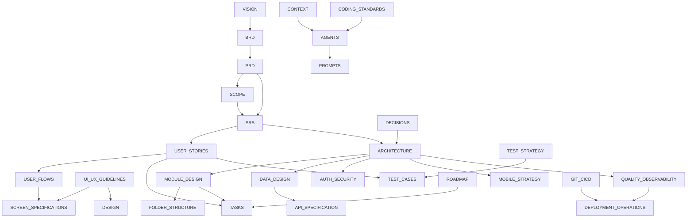

# Supply Biz — Fresh Milk • Happy Homes

Two-sided mobile marketplace for India's local milk vendors (and other local suppliers) and households.

| | |
|---|---|
| **Apps** | One Flutter app (Android first; iOS validation after Android release) with **Vendor** and **Customer** roles · Next.js **Admin Panel** · NestJS + PostgreSQL **API** |
| **Languages** | English |
| **Status** | Foundations in progress; 15-day delivery baseline documented (implementation reconciliation pending) |
| **Sources** | `SupplyBiz_Milk_Vendor_Customer_App_Project_Document.docx` (v1.0), `Wireframe.png`, stakeholder decisions 2026-10-19 |

## Delivery baseline
[15-day execution plan](docs/05-ai-development/ROADMAP.md) · [prioritized tasks](docs/05-ai-development/TASKS.md) · [approved scope reductions](docs/01-business/SCOPE.md#9-15-day-baseline-and-approved-scope-reductions) · [local file storage](docs/04-architecture/LOCAL_FILE_STORAGE.md).

ADR-023 sets English-only UI, native PostgreSQL/processes, local server file storage and module-level comprehensive testing. This revision updates documentation only; existing runtime/source/configuration cleanup is tracked in T-180–T-184. Day 15 targets an integrated application handoff; SR-01–SR-06 are approved (ADR-024), deferred features are outside current gates, and all iOS builds/runs/testing follows Android production release (ADR-025/T-185). Android public-store/provider readiness has separate gates.

[Active/simplified versus post-delivery scope](docs/05-ai-development/DELIVERY_SCOPE.md) defines requirement, screen, test and module applicability.

## Start Here
- **Humans:** [VISION](docs/01-business/VISION.md) → [PRD](docs/01-business/PRD.md) → [SCOPE](docs/01-business/SCOPE.md) (open questions).
- **AI coding agents:** [CONTEXT](docs/05-ai-development/CONTEXT.md) → [AGENTS](docs/05-ai-development/AGENTS.md) → [TASKS](docs/05-ai-development/TASKS.md).

## Document Index
| Phase | Document | Purpose |
|---|---|---|
| 1 Business | [VISION](docs/01-business/VISION.md) | Vision, goals, users, value |
| | [BRD](docs/01-business/BRD.md) | Business problems, requirements (BR-xx), revenue model |
| | [PRD](docs/01-business/PRD.md) | Features (F-xx), priorities, plan gating, KPIs |
| | [SCOPE](docs/01-business/SCOPE.md) | In/out of scope, assumptions, constraints, dependencies, risks, **open questions** |
| 2 Requirements | [SRS](docs/02-requirements/SRS.md) | Functional (FR-xxx) & non-functional (NFR-xxx) requirements, state machines |
| | [USER_STORIES](docs/02-requirements/USER_STORIES.md) | Business rules (RULE-xx), stories (US-xxx), acceptance criteria, traceability |
| 3 UX | [USER_FLOWS](docs/03-ux/USER_FLOWS.md) | Personas, journeys, navigation |
| | [SCREEN_SPECIFICATIONS](docs/03-ux/SCREEN_SPECIFICATIONS.md) | Screen inventory (S-xx), behaviour, validation, states |
| | [UI_UX_GUIDELINES](docs/03-ux/UI_UX_GUIDELINES.md) | Design tokens, components, accessibility, platform guidelines |
| 4 Architecture | [ARCHITECTURE](docs/04-architecture/ARCHITECTURE.md) | Stack, runtime/mobile/backend views |
| | [MODULE_DESIGN](docs/04-architecture/MODULE_DESIGN.md) | Modules, responsibilities, interfaces, events |
| | [FOLDER_STRUCTURE](docs/04-architecture/FOLDER_STRUCTURE.md) | Monorepo layout |
| | [DATA_DESIGN](docs/04-architecture/DATA_DESIGN.md) | Schema, ER diagram, local DB, retention |
| | [API_SPECIFICATION](docs/04-architecture/API_SPECIFICATION.md) | Conventions, errors, endpoints, examples |
| | [AUTH_SECURITY](docs/04-architecture/AUTH_SECURITY.md) | AuthN/Z, storage, network, privacy (DPDP), permissions |
| | [MOBILE_STRATEGY](docs/04-architecture/MOBILE_STRATEGY.md) | Lifecycle, navigation, state, offline, deep links, push, platform differences, performance |
| | [QUALITY_OBSERVABILITY](docs/04-architecture/QUALITY_OBSERVABILITY.md) | Errors, logging, analytics, crash, monitoring, alerts |
| 5 AI development | [AGENTS](docs/05-ai-development/AGENTS.md) | Rules for AI agents, DoD |
| | [DESIGN](docs/05-ai-development/DESIGN.md) | UI implementation guidance |
| | [DECISIONS](docs/05-ai-development/DECISIONS.md) | ADRs |
| | [CONTEXT](docs/05-ai-development/CONTEXT.md) | Context, glossary, ID conventions, constraints |
| | [TASKS](docs/05-ai-development/TASKS.md) | Implementation tasks (T-xxx) with deps & done criteria |
| | [ROADMAP](docs/05-ai-development/ROADMAP.md) | Milestones M0–M6 |
| | [PROMPTS](docs/05-ai-development/PROMPTS.md) | Reusable agent prompts |
| 6 Development | [CODING_STANDARDS](docs/06-development/CODING_STANDARDS.md) | Dart/TS/Next standards, review rules |
| | [GIT_CICD](docs/06-development/GIT_CICD.md) | Branching, PRs, CI/CD, releases |
| | [ENVIRONMENT_SETUP](docs/06-development/ENVIRONMENT_SETUP.md) | Tooling, env vars, secrets, builds |
| 7 Testing | [TEST_STRATEGY](docs/07-testing/TEST_STRATEGY.md) | Levels, tools, device matrix, criteria |
| | [TEST_CASES](docs/07-testing/TEST_CASES.md) | Test cases (TC-xxx) mapped to FR/US |
| 8 Deploy & Ops | [DEPLOYMENT_OPERATIONS](docs/08-deployment-operations/DEPLOYMENT_OPERATIONS.md) | Environments, signing, store submission, rollout, rollback, DR, incidents |
| | [USER_ADMIN_GUIDE](docs/08-deployment-operations/USER_ADMIN_GUIDE.md) | Vendor, customer, admin guides, FAQ, troubleshooting |
| | [CHANGELOG](docs/08-deployment-operations/CHANGELOG.md) | Version history |

## Sources of Truth
| Topic | Authoritative document |
|---|---|
| Scope, assumptions, risks, open questions | SCOPE |
| Requirements (FR/NFR) | SRS |
| Business rules & acceptance criteria | USER_STORIES |
| Screen behaviour | SCREEN_SPECIFICATIONS |
| Visual design | UI_UX_GUIDELINES |
| Technical decisions | DECISIONS (Accepted ADRs override all other docs) |
| API contract | `contracts/openapi.yaml` once generated (API_SPECIFICATION until then) |
| Data model | `schema.prisma` once created (DATA_DESIGN until then) |
| Work status | TASKS |
Conflicts must be raised and fixed — never resolved silently.

## Document Dependencies


## Traceability Chain
`G-xx → BR-xx → F-xx → FR-xxx → US-xxx (AC) → S-xx → T-xxx → TC-xxx`, with `RULE-xx`, `ADR-xxx` and `Q-xx` referenced wherever they constrain work.

## Repository Layout
See [FOLDER_STRUCTURE](docs/04-architecture/FOLDER_STRUCTURE.md). Setup: [ENVIRONMENT_SETUP](docs/06-development/ENVIRONMENT_SETUP.md).

## Bootstrap & Codegen Commands
```bash
tools/bootstrap.sh
tools/codegen.sh
```
