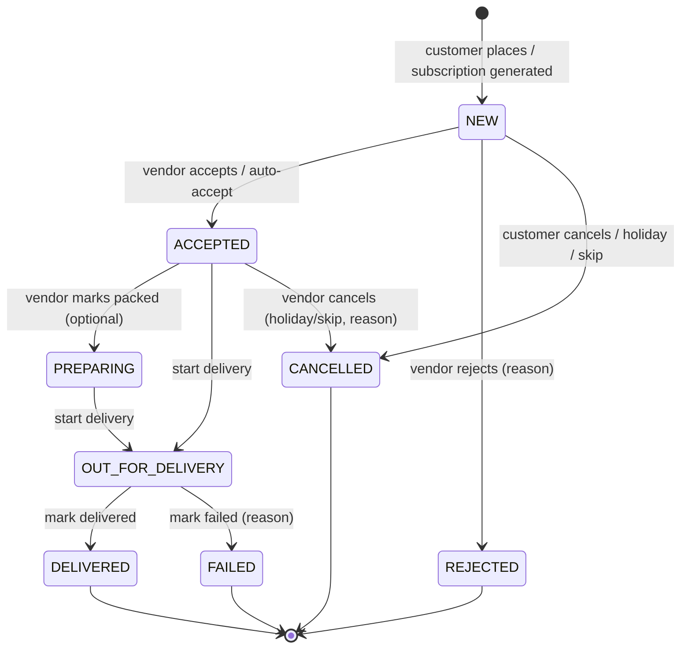

# SRS — Software Requirements Specification

| Field | Value |
|---|---|
| Status | Draft v0.1 |
| Owner | Business Analyst + Technical Architect |
| Last updated | 2026-10-19 |
| Related | [PRD](../01-business/PRD.md), [USER_STORIES](USER_STORIES.md), [SCREEN_SPECIFICATIONS](../03-ux/SCREEN_SPECIFICATIONS.md), [API_SPECIFICATION](../04-architecture/API_SPECIFICATION.md), [TEST_CASES](../07-testing/TEST_CASES.md) |

## 1. Purpose and Conventions
**Source of truth for functional (`FR-xxx`) and non-functional (`NFR-xxx`) requirements.** Business rules (`RULE-xx`) live in [USER_STORIES §2](USER_STORIES.md#2-business-rules). Screens are `S-COM-xx` (common), `S-V-xx` (vendor), `S-C-xx` (customer), `S-A-xx` (admin).

- "shall" = mandatory. Priority per [PRD §3](../01-business/PRD.md#3-priority-definitions).
- `TBD (Q-xx)` = blocked by an open question in [SCOPE §8](../01-business/SCOPE.md#8-open-questions).
- All money values are integer **paise**; quantities are integer packs (A-07).

## 2. Actors
| Actor | Description |
|---|---|
| Guest | Installed app, not logged in |
| Customer | Logged-in user with active role CUSTOMER |
| Vendor | Logged-in user with active role VENDOR (business owner) |
| Offline customer | Vendor-created customer record without app account (may later link) |
| Admin | Platform staff with an admin role (SUPER_ADMIN, OPS, SUPPORT, FINANCE — Q-25) |
| System | Scheduled jobs, notification dispatcher, KYC webhook handler |

## 3. Functional Requirements

### 3.1 Authentication, Roles, Session (F-01)
| ID | Requirement | Pri |
|---|---|---|
| FR-001 | The app shall accept an Indian mobile number (+91 fixed, 10 digits, first digit 6–9). | P0 |
| FR-002 | The system shall send a 6-digit OTP via SMS (default) or WhatsApp (user choice). | P0 |
| FR-003 | OTP shall expire in 5 min; resend enabled after 30 s; max 5 sends per number per hour; max 5 wrong attempts per OTP, then OTP invalidated. Android shall auto-read OTP (SMS Retriever); iOS shall support one-time-code autofill. | P0 |
| FR-004 | The OTP screen shall allow changing the mobile number (returns to S-COM-03, keeps input). | P0 |
| FR-005 | After first login the user shall choose a role (Customer / Vendor). A user may hold both roles and switch via Profile/More without re-login. The active role determines the navigation shell. | P0 |
| FR-006 | Sessions shall use short-lived access tokens (15 min) and rotating refresh tokens (30 days, single-use, reuse detection). Users can log out and log out of all devices. | P0 |
| FR-007 | The user shall select language (English / हिन्दी) at first launch and change it in settings; change applies immediately. | P0 |
| FR-008 | The user shall request account deletion in-app; system confirms by OTP, deactivates immediately and purges/anonymizes per retention policy (Q-20). Vendors with outstanding receivables are warned. | P0 |
| FR-009 | The user shall accept Terms and Privacy Policy (versioned) before account creation; consent with version & timestamp is stored. | P0 |

### 3.2 Vendor Onboarding & KYC (F-02)
| ID | Requirement | Pri |
|---|---|---|
| FR-010 | Vendor shall select one business category: Dairy/Milk Supplier, Water Supplier, Tiffin & Restaurant, Flower Supplier, Grocery Supplier, Fruit & Vegetable Supplier, Laundry Supplier, Others (A-15). Categories are admin-managed. | P0 |
| FR-011 | Vendor shall enter business info: Shop/Business Name (required, 2–80 chars), GST Number (optional, 15-char GSTIN format), Address line (required), City, State (list), Pincode (6 digits), and shop geo-location (map pin or GPS). | P0 |
| FR-012 | Vendor shall upload a shop photo (JPG/PNG/PDF, ≤ 5 MB). Images are compressed client-side; PDFs uploaded as-is. | P0 |
| FR-013 | Vendor shall upload Aadhaar (front/back) and PAN images (JPG/PNG/PDF, ≤ 5 MB each). Aadhaar images must be masked (first 8 digits hidden) before storage (A-10). | P0 |
| FR-014 | Vendor shall enter bank details: Account Holder Name, Bank Name, Account Number (9–18 digits, entered twice), IFSC (`^[A-Z]{4}0[A-Z0-9]{6}$`), and UPI ID (VPA, optional but required for customer UPI settlement, A-11). | P0 |
| FR-015 | System shall verify KYC via third-party APIs (PAN, bank penny-drop, Aadhaar method TBD Q-08); on API failure/mismatch the case goes to manual admin review. Status machine in §4.2 (`NOT_SUBMITTED`, `PENDING`, `MANUAL_REVIEW`, `VERIFIED`, `REJECTED`); resubmission allowed after rejection. | P0 |
| FR-016 | Onboarding progress shall be saved per step and resumable after app restart. | P0 |
| FR-017 | Unverified vendors shall be hidden from customer discovery (A-04) and see a status banner with next steps. | P0 |
| FR-018 | Vendor shall configure a service area as radius (1–20 km, default 3 km) from shop location and/or a list of pincodes. | P0 |

### 3.3 Vendor Dashboard (F-03)
| ID | Requirement | Pri |
|---|---|---|
| FR-020 | Header shall show vendor photo, shop name, city, and Verified badge (if VERIFIED). | P0 |
| FR-021 | Dashboard shall show, for selected date (default Today, IST): Today's Orders, Pending Orders, Completed Orders, Today's Sales (₹); and Total Earnings (lifetime recorded sales), Milk Stock (L, sum of active milk products' stock × pack size), Active Customers. | P0 |
| FR-022 | Quick actions: Add Product, Orders, Customers, Earnings (Payments), Reports, Quick Sale. | P0 |
| FR-023 | Vendor bottom navigation: Home · Orders · Products · Customers · More. | P0 |

### 3.4 Products & Stock (F-04)
| ID | Requirement | Pri |
|---|---|---|
| FR-030 | Vendor shall add a product: image, name (required), product type (Milk/Paneer/Curd/Ghee/Other — list per category, admin-managed), milk type (Cow/Buffalo/Toned/Double Toned/Full Cream/Other; milk only), unit (250 ml / 500 ml / 1 L / Other: value + unit ml/L/g/kg/pcs), selling price (required, > 0), subscription price (optional, ≤ selling price), stock quantity (packs, ≥ 0), minimum order quantity (≥ 1, default 1), description (≤ 500 chars), Active toggle. | P0 |
| FR-031 | Product list shall support search by name and filters All/Milk/Paneer/Curd/Other; each item shows image, name, price, stock, active status, Edit and Delete. | P0 |
| FR-032 | Vendor shall edit any product field; price changes apply to future orders only (RULE-15). | P0 |
| FR-033 | Delete shall be a soft delete with confirmation; blocked while active subscriptions reference the product (RULE-17). | P0 |
| FR-034 | Inactive products are hidden from customers and from new order/POS selection. | P0 |
| FR-035 | Stock shall decrement when an order is marked DELIVERED or a quick sale completes, and increment on reversal; vendor may adjust stock manually with reason. When stock ≤ threshold (TBD Q-34; default 10 packs) a Low Stock notification is sent (BUSINESS+). | P0 |
| FR-036 | One-time orders use selling price; subscription orders use subscription price if set, else selling price. MOQ is enforced on one-time orders and subscriptions. | P0 |

### 3.5 Vendor Orders (F-05)
| ID | Requirement | Pri |
|---|---|---|
| FR-040 | Order list with filters All/New/Accepted/Out for Delivery/Delivered/Cancelled (Cancelled includes Rejected), search by customer name or order number, sorted newest first, paginated. | P0 |
| FR-041 | Order details: customer (name, phone, address), items (product, price, qty, total), subtotal, delivery charge, discount, total, payment mode, payment status, status timeline, source (APP/SUBSCRIPTION/VENDOR). | P0 |
| FR-042 | Vendor shall accept a NEW order → ACCEPTED; customer notified. | P0 |
| FR-043 | Vendor shall reject a NEW order with a reason (Customer not available, Product out of stock, Area not serviceable, Customer requested to cancel, Other + text) → REJECTED; customer notified. | P0 |
| FR-044 | Status transitions shall follow §4.1; invalid transitions return `409 INVALID_STATE_TRANSITION`. | P0 |
| FR-045 | Vendor shall call the customer from order/delivery cards (OS dialer). | P0 |
| FR-046 | When Maximum Daily Orders or Daily Milk Capacity (FR-075) is reached for a date, new customer orders for that date are blocked with a clear message. | P1 |

### 3.6 Quick Sale / POS (F-06)
| ID | Requirement | Pri |
|---|---|---|
| FR-050 | Mode "Sale on POS": walk-in sale without customer. | P0 |
| FR-051 | Mode "Customer Sale": search and select a linked customer (name/mobile). | P0 |
| FR-052 | Vendor adds active products; per line: quantity (+/−), rate (prefilled selling price, editable), amount; delete line. Summary: total items, total amount. | P0 |
| FR-053 | Payment status Paid/Not Paid; method Cash/UPI/Other; Paid Amount (0–total); Balance = Total − Paid (auto). Walk-in sales require Paid = Total (RULE-11). For customer sales, a balance > 0 is posted to Khata. | P0 |
| FR-054 | "Complete Sale" creates a sale record, ledger entries and stock decrements atomically; works offline via outbox (NFR-007). | P0 |

### 3.7 Vendor Customers (F-07)
| ID | Requirement | Pri |
|---|---|---|
| FR-060 | Customer list: search by name/mobile; filters All/Active/Subscription/Inactive; card shows photo, name, mobile, address, status, total orders, subscription type, total purchase. | P0 |
| FR-061 | Vendor shall add/edit an offline customer: name (required), mobile (required, unique per vendor), email, address, preferred payment method. Blocked above plan customer limit (RULE-12). | P0 |
| FR-062 | Customer detail: Call, Edit, Add Order; stats (total orders, total purchase, pending amount); subscription summary; info; tabs Order History / Current Subscription / Payments. | P0 |
| FR-063 | Vendor shall mark a customer Inactive (keeps history; excluded from limit count). | P1 |
| FR-064 | When a person registers as Customer with a mobile matching a vendor's offline customer, the system links them after the customer accepts a link prompt; the ledger becomes visible to the customer. | P0 |

### 3.8 Subscriptions (F-08, vendor side)
| ID | Requirement | Pri |
|---|---|---|
| FR-070 | Vendor shall create a subscription for an existing or new customer: product, quantity per day (packs), delivery days (Mon–Sun multi-select), start date (≥ tomorrow), optional end date, time slot, payment method (Cash/UPI/Wallet), payment status note. | P0 |
| FR-071 | Daily amount = qty × unit subscription price; Monthly amount (estimate) = daily amount × number of selected delivery days in the current calendar month (RULE-16). | P0 |
| FR-072 | Subscription status: `PENDING_APPROVAL → ACTIVE ⇄ PAUSED → CANCELLED` and `ACTIVE → COMPLETED` at end date. Pause may be open-ended or with a resume date. | P0 |
| FR-073 | Vendor shall edit quantity/days/slot; changes apply from the next ungenerated date. | P0 |
| FR-074 | System job shall, at 22:00 IST daily (A-05), generate orders for the next day for each ACTIVE subscription where the date is a delivery day, within start/end, not paused, not skipped, not a vendor holiday, and vendor delivery not paused (RULE-07). Generation is idempotent (one order per subscription per date). | P0 |
| FR-075 | Subscription settings: Auto-accept subscription orders (BUSINESS+), Delivery availability toggle with start/end time, Maximum daily orders, Daily milk capacity (L), Pause all subscriptions toggle, summary and subscription-customer list. | P0 |
| FR-076 | Customer-initiated subscriptions start as PENDING_APPROVAL; vendor accepts/rejects; auto-accepted if Auto-accept is on. | P0 |
| FR-077 | Customer or vendor may skip a single date before cutoff (A-05). Skips after generation cancel the generated order if still NEW/ACCEPTED (vendor only after cutoff). | P0 |

### 3.9 Delivery, Availability, Holidays (F-09)
| ID | Requirement | Pri |
|---|---|---|
| FR-080 | Delivery list for a selected date with tabs All/Pending (ACCEPTED)/Preparing/Out for Delivery/Delivered/Failed; card shows order no., slot, customer, address, products, qty, amount, Call. | P0 |
| FR-081 | Actions: Mark Preparing (optional), Start Delivery (→ OUT_FOR_DELIVERY), Mark Delivered (with payment collected? Yes/No + method + amount), Mark Failed (reason). Supported offline (NFR-007). | P0 |
| FR-082 | Today's Delivery Availability toggle; when off, no new one-time orders accepted for today. | P0 |
| FR-083 | Mark Holiday (date ≥ today, reason): suppresses subscription generation; already generated orders for that date are cancelled; affected customers notified. | P0 |
| FR-084 | Pause Delivery / Resume Delivery (open-ended) with the same effects as holidays for every day while paused. | P0 |
| FR-085 | Upcoming holidays list; vendor may delete a future holiday (subscriptions resume if before generation). | P0 |

### 3.10 Reports (F-10)
| ID | Requirement | Pri |
|---|---|---|
| FR-090 | Date range: Today/Weekly/Monthly/Custom (max 366 days). | P1 |
| FR-091 | Summary cards: Total Sales, Total Orders, Delivered, Cancelled, Total Milk Sold (L), Total Earnings (payments received), Pending Payments (Khata receivable), Active Customers. | P1 |
| FR-092 | Sales overview bar chart by day (by week if range > 62 days). | P1 |
| FR-093 | Product-wise table: quantity sold, sales amount. | P1 |
| FR-094 | Download report (format TBD Q-23; proposed PDF + CSV) generated server-side; shared via OS share sheet. | P1 |
| FR-095 | FR-092–FR-094 gated to BUSINESS+; FR-091 available to all plans (proposed). | P1 |

### 3.11 Notifications (F-11)
| ID | Requirement | Pri |
|---|---|---|
| FR-100 | In-app notification center; vendor tabs All/Orders/Payments/Delivery/System; customer tabs All/Orders/Payments/Offers; each item shows title, body, relative timestamp, read state. | P0 |
| FR-101 | Push events — Vendor: New Order, Order Cancelled by customer, Subscription request, Payment claim, Low Stock, Plan expiring, KYC status. Customer: Order Accepted/Rejected, Out for Delivery, Delivered, Delivery Failed, Payment recorded, Subscription approved/renewed/paused by vendor, Vendor holiday, Offers. | P0 |
| FR-102 | Mark read on open; Mark all read; Clear all. Retained 90 days. | P0 |
| FR-103 | Notification preferences per category (Orders, Payments, Delivery, Offers, System); transactional KYC/security cannot be disabled. | P1 |
| FR-104 | Tapping a notification deep-links to the target screen and switches active role if needed (with confirmation). | P0 |

### 3.12 Vendor Khata & Payments (F-12)
| ID | Requirement | Pri |
|---|---|---|
| FR-110 | Khata list tabs All/Receivable/Paid (settled); per customer: total debit, total paid, due; search. | P0 |
| FR-111 | System posts DEBIT on order DELIVERED and on customer quick sale; posts CREDIT on payment recorded/confirmed (RULE-10). | P0 |
| FR-112 | Vendor records a payment: customer, amount (> 0), method (Cash/UPI/Bank/Wallet), date, note → CREDIT. | P0 |
| FR-113 | "Add Customer Khata": opening balance entry for a new or existing customer (DEBIT or CREDIT, note required). | P0 |
| FR-114 | Payments screen: Total Receivable, This Month Received, recent payments (amount, time, method). "Settle to Bank": **TBD (Q-05)**, hidden in v1. | P0 |
| FR-115 | Vendor confirms or rejects customer payment claims (FR-253); confirmation posts CREDIT; rejection notifies customer with reason. | P0 |
| FR-116 | Ledger entries are immutable; corrections via reversal entries with reason; all changes audit-logged. | P0 |

### 3.13 Vendor SaaS Plans (F-13)
| ID | Requirement | Pri |
|---|---|---|
| FR-120 | Show plan catalog (admin-managed) with price per duration, customer limit, features, "Most Popular" marker (BUSINESS). | P1 |
| FR-121 | Vendor purchases/renews/upgrades a plan through the billing channel decided in ADR-015 (Q-03); entitlement activated only after server-verified payment. | P1 |
| FR-122 | Customer-limit enforcement (RULE-12). | P1 |
| FR-123 | Feature gating per [PRD §5](../01-business/PRD.md#5-plan-feature-gating), enforced server-side (`403 PLAN_FEATURE_LOCKED`). | P1 |
| FR-124 | Expiry reminders at 7, 3, 1 days and on expiry; grace period and post-expiry behaviour TBD (Q-04). | P1 |
| FR-125 | Free trial: TBD (Q-04). | P1 |
| FR-126 | Plan invoices (GST treatment TBD Q-24) downloadable by vendor. | P1 |

### 3.14 Vendor Settings & Help (F-14)
| ID | Requirement | Pri |
|---|---|---|
| FR-130 | Settings menu: Profile, Business Information, KYC & Bank Details, Service Area, Delivery Settings, Notification Settings, Subscription Settings, Plan & Billing, Language, Privacy Policy, Terms, Help & Support, Switch to Customer, Logout, Delete Account. ("Security / Change Password" removed — OTP-only.) | P1 |
| FR-131 | Editing verified fields (business name, PAN, bank, Aadhaar) sets KYC to PENDING for re-verification; vendor remains discoverable with prior verified data until decision (proposed). | P1 |
| FR-132 | Delivery settings: delivery charge (₹, default 0), minimum order value, time slots (default 7–8, 8–9, 9–10 AM), order cut-off for same-day orders (A-16). | P1 |
| FR-133 | Help Center: FAQs (admin CMS) by topic (Orders, Payments, Delivery, Account/KYC), Call Support (number Q-30), email. Tickets/chat deferred. | P1 |
| FR-134 | Legal pages (Terms, Privacy) rendered from CMS, versioned. | P0 |

### 3.15 Customer Home, Location, Search (F-15)
| ID | Requirement | Pri |
|---|---|---|
| FR-200 | Location: on first use ask for location permission (pre-prompt); if granted use GPS + reverse-geocode; else manual city/address search. Selected location shown in header; changeable anytime; saved addresses selectable. | P0 |
| FR-201 | Home shows: location selector, notification bell with unread dot, search bar, hero banner(s) (admin-managed) with CTA, category grid (admin-managed; disabled categories show "Coming soon"), Today's Delivery list (status Delivered/On the way/Scheduled). | P0 |
| FR-202 | Search vendors and products by keyword within serviceable area; recent searches stored locally. | P0 |
| FR-203 | Customer bottom navigation per A-17 (Q-10). | P0 |

### 3.16 Discovery & Vendor Details (F-16, F-24)
| ID | Requirement | Pri |
|---|---|---|
| FR-210 | Vendor list per category: only VERIFIED vendors with active plan serving the location; sort chips Nearby (distance), Popular (orders 30 d), Rating; card: image, name, rating, review count, distance, badges, quick add. Paginated. | P0 |
| FR-211 | Vendor details: cover, name, rating, distance, badges (Pure Milk, On Time Delivery, Trusted — rules TBD, admin-assigned in v1), tabs Products / Subscription / Reviews / About (address, hours, delivery charge, holidays). | P0 |
| FR-212 | Product details: image, name, price, description, attributes, qty stepper (≥ MOQ), Add to Cart, Subscribe & Save. | P0 |
| FR-213 | After a DELIVERED order, customer may rate the vendor 1–5 with optional text (≤ 500 chars); one review per order; vendor rating = average of published reviews. | P1 |
| FR-214 | Customer may favorite/unfavorite vendors (heart icon) and see favorites first in lists. | P1 |

### 3.17 Cart, Checkout, Place Order (F-17)
| ID | Requirement | Pri |
|---|---|---|
| FR-220 | Cart holds items from one vendor (A-09); adding from another vendor prompts to replace. Cart persists locally. | P0 |
| FR-221 | Bill details: item total, delivery charge (vendor setting), coupon discount, total amount. | P0 |
| FR-222 | Apply Coupon: TBD (Q-06); feature-flagged off until defined. | P2 |
| FR-223 | Checkout: delivery address (saved/new), delivery date (today if before vendor cut-off, else from tomorrow; max +7 days), time slot (vendor slots), payment mode: Pay on Delivery (Cash/UPI) or Add to Khata (if vendor allows credit — proposed default allowed for linked customers). "Proceed" places order (NEW). | P0 |
| FR-224 | Place New Order screen: tabs Milk & Dairy / Water Can; One Time / Subscription toggle; product rows with qty steppers; date; time slot; Add to Cart (one-time) or continue to subscription setup. | P0 |
| FR-225 | Server validation at placement: vendor active & serving address, product active, qty ≥ MOQ and ≤ stock, date not holiday/paused, capacity (FR-046), price re-computed server-side; client shows specific errors. Idempotency-Key required. | P0 |

### 3.18 Customer Subscriptions (F-08, customer side)
| ID | Requirement | Pri |
|---|---|---|
| FR-230 | Subscription tab shows plans derived from vendor products: 1 L Daily, 500 ml Daily, 2 L Daily (computed monthly ₹ and per-day ₹), and Custom Plan (choose product, qty, days). "Most Popular" marker per vendor config. Features list: free delivery (if charge 0), pause or skip anytime, monthly billing, manage from app. | P0 |
| FR-231 | Start subscription: product, qty, days, start date (≥ tomorrow), slot, address, payment method → PENDING_APPROVAL (FR-076). | P0 |
| FR-232 | Manage: pause (range or open), resume, skip date, modify qty/days/slot (effective after cutoff), cancel (with confirmation). | P0 |
| FR-233 | Monthly statement per subscription: delivered days, qty, amount, paid, due (from ledger). | P1 |

### 3.19 My Orders & Tracking (F-18)
| ID | Requirement | Pri |
|---|---|---|
| FR-240 | My Orders tabs All/Ongoing/Delivered/Cancelled; card: order no., product icon, item summary, date, amount, status badge. | P0 |
| FR-241 | Order tracking: timeline Confirmed (ACCEPTED) → Packed (PREPARING) → Out for Delivery → Delivered; delivery address; vendor name & Call button. No live map (F-D3). Auto-refresh via push + pull-to-refresh. | P0 |
| FR-242 | Customer may cancel while NEW; after ACCEPTED TBD (Q-16). | P0 |
| FR-243 | Reorder a past order (adds available items to cart at current prices). | P1 |

### 3.20 Customer Khata (F-19)
| ID | Requirement | Pri |
|---|---|---|
| FR-250 | Khata summary: Total Receivable, Total Payable, Net Balance; tabs All / Customers (personal contacts) / Vendors; each row shows balance and status (Receivable/Payable/Settled). | P0 |
| FR-251 | Vendor ledger (read-only, synced from vendor Khata): month selector, Total Payable, Total Paid, entries with date, product, amount, Pending/Paid. | P0 |
| FR-252 | Personal entries: add contact (name, optional mobile — manual or OS contact picker), entry "You gave"/"You got", amount, date, note; edit/delete own personal entries. | P0 |
| FR-253 | Settle Payment (vendor ledger): opens UPI intent to vendor VPA with amount (editable ≤ due) and note; on return user confirms "I've paid" → payment claim PENDING; fallback shows VPA + QR + copy (iOS, R-11); cash option records claim only. | P0 |

### 3.21 Money (F-20)
| ID | Requirement | Pri |
|---|---|---|
| FR-260 | Month selector; overview Total Income, Total Expense, Net Saving. | P1 |
| FR-261 | Add/edit/delete income or expense: amount, category (Food, Transport, Home, Shopping, Bills, Others; Income: Salary, Business, Other), date, note. | P1 |
| FR-262 | Expense breakdown pie chart by category; recent transactions list. | P1 |
| FR-263 | Auto-import confirmed Supply Biz payments as expenses: TBD (Q-21). | P2 |

### 3.22 Services & Bill Payments (F-21)
| ID | Requirement | Pri |
|---|---|---|
| FR-270 | Services screen: search; categories (Milk & Dairy, Water Can, Tiffin, Laundry, Grocery, Fruits & Veg, Food & Restaurant, Medicines, Flowers, Newspaper, Home Services, Electricity, Gas & Fuel, Mobile Recharge, DTH Recharge, More); supply categories open vendor list; bill categories open bill payments; disabled ones show "Coming soon"; promo banner. | P1 |
| FR-271 | Bill payment categories: Mobile Recharge, DTH, Electricity, Gas Cylinder, Water, Broadband, Landline, Insurance, Credit Card, Loan EMI, Municipal Tax, FASTag, Education Fees, Hospital, Recurring Bills — provider, payment rails and availability TBD (Q-07). Feature flag `bill_payments`. | P2 |
| FR-272 | Flow: choose biller → enter consumer number → fetch bill → pay → receipt & history. Details TBD with partner (Q-07). | P2 |

### 3.23 Grocery Voice & Image Order (F-22)
| ID | Requirement | Pri |
|---|---|---|
| FR-280 | Voice order: tap-and-speak (EN/HI), live transcript, stop/retry; microphone & speech permission requested in context. | P2 |
| FR-281 | Image to order: capture or pick photo of a list (printed/handwritten, Latin + Devanagari) → text extraction. | P2 |
| FR-282 | Parsed items (name + qty) matched against selected grocery vendor's catalog; list shows matched items with qty steppers, unmatched items flagged with "search" action; user can edit/remove. | P2 |
| FR-283 | "Add All to Cart" adds matched items (RULE-05 applies). Raw audio/images are not stored server-side (proposed; Q-28). | P2 |

### 3.24 Profile & Account (F-23)
| ID | Requirement | Pri |
|---|---|---|
| FR-290 | Profile: photo, name, mobile (read-only), email; edit name/email/photo. | P1 |
| FR-291 | Addresses: list, add, edit, delete, set default; fields: label (Home/Office/Parents Home/Other), house/flat, street/area, landmark, city, state, pincode, map pin (lat/lng). | P0 |
| FR-292 | Payment Methods: TBD (Q-22); proposed: preferred method (Cash/UPI) + saved UPI ID for display only. | P2 |
| FR-293 | Invite & Earn: share referral link/code; reward rules TBD (Q-14); feature flag `referral`. | P2 |
| FR-294 | Reports & Insights: monthly spend by vendor/category, milk consumed (L) from orders and Money data. | P1 |
| FR-295 | App Settings: language, notification preferences, switch role, clear cache, about, logout, delete account. | P1 |
| FR-296 | Help & Support: FAQs (CMS), call/email support. | P1 |
| FR-297 | About Supply Biz: version, licenses, legal links. | P1 |

### 3.25 Admin Panel (F-25)
| ID | Requirement | Pri |
|---|---|---|
| FR-400 | Admin login: email + password (≥ 12 chars) + mandatory TOTP 2FA; RBAC roles (Q-25); session timeout 30 min idle. | P0 |
| FR-401 | Dashboard: vendors by KYC status, active vendors/customers, orders/day, recorded GMV, plan revenue, delivery success rate. | P0 |
| FR-402 | KYC queue: list PENDING/MANUAL_REVIEW, view documents (watermarked, access-logged), API results, approve/reject with reason. | P0 |
| FR-403 | Vendor management: search, view, suspend/reinstate (suspended = hidden + cannot accept orders), assign badges, view plan. | P0 |
| FR-404 | Customer management: search, view, block/unblock. | P0 |
| FR-405 | Category management: create/edit, icon, order, enabled/coming soon, type (SUPPLY/BILL). | P0 |
| FR-406 | Plans: manage tiers, prices, limits, features; view vendor plan subscriptions and payments; manual extend/grant (audit-logged). | P1 |
| FR-407 | Banners (image, deep link, schedule, city) and coupons (Q-06). | P1 |
| FR-408 | CMS: FAQs (EN/HI), Terms, Privacy (versioned); App config: min supported version (force update), feature flags. | P0 |
| FR-409 | Broadcast push to segment (role, city, category) with schedule. | P1 |
| FR-410 | Review moderation: hide/restore reviews (policy Q-26). | P1 |
| FR-411 | Audit log viewer (actor, action, entity, before/after, IP, time); read-only. | P0 |
| FR-412 | Data-subject requests: account deletion queue, data export (DPDP). | P0 |
| FR-413 | Export platform reports (CSV). | P1 |

## 4. State Machines

### 4.1 Order

Quick sales are separate `sale` records (no state machine).

### 4.2 KYC
`NOT_SUBMITTED → PENDING → (API ok) VERIFIED | (API fail/mismatch) MANUAL_REVIEW → VERIFIED | REJECTED → (resubmit) PENDING`.

### 4.3 Payment claim
`PENDING → CONFIRMED (CREDIT posted) | REJECTED (reason)`.

## 5. Non-Functional Requirements
| ID | Category | Requirement |
|---|---|---|
| NFR-001 | Performance | Cold start to interactive ≤ 2.5 s p90 on reference Android (4 GB RAM, Android 10); ≤ 1.5 s on iPhone 11+ |
| NFR-002 | Performance | Scrolling/animations at 60 fps; janky frames < 1% on reference device |
| NFR-003 | Performance | API p95 ≤ 500 ms (reads) / ≤ 800 ms (writes) at target load |
| NFR-004 | Availability | API 99.5% monthly (proposed; SLA TBD) |
| NFR-005 | Scalability | Design target (assumption, Q-27): 10k vendors, 1M customers, 300k orders/day; horizontally scalable stateless API |
| NFR-006 | Reliability | Subscription generation completes for all vendors within 30 min, idempotent, with alerting on failure |
| NFR-007 | Offline | Cached read for dashboard, orders, deliveries, customers, Khata; vendor delivery status, payment record and quick sale queued offline and synced with idempotency |
| NFR-008 | Security | OWASP MASVS L1 baseline (L2 controls for KYC/financial data), OWASP ASVS L2 for API/admin, TLS 1.2+ |
| NFR-009 | Privacy | DPDP Act 2023 compliance; data in India; Aadhaar masking; PII minimization |
| NFR-010 | Accessibility | WCAG 2.1 AA equivalent; TalkBack/VoiceOver labels; text scale up to 200% without loss; touch targets ≥ 48dp/44pt |
| NFR-011 | Localization | EN/HI; all strings externalized; Indian number grouping (₹1,20,000); IST display |
| NFR-012 | Compatibility | Android 7.0+ (API 24), iOS 13+ (A-13); phones 320–480 dp width; portrait only |
| NFR-013 | Size | Android download ≤ 40 MB per ABI; iOS ≤ 60 MB |
| NFR-014 | Battery | No continuous background location; background work only via OS-sanctioned schedulers |
| NFR-015 | Stability | Crash-free sessions ≥ 99.5%, ANR rate < 0.47% |
| NFR-016 | Observability | Structured logs, metrics, traces with correlation ID end-to-end |
| NFR-017 | DR | RPO ≤ 15 min, RTO ≤ 4 h |
| NFR-018 | Maintainability | Test coverage ≥ 80% domain/business logic, ≥ 60% overall; lint clean |
| NFR-019 | Network | Usable on 3G (≥ 400 kbps); image uploads compressed to ≤ 300 KB (KYC docs ≤ 1.5 MB after compression) |
| NFR-020 | Auditability | All ledger, KYC, plan and admin actions audit-logged, retained per Q-20 |

## 6. Traceability
FR → US → TC mapping lives in [USER_STORIES](USER_STORIES.md) (FR column) and [TEST_CASES](../07-testing/TEST_CASES.md) (FR/US columns). Tasks reference FR IDs in [TASKS](../05-ai-development/TASKS.md).
