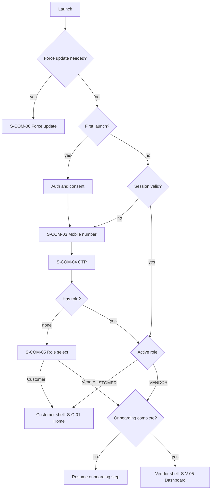
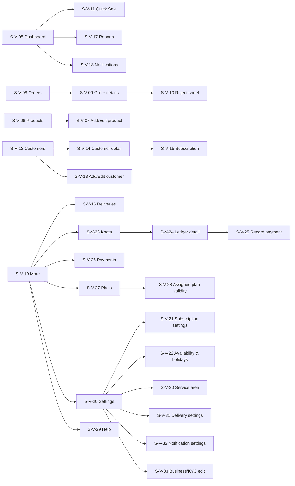
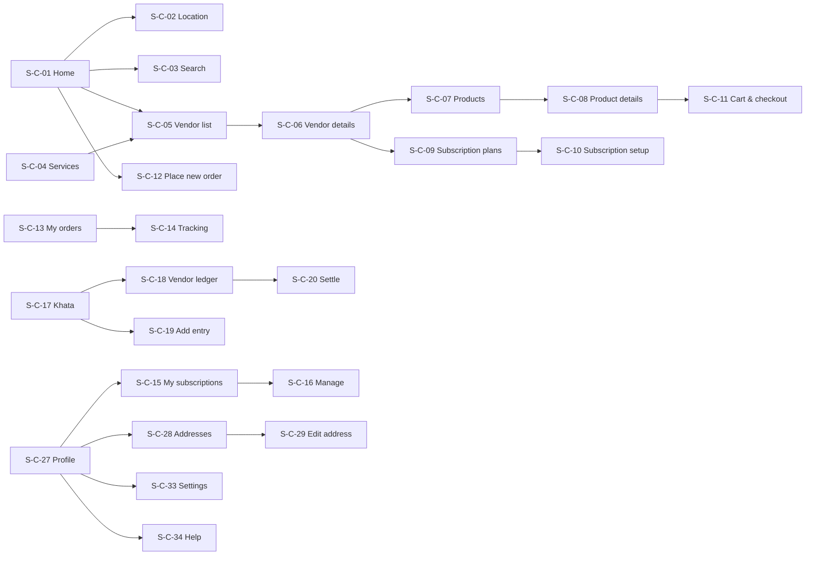
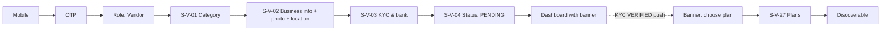
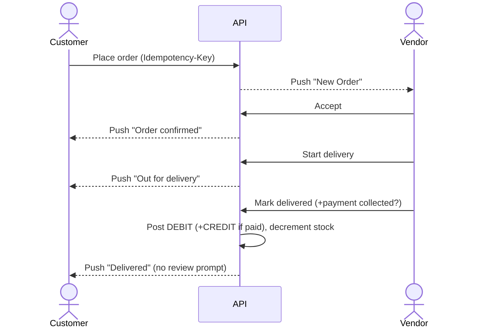
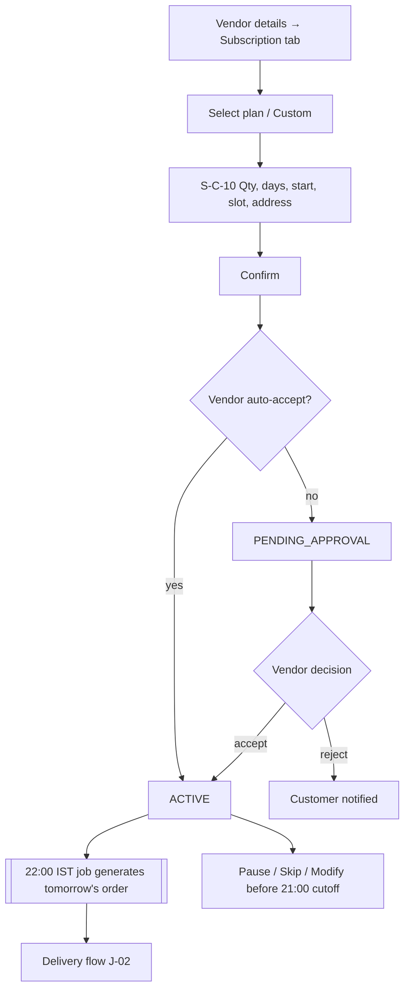
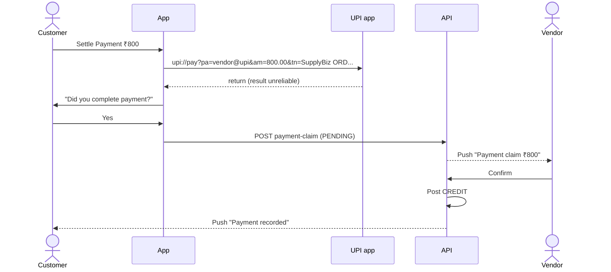

# USER FLOWS — Personas, Journeys, Navigation

| Field | Value |
|---|---|
| Status | Draft v0.1 |
| Owner | UX Designer |
| Last updated | 2026-10-29 |
| Related | [USER_STORIES](../02-requirements/USER_STORIES.md), [SCREEN_SPECIFICATIONS](SCREEN_SPECIFICATIONS.md), [MOBILE_STRATEGY](../04-architecture/MOBILE_STRATEGY.md) |

## 1. Personas
| Persona | Profile | Goals | Pain points | Design implications |
|---|---|---|---|---|
| **Rohit — milk vendor** (from mockup "Rohit Milk Center") | 38, runs a dairy with ~150 households, low-end Android, prefers simple text, delivers 6–9 AM | Never miss a delivery; know dues; get paid on time | Paper diary errors, month-end billing disputes | Big touch targets, simple English, offline delivery updates, one-tap actions |
| **Ramesh — household customer** (mockup "Ramesh Kumar") | 42, family of 4, daily 2 L milk, UPI user | Reliable delivery; easy pause when travelling; clear bill | Doesn't know monthly due until vendor tells | Today's delivery on home, pause/skip in 2 taps, transparent Khata |
| **Priya — multi-service customer** | 29, working professional, orders water cans, tiffin and grocery catalog items | One app for local needs | Many apps/contacts | Services grid, catalog search and recurring orders (bills/recognition deferred) |
| **Anita — ops admin** | Platform operations | Verify vendors quickly, resolve issues | Manual document checks | KYC queue with API results, audit trail |

## 2. App Entry & Role Flow

## 3. Navigation Structure

### 3.1 Vendor shell (bottom nav: Home · Orders · Products · Customers · More)

### 3.2 Customer shell (bottom nav: Home · Orders · Khata · Services · Profile — A-17/Q-10)

## 4. Critical Journeys

### J-01 Vendor onboarding (US-010–US-014)

Edge cases: app killed mid-step (resume, FR-016); file too large; KYC REJECTED → edit & resubmit; no network on submit (retry; uploads are not queued offline).

### J-02 Order lifecycle (US-041, US-080, US-240)

Alternatives: vendor rejects (reason) → customer notified; customer cancels while NEW; delivery FAILED (reason) → no DEBIT.

### J-03 Subscription (US-074, US-071, US-075)

### J-04 Quick Sale (US-050/051)
Dashboard → Quick Sale → choose mode → add products → adjust qty/rate → payment status/method/paid → Complete Sale → success toast + "New sale". Offline: saved to outbox with "Pending sync" chip.

### J-05 Holiday (US-081)
More → Settings → Availability & Holidays → Mark Holiday (date, reason) → confirm dialog shows count of affected orders/customers → save → customers notified.

### J-06 Khata settle (US-252, US-113)

### J-07 Grocery voice/image (US-280) — POST-DELIVERY SR-01
Future journey reference only; not active navigation or acceptance.
Services → Grocery → vendor → Voice Order or Image to Order → permission pre-prompt → capture → detected items list (edit) → Add All to Cart → Cart → checkout.

### J-08 Admin KYC review (US-401)
Login + TOTP → KYC queue → open case → view docs & API results → Approve / Reject(reason) → vendor notified → audit log entry.

## 5. Deep-Link Entry Points
| Link | Target | Role |
|---|---|---|
| `/o/{orderId}` | Order details/tracking | Vendor or customer (per ownership) |
| `/v/{vendorId}` | Vendor details | Customer |
| `/s/{subscriptionId}` | Subscription detail | Both |
| `/khata/{vendorId}` | Customer vendor ledger | Customer |
| `/invite/{code}` | Install/referral attribution | Guest |
Unauthenticated deep links are stored and resumed after login. Details in [MOBILE_STRATEGY §4](../04-architecture/MOBILE_STRATEGY.md#4-deep-links).

## 6. Open Questions
Q-10 (customer nav), Q-16 (cancel after accept), Q-35 (vendor list "+" button).

## 7. Approved delivery journeys
SR-01–SR-06 are approved under ADR-024: the navigation diagrams above omit deferred screens; future J-07 is excluded. Manual KYC and admin plan assignment/extension are required before the discovery/order journey can pass. Plan changes show assigned validity/limits and support assistance, without a checkout. Reports show tables and CSV export; location/address flows use forms/optional GPS coordinates with server coverage validation. Android is the only runtime/test/release target; iOS validation follows actual Android release in T-185 (ADR-025).
