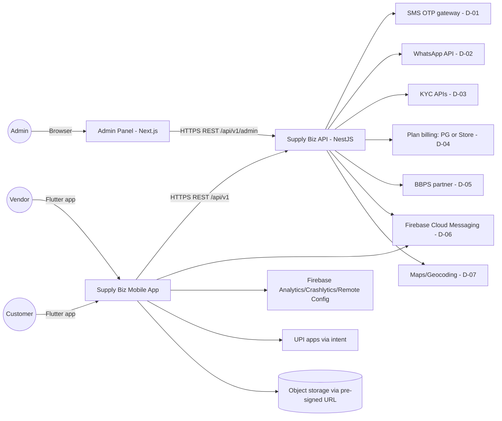
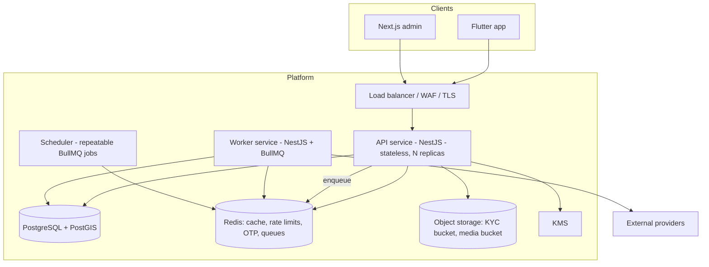
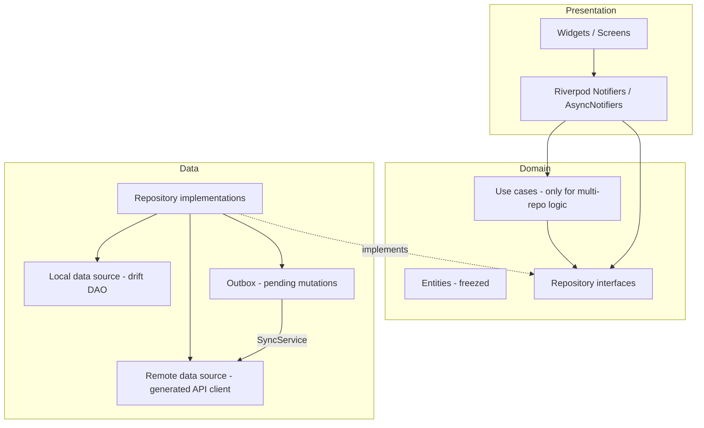
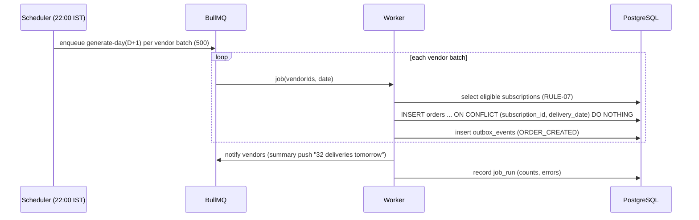
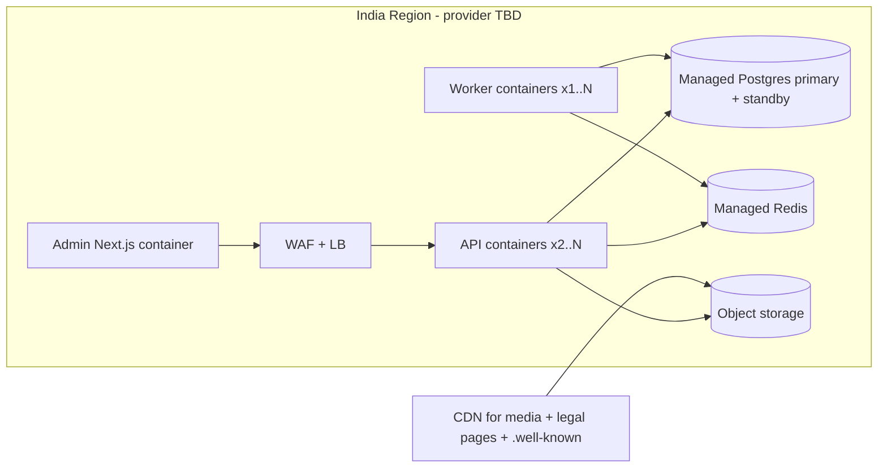

# ARCHITECTURE

| Field | Value |
|---|---|
| Status | Draft v0.1 |
| Owner | Technical Architect |
| Last updated | 2026-10-19 |
| Related | [DECISIONS](../05-ai-development/DECISIONS.md), [MODULE_DESIGN](MODULE_DESIGN.md), [DATA_DESIGN](DATA_DESIGN.md), [API_SPECIFICATION](API_SPECIFICATION.md), [MOBILE_STRATEGY](MOBILE_STRATEGY.md), [AUTH_SECURITY](AUTH_SECURITY.md) |

## 1. Purpose
High-level architecture, technology stack and patterns for the Supply Biz mobile app, backend API and admin panel. **Source of truth for technical decisions is [DECISIONS](../05-ai-development/DECISIONS.md)**; this document describes the resulting architecture.

## 2. Architectural Drivers
| Driver | Source | Architectural response |
|---|---|---|
| One app, two roles | A-02, ADR-002 | Role-scoped navigation shells; role-scoped API namespaces |
| Daily subscription correctness | FR-074, R-07 | Idempotent scheduled job with DB uniqueness constraints |
| Offline vendor operations | NFR-007 | Local encrypted DB + outbox with idempotency keys |
| Financial integrity | FR-116, RULE-09 | Append-only ledger; transactional writes; audit log |
| KYC/PII sensitivity | NFR-008/009 | Encrypted object storage, field-level encryption, masked Aadhaar, least privilege |
| Low-end devices | C-04 | Flutter AOT, image caching/compression, lean dependencies |
| Unknown cloud & scale | Q-02, Q-27 | Containerized, cloud-agnostic components (Postgres, Redis, S3-compatible storage) |

## 3. Technology Stack
Versions are pinned at milestone M0 (see [ENVIRONMENT_SETUP](../06-development/ENVIRONMENT_SETUP.md)); below are the target majors.

| Layer | Choice | Notes |
|---|---|---|
| Mobile | Flutter (stable, pinned via FVM), Dart 3 | ADR-001 |
| State management | Riverpod 2 (`riverpod_generator`) | ADR-005 |
| Navigation | go_router (typed routes, `StatefulShellRoute`) | ADR-005 |
| HTTP | dio + generated OpenAPI client (`packages/api_client`) | ADR-013 |
| Models | freezed + json_serializable | — |
| Local DB | drift (SQLite) with SQLCipher | ADR-006 |
| Secure storage | flutter_secure_storage (Keychain / Android Keystore) | — |
| i18n | flutter_localizations + intl, ARB files (en, hi) | ADR-019 |
| Push / analytics / crash / config / perf | Firebase Messaging, Analytics, Crashlytics, Remote Config, Performance | ADR-010 |
| Charts | fl_chart | — |
| Media | image_picker, file_picker, flutter_image_compress | — |
| Location & maps | geolocator + maps/places provider (Q-32) | D-07 |
| Voice / OCR | speech_to_text (on-device OS engines), google_mlkit_text_recognition (Latin + Devanagari) | Q-28 |
| Backend | Node.js (Active LTS), NestJS, TypeScript strict | ADR-004 |
| ORM / DB | Prisma, PostgreSQL 16 + PostGIS | ADR-004 |
| Cache / queue | Redis 7 + BullMQ | ADR-011 |
| Object storage | S3-compatible with SSE-KMS, pre-signed URLs | ADR-018 |
| Admin panel | Next.js (App Router), TypeScript, TanStack Query, shadcn/ui, generated TS client | ADR-012 |
| API contract | OpenAPI 3.1 (`contracts/openapi.yaml`), generated from NestJS decorators and checked into repo | ADR-013 |
| Observability (server) | pino JSON logs, OpenTelemetry traces/metrics, Sentry (API + admin errors) | QUALITY_OBSERVABILITY |
| CI/CD | GitHub Actions, Fastlane, Docker | A-14 |
| Infrastructure | Containers on managed platform (cloud TBD, Q-02), managed Postgres & Redis, IaC with Terraform | ADR-017 |

## 4. System Context

## 5. Container View

- **API**: request/response, validation, authZ, transactional writes.
- **Worker**: subscription generation, notifications fan-out, KYC verification calls & webhooks, report generation, plan expiry, cleanup/retention jobs.
- API and Worker are the same codebase with different entry points (`main.ts`, `worker.ts`).

## 6. Mobile Architecture
Feature-first, layered (presentation → domain → data), unidirectional data flow.

Rules:
- Widgets never call data sources directly; Notifiers depend on repository interfaces (DI via Riverpod providers).
- Read strategy: **stale-while-revalidate** for cacheable lists (emit local → fetch → upsert → emit).
- Vendor offline writes go to the **outbox** (see [MOBILE_STRATEGY §6](MOBILE_STRATEGY.md#6-offline-support--sync)).
- Role shells: `VendorShell` and `CustomerShell` as separate `StatefulShellRoute`s; shared `common` features.

## 7. Backend Architecture
Modular monolith (NestJS modules per bounded context, see [MODULE_DESIGN](MODULE_DESIGN.md)). Each module: `controller → service → repository (Prisma)`; cross-module calls via exported services or domain events (in-process `EventEmitter2` + BullMQ for async side effects).

Key patterns:
- **Transactional outbox (server)**: domain events written in the same DB transaction (`outbox_events` table) and dispatched by the worker → guarantees notifications/ledger side effects are not lost.
- **Idempotency**: `Idempotency-Key` header stored in `idempotency_keys` (24 h) for all non-GET mobile mutations.
- **Optimistic concurrency**: `version` column on orders, subscriptions, products; `If-Match` / `version` in body → `409 VERSION_CONFLICT`.
- **Ledger**: append-only `ledger_entries`; balances via materialized `ledger_balances` updated in the same transaction.
- **Plan gating**: `@RequiresPlanFeature('SUBSCRIPTIONS')` guard.
- **Geo**: PostGIS `geography(Point)` for shops/addresses; service area via `ST_DWithin` + pincode list.

## 8. Subscription Generation (FR-074)

Failures retry with exponential backoff (5 attempts); job_run monitored with alert if incomplete by 22:30 IST (NFR-006).

## 9. Deployment View

Environments: `dev`, `staging`, `prod` (see [DEPLOYMENT_OPERATIONS](../08-deployment-operations/DEPLOYMENT_OPERATIONS.md)).

## 10. Cross-Cutting Concerns
| Concern | Where |
|---|---|
| AuthN/AuthZ, encryption, privacy | [AUTH_SECURITY](AUTH_SECURITY.md) |
| Lifecycle, navigation, offline, push, deep links | [MOBILE_STRATEGY](MOBILE_STRATEGY.md) |
| Errors, logging, analytics, monitoring | [QUALITY_OBSERVABILITY](QUALITY_OBSERVABILITY.md) |
| Data model | [DATA_DESIGN](DATA_DESIGN.md) |
| Contracts | [API_SPECIFICATION](API_SPECIFICATION.md) |

## 11. Risks & Future Improvements
- Extract worker-heavy contexts (notifications, reports) into separate services if load requires.
- Live tracking (F-D3) would add WebSocket/MQTT gateway + background location on delivery devices.
- Read replicas for reports once data volume grows.
- Open: Q-02 (cloud), Q-28 (voice/OCR on-device vs cloud), Q-32 (maps).
