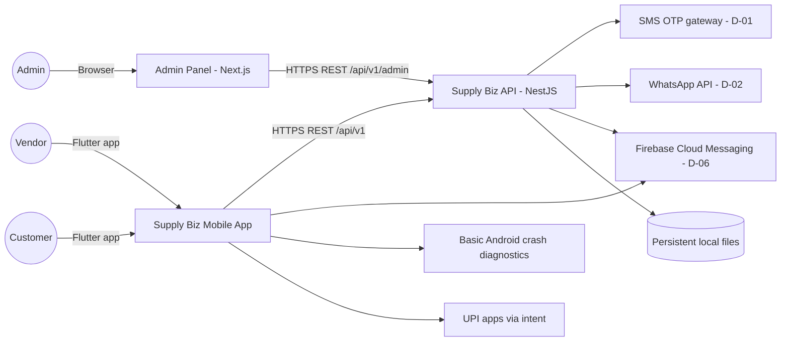
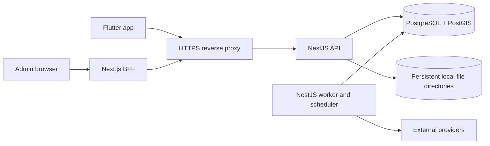
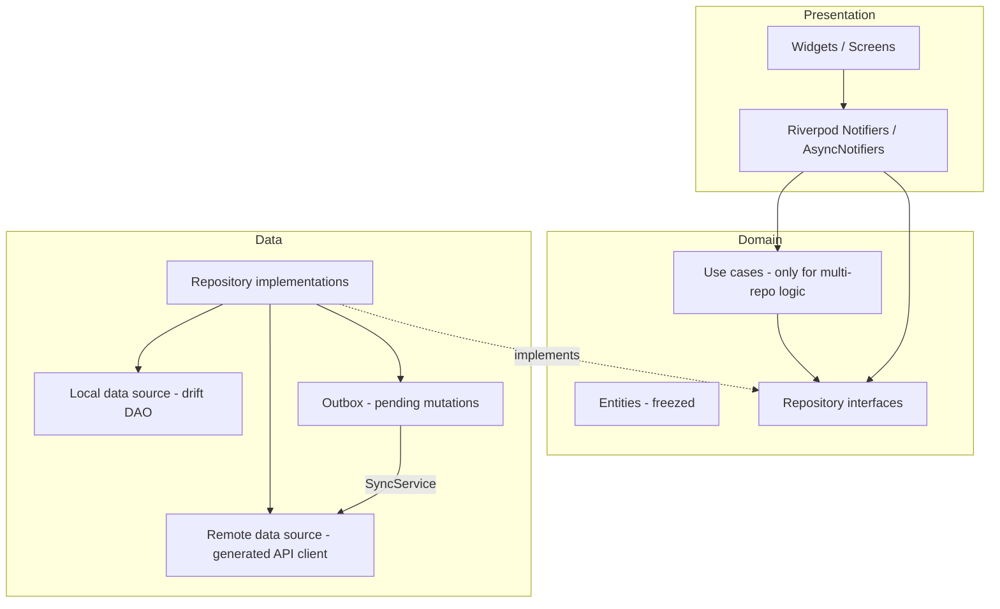

# ARCHITECTURE

| Field | Value |
|---|---|
| Status | Draft v0.1 |
| Owner | Technical Architect |
| Last updated | 2026-10-29 |
| Related | [DECISIONS](../05-ai-development/DECISIONS.md), [MODULE_DESIGN](MODULE_DESIGN.md), [DATA_DESIGN](DATA_DESIGN.md), [API_SPECIFICATION](API_SPECIFICATION.md), [MOBILE_STRATEGY](MOBILE_STRATEGY.md), [AUTH_SECURITY](AUTH_SECURITY.md) |

## 1. Purpose
High-level architecture, technology stack and patterns for the Supply Biz mobile app, backend API and admin panel. **Source of truth for technical decisions is [DECISIONS](../05-ai-development/DECISIONS.md)**; this document describes the resulting architecture.

## 2. Architectural Drivers
| Driver | Source | Architectural response |
|---|---|---|
| One app, two roles | A-02, ADR-002 | Role-scoped navigation shells; role-scoped API namespaces |
| Daily subscription correctness | FR-074, R-07 | Idempotent scheduled job with DB uniqueness constraints |
| Offline vendor operations | NFR-007 | Local encrypted DB + outbox with idempotency keys |
| Financial integrity | FR-116, RULE-09 | Append-only ledger; transactional writes; audit log |
| KYC/PII sensitivity | NFR-008/009 | Encrypted local filesystem, field-level encryption, masked Aadhaar, least privilege |
| Low-end devices | C-04 | Flutter AOT, image caching/compression, lean dependencies |
| Unknown cloud & scale | Q-02, Q-27 | Native processes, PostgreSQL/PostGIS and persistent local file storage |

## 3. Technology Stack
Versions are pinned at milestone M0 (see [ENVIRONMENT_SETUP](../06-development/ENVIRONMENT_SETUP.md)); below are the target majors.

| Layer | Choice | Notes |
|---|---|---|
| Mobile | Flutter (stable, pinned via FVM), Dart 3 | ADR-001 |
| State management | Riverpod 2 (`riverpod_generator`) | ADR-005 |
| Navigation | go_router (typed routes, `StatefulShellRoute`) | ADR-005 |
| HTTP | dio + generated OpenAPI client (`packages/api_client`) | ADR-013 |
| Models | freezed + json_serializable | — |
| Local DB | drift (SQLite) with SQLCipher | ADR-006 |
| Secure storage | flutter_secure_storage (Keychain / Android Keystore) | — |
| i18n | flutter_localizations + intl, English ARB | ADR-023 |
| Push / diagnostics / config | Existing Firebase Messaging/basic Crashlytics; basic API config | ADR-024; advanced telemetry deferred |
| Reports | SQL-derived summaries/tables + CSV; reuse existing shared UI | Chart polish deferred SR-04; no new chart pipeline |
| Media | image_picker, file_picker, flutter_image_compress | — |
| Location | Address/pincode/numeric coordinates; optional device GPS (existing geolocator) | SR-04; no maps/places provider |
| Backend | Node.js (Active LTS), NestJS, TypeScript strict | ADR-004 |
| ORM / DB | Prisma, PostgreSQL 16 + PostGIS | ADR-004 |
| Jobs / abuse controls | PostgreSQL tables + existing NestJS worker/timer | ADR-023 |
| File storage | Local persistent server directories; authenticated API upload/read | ADR-023; LOCAL_FILE_STORAGE |
| Admin panel | Next.js (App Router), TypeScript, TanStack Query, shadcn/ui, generated TS client | ADR-012 |
| API contract | OpenAPI 3.1 (`contracts/openapi.yaml`), generated from NestJS decorators and checked into repo | ADR-013 |
| Observability (server) | pino JSON logs/request IDs, basic health/job/disk/backup alerts, existing basic crash diagnostics; advanced exporters/trace infrastructure deferred | QUALITY_OBSERVABILITY |
| CI/CD | GitHub Actions, existing build scripts | A-14 |
| Infrastructure | One application host with supervised native API/admin/worker processes; PostgreSQL/PostGIS; persistent encrypted file volume (host Q-02) | ADR-023/ADR-024 |

## 4. System Context

## 5. Runtime View

API, admin and worker run as supervised native processes. Keep current module boundaries and existing worker entry point; do not add a broker or a generic job framework. Files are outside source/build directories and outside the web root. See [LOCAL_FILE_STORAGE](LOCAL_FILE_STORAGE.md).

## 6. Mobile Architecture
Feature-first, layered (presentation → domain → data), unidirectional data flow.

Rules:
- Widgets never call data sources directly; Notifiers depend on repository interfaces (DI via Riverpod providers).
- Read strategy: **stale-while-revalidate** for cacheable lists (emit local → fetch → upsert → emit).
- Vendor offline writes go to the **outbox** (see [MOBILE_STRATEGY §6](MOBILE_STRATEGY.md#6-offline-support--sync)).
- Role shells: `VendorShell` and `CustomerShell` as separate `StatefulShellRoute`s; shared `common` features.

## 7. Backend Architecture
Modular monolith (NestJS modules per bounded context, see [MODULE_DESIGN](MODULE_DESIGN.md)). Each module: `controller → service → repository (Prisma)`; cross-module calls via exported services or domain events (in-process existing events + PostgreSQL outbox polling for async side effects).

Key patterns:
- **Transactional outbox (server)**: domain events written in the same DB transaction (`outbox_events` table) and dispatched by the worker → guarantees notifications/ledger side effects are not lost.
- **Idempotency**: `Idempotency-Key` header stored in `idempotency_keys` (24 h) for all non-GET mobile mutations.
- **Optimistic concurrency**: `version` column on orders, subscriptions, products; `If-Match` / `version` in body → `409 VERSION_CONFLICT`.
- **Ledger**: append-only `ledger_entries`; balances via materialized `ledger_balances` updated in the same transaction.
- **Plan gating**: `@RequiresPlanFeature('SUBSCRIPTIONS')` guard.
- **Geo**: PostGIS `geography(Point)` for shops/addresses; service area via `ST_DWithin` + pincode list.

## 8. Subscription Generation (FR-074)
At 22:00 IST the worker checks `job_runs` for the next delivery date, acquires a PostgreSQL advisory lock, and creates eligible orders in bounded transactions. Enforce uniqueness on `(subscription_id, delivery_date)` and `(job_type, business_date, scope_id)`; a retry must not duplicate orders, ledger entries or notifications. Preserve the 21:00 IST cutoff.

Persist attempts, next retry time, completion counts and last error. Claim outbox rows with `FOR UPDATE SKIP LOCKED`, lease expiry and bounded retries; after a crash another poll reclaims expired work. Use unique event/delivery keys for at-least-once dispatch. On startup scan for incomplete due jobs and catch up; alert if generation is incomplete by 22:30 IST. Do not rely on a timer alone for durable scheduling.

## 9. Deployment View
One India-hosted application server runs native API/admin/worker processes behind HTTPS. PostgreSQL/PostGIS may be local or managed; both choices must meet approved backup targets. Use persistent encrypted file directories, with encrypted backups on a separate disk/host. Keep dev/staging/prod database, directories, keys and credentials separate. Do not add autoscaling, a CDN or orchestration before the integrated flows work. Hosting choice and capacity remain Q-02/Q-27; restore evidence is required for release.

## 10. Cross-Cutting Concerns
| Concern | Where |
|---|---|
| AuthN/AuthZ, encryption, privacy | [AUTH_SECURITY](AUTH_SECURITY.md) |
| Lifecycle, navigation, offline, push, deep links | [MOBILE_STRATEGY](MOBILE_STRATEGY.md) |
| Errors, logging, analytics, monitoring | [QUALITY_OBSERVABILITY](QUALITY_OBSERVABILITY.md) |
| Data model | [DATA_DESIGN](DATA_DESIGN.md) |
| Contracts | [API_SPECIFICATION](API_SPECIFICATION.md) |

## 11. Risks & Future Improvements
- Extract worker-heavy contexts (notifications, reports) into separate services if load requires.
- Live tracking (F-D3) would add WebSocket/MQTT gateway + background location on delivery devices.
- Read replicas for reports once data volume grows.
- Active hosting/capacity: Q-02/Q-27. Speech/OCR/maps/provider automation are post-delivery (ADR-024).

## 12. Approved reduced scope and platform sequence
ADR-024/DELIVERY_SCOPE exclude deferred modules/providers from active dependencies. Manual KYC and audited admin plan grants are implemented business workflows; no synthetic provider success or payment receipt. Reports use SQL-derived tables/CSV, location uses forms/coordinates/GPS, and product analytics/attestation/pinning/multi-zone automation remain deferred. Existing source/configuration is reconciled only during authorized implementation.

ADR-025: Android is the sole mobile build/run/test/release target now. Preserve iOS source/configuration; iOS toolchain/build/signing/APNs/Universal Links/VoiceOver/device/E2E validation is T-185 after Android production release, outside current module gates.
