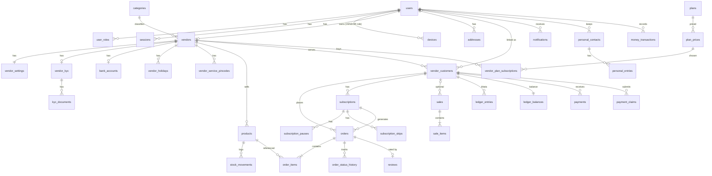

# DATA DESIGN

| Field | Value |
|---|---|
| Status | Draft v0.1 |
| Owner | Technical Architect |
| Last updated | 2026-10-29 |
| Related | [MODULE_DESIGN](MODULE_DESIGN.md), [API_SPECIFICATION](API_SPECIFICATION.md), [AUTH_SECURITY](AUTH_SECURITY.md) |

## 1. Conventions
| Topic | Rule |
|---|---|
| Keys | `id UUID v7` (time-ordered) primary keys; human-readable numbers where needed (`order_no`) |
| Money | `BIGINT` paise, column suffix `_paise` (ADR-009) |
| Quantities | `INTEGER` packs (A-07); pack size in product (`unit_value`, `unit_type`) |
| Time | `TIMESTAMPTZ` UTC (`created_at`, `updated_at`); business dates as `DATE` in IST (`delivery_date`) |
| Soft delete | `deleted_at TIMESTAMPTZ NULL` on user-managed entities (products, customers, addresses) |
| Concurrency | `version INTEGER` on mutable aggregates (orders, subscriptions, products, vendor_settings) |
| Enums | PostgreSQL enums via Prisma |
| Geo | `geography(Point,4326)` (PostGIS) |
| PII encryption | Field-level AES-256-GCM (envelope via KMS) for `vendor_kyc.account_number_enc`, `vendor_kyc.pan_enc`; plus last-4 columns for display |
| Naming | snake_case tables/columns, plural table names |

## 2. ER Diagram (core)

## 3. Tables

### 3.1 Identity
| Table | Key columns | Constraints / indexes |
|---|---|---|
| `users` | id, mobile (E.164), name, email, photo_media_id, language (`en` only), active_role, status (ACTIVE/BLOCKED/DELETED), created_at | `UNIQUE(mobile) WHERE status <> 'DELETED'` |
| `user_roles` | user_id, role (CUSTOMER/VENDOR) | PK(user_id, role) |
| `consents` | user_id, doc_type (TERMS/PRIVACY), doc_version, accepted_at, ip | index(user_id) |
| `sessions` | id, user_id, refresh_token_hash, family_id, device_id, expires_at, revoked_at, last_used_at | index(user_id), index(family_id) |
| `devices` | id, user_id, platform, app_version, os_version, push_token, push_enabled, last_seen_at | UNIQUE(push_token) |
| `user_preferences` | user_id, notification_prefs JSONB, … | PK(user_id) |
| `admin_users` | id, email, password_hash (argon2id), totp_secret_enc (AES-256-GCM), role, status, last_login_at, failed_attempts, locked_until, last_totp_step | UNIQUE(email) |

| `admin_auth_challenges` | token_hash, admin_id, secret_enc, enrolling, expires_at | T-150: five-minute challenge; encrypted pending enrolment, consumed atomically |
| `admin_sessions` | token_hash, admin_id, csrf_hash, created_at, last_used_at, expires_at | T-150: hashed credentials; index(admin_id), index(expires_at); 30 min idle / 8 h absolute |
| `admin_auth_events` | id, admin_id nullable, action, at | T-150 auth-only append-only events; trigger rejects update/delete; general viewer remains T-152 |

### 3.2 Vendor
| Table | Key columns | Notes |
|---|---|---|
| `vendors` | id, user_id, category_id, business_name, gstin, address_line, city, state, pincode, location geography, shop_photo_media_id, onboarding_step, kyc_status, is_suspended, rating_avg, rating_count, badges TEXT[], upi_vpa | UNIQUE(user_id); GIST(location); index(kyc_status) |
| `vendor_settings` | vendor_id, service_radius_km (1–20), delivery_charge_paise, min_order_paise, time_slots JSONB, same_day_cutoff TIME, auto_accept_subscriptions, accepting_today, delivery_paused, delivery_paused_until, max_daily_orders, daily_milk_capacity_ml, low_stock_threshold, allow_khata_orders, version | PK(vendor_id) |
| `vendor_service_pincodes` | vendor_id, pincode | PK(vendor_id, pincode) |

T-155 adds `vendors.badges TEXT[] NOT NULL DEFAULT '{}'` (at most 10 display
labels), retaining existing suspension/KYC/plan states. `management_requests`
stores permanent admin-scoped request hash/path/result with append-only/no-truncate
triggers. Status/badge write, safe audit snapshot and replay record share one
transaction. Customer block uses the session advisory user lock and revokes
sessions/clears push tokens atomically; vendor mutations take that lock before
the vendor row. Deleted accounts and stale record versions cannot be overwritten.
| `vendor_holidays` | id, vendor_id, date, reason | UNIQUE(vendor_id, date) |
| `vendor_kyc` | id, vendor_id, status, verification_method, provider_checks, aadhaar_front_media_id, aadhaar_back_media_id, pan_media_id, pan_enc, pan_last4, account_number_enc, account_last4, holder_name, bank_name, ifsc, upi_id, reviewer_id, reviewed_at, reason, submitted_at | T-022 revision PK(id); one pending revision/vendor; documents reference private media; closed revisions immutable |
| `kyc_notices` | id, user_id, submission_id, status, reason, created_at | Unique submission_id; durable owned decision notice; immutable |
| `categories` | id, code, name_en, name_hi, icon, type (SUPPLY/BILL), status (ENABLED/COMING_SOON/HIDDEN), sort_order, product_types JSONB | UNIQUE(code) |

T-021 implements the vendor profile/settings foundation only. Category-only drafts have
nullable business fields and next `onboarding_step=2`; a validated business save sets 3.
`latitude`/`longitude` generate stored PostGIS `location` (SRID 4326, longitude first),
with coordinate bounds, GIST location and KYC-status indexes. Profiles are unique per user;
category, owner, photo and settings references use restrictive foreign keys. Rating fields
remain deferred. KYC/bank/UPI/service-area tables and subsequent settings edits belong to
their owning tasks. Initial charges/minimum are zero, slots empty, automatic acceptance,
accepting-today, delivery pause and Khata permission false; version 1; stock threshold 10
per FR-035's documented default. Radius/cutoff/caps/pause-until remain unconfigured (null),
so onboarding does not invent delivery capacity, timing, plan or visibility policy.
T-023 supersedes the unconfigured-radius baseline: its additive migration initializes
null radii to FR-018's 3 km default and defaults future settings to 3 km. A subsequent
explicit pincode-only save may set radius null; at least one coverage method is required
by the service. `vendor_service_pincodes` has a restrictive vendor foreign key, composite
primary key and six-digit pincode check. Radius/list/version and idempotent replay commit
together. This source/migration remains provisional until T-023 verification completes.

### 3.3 Catalog
| Table | Key columns | Notes |
|---|---|---|
| `products` | id, vendor_id, name, product_type, milk_type, unit_value, unit_type (ML/L/G/KG/PCS), selling_price_paise, subscription_price_paise, stock_qty, moq, description, image_media_id, is_active, deleted_at, version | index(vendor_id, is_active); CHECK(subscription_price_paise ≤ selling_price_paise) |
| `stock_movements` | id, product_id, delta, reason (OPENING/ORDER/SALE/ADJUST/REVERSAL), note, ref_id, created_by, created_at | append-only; DB rejects UPDATE/DELETE |
| `product_subscription_links` | subscription_id, product_id, status | T-026 deletion guard; T-072 maintains within each subscription transaction; ACTIVE/PAUSED blocks deletion |

T-026 catalog money is int32 paise (positive selling price, nullable nonnegative
subscription price ≤ selling price); stock/MOQ are bounded integer packs and
unit_value is decimal(12,3). Product image/owner references use restrictive FKs.
Opening stock, adjustments, product version and STOCK_LOW events commit atomically.
The low-stock threshold is fixed at 10 packs (Q-34 resolved 2026-11-10); there is no
threshold configuration endpoint. Subscription references lock the product row and
reject new references to deleted products; changing a reference's product is denied.
T-072 owns the full subscription model and must maintain this guard, and
T-049/T-079/T-071 must call CatalogService.changeStock in their authorized financial
transactions. T-041/T-045/T-079 must enforce active selection as well as their own
visibility/coverage/entitlement rules. These hooks do not supply module integration
evidence before those tasks exist. T-032 consumes STOCK_LOW, checks real
STOCK_ALERTS entitlements and deduplicates by event ID; until that consumer exists,
dispatcher attempts fail explicitly as WORKER_HANDLER_MISSING, never as delivery.

### 3.4 Customers & addresses

T-041 adds the documented `favorites` and `vendor_holidays` tables and the `orders`
storage foundation for discovery reads. Orders add nullable `completed_at`
(TIMESTAMPTZ) indexed with vendor ID: DELIVERED requires completion time and other
states require null. Popular counts completions in the rolling interval
`[database asOf - 30 days, asOf]`; creation time never determines popularity.
The SQL migration retains zero-discount/integer-paise constraints and the partial
subscription/date unique index. T-045/T-049 must implement actual order/delivery
writes and their financial effects against this foundation; T-074 owns holiday
writes. T-041 adds no order/holiday mutation endpoint and supplies no evidence of
those downstream flows. No synthetic production completion source is introduced.
| Table | Key columns | Notes |
|---|---|---|
| `vendor_customers` | id, vendor_id, user_id NULL, name, mobile (+91 normalized), email, address_text, preferred_payment, status (ACTIVE/INACTIVE), deleted_at, created_at, updated_at | UNIQUE(vendor_id, mobile) WHERE deleted_at IS NULL; UNIQUE(vendor_id,user_id) for live linked records; index(user_id), index(mobile). T-040 adds address references when available. |
| `customer_link_decisions` | vendor_customer_id, user_id, decision (ACCEPTED/DECLINED), decided_at | Composite PK; pending prompts derived from verified mobile match minus decisions; user_id on vendor_customers changes only after acceptance. Link status is derived from user_id, not independently writable. |
| `customer_subscription_links` | subscription_id, vendor_customer_id, status | T-072 maintains atomically; ACTIVE/PAUSED feeds SUBSCRIPTION filter, not fabricated activity. |
| `addresses` | id, user_id, label, line1, line2, landmark, city, state, pincode, latitude, longitude, location geography, is_default, deleted_at, created_at, updated_at | T-040: validated numeric coordinates; geography generated from lon/lat with GIST index. Partial unique live-default index; per-user transaction lock ensures exactly one default for nonempty live collections. Soft delete clears default and promotes oldest remaining address. User FK RESTRICT retains history. |
| `favorites` | user_id, vendor_id | PK |

T-028 adds nullable `vendors.assigned_customer_limit`: null means never assigned
and applies ADR-028's 50-active-customer allowance. T-084/T-103 write a catalog
limit under the same vendor-row lock in the audited assignment transaction. No
client can set it; no plan is automatically assigned. Assigned caps remain
100/250/500/1000. Never clear this field on expiry: ADR-029 forbids a fallback to
the pre-assignment allowance and blocks additions/reactivations until renewal.
An over-limit downgrade preserves all customer rows, applies the new cap/features
and restricts additions/reactivations until below the new cap; no automatic pruning.
Every customer creator/reactivator must call the capacity lock/count hook within
its write transaction. Accepting an existing offline row does not add an active
customer or consume another slot. Deactivation preserves all future history.

`vendor_customers` is the **link entity** for all vendor-side relations (orders, subscriptions, ledger). A customer-app order auto-creates/links a `vendor_customers` row (counts toward plan limit — RULE-12; if limit reached, order is rejected with `VENDOR_UNAVAILABLE`, vendor notified to upgrade).

### 3.5 Orders, subscriptions, sales
| Table | Key columns | Notes |
|---|---|---|
| `orders` | id, order_no, vendor_id, vendor_customer_id, source (APP/SUBSCRIPTION/VENDOR), subscription_id NULL, status, delivery_date DATE, time_slot, address_snapshot JSONB, subtotal_paise, delivery_charge_paise, discount_paise, total_paise, payment_mode (POD_CASH/POD_UPI/KHATA), payment_status (UNPAID/PAID), reject_reason, cancel_reason, fail_reason, version, created_at | UNIQUE(order_no); **UNIQUE(subscription_id, delivery_date) WHERE subscription_id IS NOT NULL**; index(vendor_id, delivery_date, status); index(vendor_customer_id, created_at) |
| `order_items` | id, order_id, product_id, product_name_snapshot, unit_snapshot, unit_price_paise, qty, line_total_paise | |
| `order_status_history` | id, order_id, from_status, to_status, actor_type, actor_id, reason, at | append-only |
| `subscriptions` | id, vendor_id, vendor_customer_id, product_id, qty, weekdays SMALLINT (bitmask Mon=1…Sun=64), start_date, end_date NULL, time_slot, address_snapshot JSONB, payment_method, status, created_by (VENDOR/CUSTOMER), version | index(vendor_id, status) |
| `subscription_pauses` | id, subscription_id, from_date, to_date NULL | |
| `subscription_skips` | subscription_id, date | PK(subscription_id, date) |
| `sales` | id, sale_no, vendor_id, vendor_customer_id NULL, total_paise, paid_paise, balance_paise, payment_method, client_created_at, created_at | CHECK(vendor_customer_id IS NOT NULL OR balance_paise = 0) (RULE-11) |
| `sale_items` | id, sale_id, product_id, name_snapshot, qty, rate_paise, amount_paise | |
| `job_runs` | id, job, run_date, status, counts JSONB, error, started_at, finished_at | UNIQUE(job, run_date) |

### 3.6 Ledger & payments
| Table | Key columns | Notes |
|---|---|---|
| `ledger_entries` | id, vendor_id, vendor_customer_id, type (DEBIT/CREDIT), amount_paise BIGINT (>0), ref_type (ORDER/SALE/PAYMENT/CLAIM/OPENING/REVERSAL), ref_id, reverses_entry_id NULL UNIQUE, request_key NULL UNIQUE, request_hash NULL, note, entry_date DATE, created_by, created_at | Append-only; source UNIQUE(ref_type,ref_id,type); opening/reversal keys/hashes persist with entries rather than expiring cache. No UPDATE/DELETE/TRUNCATE runtime grants. |
| `ledger_balances` | vendor_customer_id, total_debit_paise, total_credit_paise, due_paise, updated_at | updated in same transaction as entry insert |
| `ledger_reconciliation_findings` | id, business_date, vendor_customer_id, expected JSONB, observed JSONB NULL, created_at | Immutable drift evidence; UNIQUE(business_date,vendor_customer_id); alert without silent repair. |
| `payments` | id, vendor_id, vendor_customer_id, amount_paise, method (CASH/UPI/BANK/WALLET), received_on, note, client_ref, created_at | |
| `payment_claims` | id, vendor_customer_id, amount_paise, method (UPI/CASH), upi_txn_ref NULL, status (PENDING/CONFIRMED/REJECTED), decided_by, decided_at, reject_reason | |

### 3.7 Customer personal finance
| Table | Key columns |
|---|---|
| `personal_contacts` | id, user_id, name, mobile NULL, deleted_at |
| `personal_entries` | id, contact_id, direction (GAVE/GOT), amount_paise, date, note, deleted_at |
| `money_transactions` | id, user_id, kind (INCOME/EXPENSE), category, amount_paise, date, note, source (MANUAL/AUTO), deleted_at |

### 3.8 Plans
| Table | Key columns | Notes |
|---|---|---|
| `plans` | id, code (BASIC/STANDARD/BUSINESS/PREMIUM), name, customer_limit, features TEXT[], is_popular, status | |
| `plan_prices` | id, plan_id, duration (MONTHLY/HALF_YEARLY/YEARLY), price_paise, store_product_id NULL | |
| `vendor_plan_assignments` | id, vendor_id, plan_id, starts_at, ends_at, reason, granted_by_admin, audit_id UNIQUE, superseded_at NULL, created_at | Active manual-assignment foundation (T-084); FK to vendor/catalog/admin/audit; one non-superseded row per vendor; end strictly after start. T-103 owns permission/reason/idempotency/extension writes under the vendor lock with the limit projection and audit in one transaction. |
| `plan_assignment_requests` | request_key SHA-256 PK, admin_id FK, path, request_hash, response JSONB, created_at | T-103 permanent actor-scoped grant/extension replay. Append-only/no-truncate triggers; committed with the assignment/audit/cap/jobs, independent of short-lived HTTP caches. |

T-156 reuses this replay identity for catalog writes (`catalog/{planId}` path),
committed with catalog/prices and PLAN_CATALOG_UPDATE before/after audit. Existing
catalog timestamps provide stale-edit detection; no additional migration is needed.
| `vendor_plan_subscriptions` | id, vendor_id, plan_price_id, status (PENDING_PAYMENT/ACTIVE/EXPIRED/CANCELLED), starts_at, ends_at, provider, provider_ref, granted_by_admin NULL | index(vendor_id, status) |
| `plan_payments` | id, vendor_plan_subscription_id, amount_paise, provider, provider_payment_id, status, raw_webhook JSONB (redacted), invoice_no | UNIQUE(provider, provider_payment_id) |

The provider subscription/payment tables above remain post-delivery SR-03 design,
not the active manual-assignment source. T-084 reads assignment validity using DB
time after the vendor lock; a matching ADMIN/PLAN_ASSIGNED/VENDOR audit is required.
The approved ADR-029 tier allowlist and fixed caps are enforced independently of
client values or stale catalog feature strings. Expiry preserves the projection;
assignment history prevents a return to setup access even if no current row exists.

T-103 extensions create a new assignment and supersede the old row; old validity,
reason and audit are retained. Reminder outbox events/job_runs are created in the
same assignment transaction at end minus 7/3/1 days and at expiry, scoped by
assignment ID/stage with IST business dates. Stages already before grant/start
are omitted; worker catch-up suppresses obsolete/superseded stages. Inbox sources
deduplicate by assignment/stage; normal notification preferences/push rules apply.

### 3.9 Engagement, content, platform
| Table | Key columns |
|---|---|
| `reviews` | id, order_id UNIQUE, vendor_id, user_id, rating 1–5, text, status (PUBLISHED/HIDDEN), created_at |
| `notifications` | id, user_id, role, category, type, source_key UNIQUE, title, body, data JSONB (internal path), mandatory, read_at, cleared_at, created_at (TTL 90 d) |
| `notification_pushes` | id, notification_id, device_id, token_hash, status (PENDING/SENT/SKIPPED/INVALID), event_id UNIQUE, sent_at | Unique(notification_id,device_id); outbox leases/retries; no raw token snapshot |
| `banners`, `faqs`, `legal_documents` (type, version, locale, body_md, effective_at), `app_config` (key, value JSONB, updated_at) | T-017 public `mobile` value: minVersionAndroid and boolean flags; admin writes/audit follow T-158/T-152 |
| `coupons` | TBD (Q-06) |
| `bill_payments` | TBD (Q-07) |
| `referrals` | id, referrer_user_id, code UNIQUE, referred_user_id, status (TBD Q-14) |
| `media_access_events` | id, media_id, admin_user_id, action (KYC_DOCUMENT_READ), created_at; append-only access evidence for T-152 viewer |
| `media_files` | id, owner_user_id, purpose (PRODUCT_IMAGE/SHOP_PHOTO/PROFILE/KYC_DOC), relative_storage_key, mime, size, sha256, status (READY), request_key/hash, created_at |
| `audit_logs` | id, actor_type (USER/ADMIN/SYSTEM), actor_id, action, entity, entity_id, before JSONB, after JSONB (PII redacted), ip, at — append-only |
| `outbox_events`, `idempotency_keys` (key, user_id, request_hash, response JSONB, expires_at), `data_requests` | |

T-152 adds `(at,id)` indexing and database rejection of audit UPDATE/DELETE/TRUNCATE. Current admin-account writes project only role/status, failure count, lock/login times and TOTP-enrolled boolean; credentials/contact fields are excluded. Auth events and private-media access events mirror into audit atomically and backfill historical actor/time without invented IP/snapshots. Transaction-local authenticated actor/socket-IP context does not leak through pooled connections; context-free operator account changes are SYSTEM. Later business modules add their atomic audit writes/redacted contracts when implemented. Retention/purge remains undecided under Q-20.

## 4. Derived Values
| Value | Computation |
|---|---|
| Vendor rating | avg(reviews.rating where PUBLISHED); stored on vendors, updated on review change |
| Due (Khata) | `ledger_balances.due_paise = total_debit − total_credit` |
| Dashboard metrics | SQL aggregates on orders/sales by `delivery_date`/`created_at` in IST; queried directly from PostgreSQL initially |
| Milk stock (L) | Σ(stock_qty × unit in litres) for active products with product_type = MILK |

## 5. Mobile Local Database (drift + SQLCipher)
| Table | Purpose | Role |
|---|---|---|
| `cached_orders`, `cached_order_items` | Orders/deliveries for ±7 days | Vendor, Customer |
| `cached_products` | Vendor catalog | Vendor |
| `cached_customers`, `cached_ledger_balances`, `cached_ledger_entries` (last 90 d) | Khata offline | Vendor |
| `cached_dashboard` | Last metrics JSON + fetched_at | Vendor |
| `outbox` | id, type, payload JSON, idempotency_key, created_at, attempts, last_error, status (PENDING/SENDING/FAILED/DONE) | Vendor |
| `cart_items` | Local cart | Customer |
| `personal_entries`, `money_transactions` | Cache + optimistic writes | Customer |
| `kv` | small key-values (last role, recent searches) | Both |
DB is wiped on logout and on role switch only for that role's caches.

## 6. Data Lifecycle & Retention (proposed, Q-20)
| Data | Retention |
|---|---|
| KYC documents | Until vendor account deleted + legal period TBD; access-logged |
| Ledger, orders, sales, plan payments | Retained per financial record-keeping law (period TBD); anonymized on account deletion |
| Notifications | 90 days |
| Idempotency keys | 24 hours |
| OTP | PostgreSQL digest/expiry rows, 5 min |
| Audit logs | TBD (proposed ≥ 3 years) |
| Analytics | Firebase default retention configured to 14 months |

## 7. Migrations & Seed
- Prisma Migrate; every migration reviewed; destructive changes use expand → migrate → contract across two releases.
- Seed (`prisma/seed.ts`): categories (English), plans & prices from BRD §5, FAQs placeholder, demo vendor/customer for dev only.

## 8. ADR-023 baseline reconciliation (T-180/T-181/T-182)
Target tables below require reviewed migrations during implementation; they are not yet claims about schema.prisma. Keep financial rows/unique constraints and existing idempotency/outbox data intact.

| State | Minimum durable representation and integrity |
|---|---|
| OTP challenges | Opaque ID, purpose-separated mobile hash, salt/HMAC digest, revision, PENDING/ACTIVE/CONSUMED state, expiry, attempts and exhaustion state; never plaintext OTP/PII keys |
| Rate-limit state | Hashed mobile/IP/device + rule/window identity, send timestamps or rolling-window events, cooldown/lockout deadlines, unique keys; transaction/row or advisory lock serializes checks and increments |
| Scheduled jobs | job type, business date, scope ID with unique key; status, attempt count, next attempt, lease expiry, completion counts and sanitized error; restart catch-up uses persisted state |
| Outbox delivery | Existing event ID/payload plus claim lease, next-attempt time and bounded retries; row claim with SKIP LOCKED, unique delivery/event effect keys for replay |
| Media | Owner and tenant/resource linkage, generated relative storage key, purpose, validated MIME/bytes/hash, quarantine/READY/rejected state; root path remains environment config |

Use DB time for TTL/limits, expire consumed OTP state safely, and index due-job/outbox scans. Cleanup is bounded; it must not erase rate-limit budgets early or mutate financial history. Use rolling-window semantics to preserve existing OTP limits. Claim/verify must be atomic across processes; fail closed if durable state is unavailable. Media metadata/file commit failures need compensation and orphan cleanup as described in LOCAL_FILE_STORAGE.

T-180 implements OTP/abuse state in `auth_abuse_state(key varchar(100) PK, value jsonb, expires_at timestamptz)` with an expiry index. Purpose-prefixed HMAC keys identify mobile/IP/device budgets and challenges; HTTP route/IP tracker keys are purpose-hashed. Values contain only challenge digest/salt/revision/status/attempts, bounded rolling timestamps or lockout streak/deadline. Success deletes the challenge atomically; no consumed code can replay. Sorted transaction advisory locks serialize absent/existing keys; database time is read after locking. Expired rows are ignored immediately and removed in batches of up to 500 every minute. Migration `20261029090000_auth_abuse_state` is additive; reverting the app before dropping the table resets budgets and invalidates pending challenges. Native PostgreSQL migration/concurrency/client-reconnect/cleanup checks pass; manual API-process restart and G0 evidence remain pending in TASKS.

## 9. Approved active data scope (ADR-024)
Future-only tables for Money transactions, bill payments, referrals, coupons, reviews/rating aggregates and banner/broadcast campaigns are POST-DELIVERY; their earlier schema descriptions are reference only and need no active migrations or seeds. Preserve existing data/source until an implementation task safely reconciles it. Personal contacts/entries, financial ledgers, transactional notifications, privacy/audit records and categories remain active.

KYC stores manual reviewer/method/reason/time and distinguishes provider NOT_RUN from actual verified checks; approval grants business KYC status without faking PAN/bank API success. Vendor plan assignments store catalog tier, validity, reason, actor and audit with idempotent mutation behavior. A grant is not a plan payment; do not seed fabricated invoices/revenue. Existing entitlement history and limits stay consistent. Trial/expiry/downgrade behavior follows ADR-029 (Q-04 resolved); retain the A-04/RULE-13 visibility baseline. Q-18 is not a prerequisite for the Day-4 manual assignment service.

T-022 stores bank/PAN/document references together on a KYC revision so rejection and
resubmission preserve the exact reviewed data. Full Aadhaar numbers are not collected;
uploaders supply masked images under ADR-027. No successful provider results or bank
`verified_at` are fabricated. Development/test field encryption is AES-256-GCM with
FIELD_ENCRYPTION_KEY and vendor/field AAD. Production KMS envelope encryption remains
unimplemented; KYC mutations fail closed there. Replay input uses a canonical keyed digest;
responses contain only PAN/account last-4. Vendor status, review, audit and in-app notice
are transactional. Retention/deletion remains Q-20; this task invents no purge policy.
