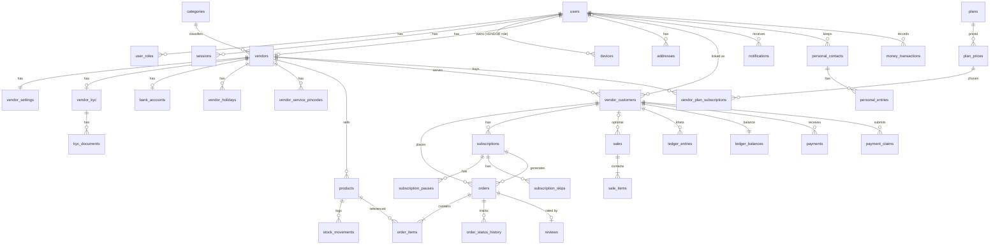

# DATA DESIGN

T-081 vendor Khata uses existing ledger/balance/source/request tables: no schema
change. Public opening/reversal plan checks and immutable append run in the same
transaction, reusing khata_requests for minimal permanent acknowledgements. A
recursive read resolves correction chains to their original source, so payments
and reversals have exact signed net totals without allocating payments to orders
or subscriptions. Opening credits remain distinct from received payment credits.

| Field | Value |
|---|---|
| Status | Draft v0.1 |
| Owner | Technical Architect |
| Last updated | 2026-10-29 |
| Related | [MODULE_DESIGN](MODULE_DESIGN.md), [API_SPECIFICATION](API_SPECIFICATION.md), [AUTH_SECURITY](AUTH_SECURITY.md) |

## 1. Conventions
| Topic | Rule |
|---|---|
| Keys | `id UUID v7` (time-ordered) primary keys; human-readable numbers where needed (`order_no`) |
| Money | `BIGINT` paise, column suffix `_paise` (ADR-009) |
| Quantities | `INTEGER` packs (A-07); pack size in product (`unit_value`, `unit_type`) |
| Time | `TIMESTAMPTZ` UTC (`created_at`, `updated_at`); business dates as `DATE` in IST (`delivery_date`) |
| Soft delete | `deleted_at TIMESTAMPTZ NULL` on user-managed entities (products, customers, addresses) |
| Concurrency | `version INTEGER` on mutable aggregates (orders, subscriptions, products, vendor_settings) |
| Enums | PostgreSQL enums via Prisma |
| Geo | `geography(Point,4326)` (PostGIS) |
| PII encryption | Field-level AES-256-GCM (envelope via KMS) for `vendor_kyc.account_number_enc`, `vendor_kyc.pan_enc`; plus last-4 columns for display |
| Naming | snake_case tables/columns, plural table names |

## 2. ER Diagram (core)

## 3. Tables

### 3.1 Identity
| Table | Key columns | Constraints / indexes |
|---|---|---|
| `users` | id, mobile (E.164), name, email, photo_media_id, language (`en` only), active_role, status (ACTIVE/BLOCKED/DELETED), created_at | `UNIQUE(mobile) WHERE status <> 'DELETED'` |
| `user_roles` | user_id, role (CUSTOMER/VENDOR) | PK(user_id, role) |
| `consents` | user_id, doc_type (TERMS/PRIVACY), doc_version, accepted_at, ip | index(user_id) |
| `sessions` | id, user_id, refresh_token_hash, family_id, device_id, expires_at, revoked_at, last_used_at | index(user_id), index(family_id) |
| `devices` | id, user_id, platform, app_version, os_version, push_token, push_enabled, last_seen_at | UNIQUE(push_token) |
| `user_preferences` | user_id, notification_prefs JSONB, … | PK(user_id) |
| `admin_users` | id, email, password_hash (argon2id), totp_secret_enc (AES-256-GCM), role, status, last_login_at, failed_attempts, locked_until, last_totp_step | UNIQUE(email) |

| `admin_auth_challenges` | token_hash, admin_id, secret_enc, enrolling, expires_at | T-150: five-minute challenge; encrypted pending enrolment, consumed atomically |
| `admin_sessions` | token_hash, admin_id, csrf_hash, created_at, last_used_at, expires_at | T-150: hashed credentials; index(admin_id), index(expires_at); 30 min idle / 8 h absolute |
| `admin_auth_events` | id, admin_id nullable, action, at | T-150 auth-only append-only events; trigger rejects update/delete; general viewer remains T-152 |

### 3.2 Vendor
| Table | Key columns | Notes |
|---|---|---|
| `vendors` | id, user_id, category_id, business_name, gstin, address_line, city, state, pincode, location geography, shop_photo_media_id, onboarding_step, kyc_status, is_suspended, rating_avg, rating_count, badges TEXT[], upi_vpa | UNIQUE(user_id); GIST(location); index(kyc_status) |
| `vendor_settings` | vendor_id, service_radius_km (1–20), delivery_charge_paise, min_order_paise, time_slots JSONB, same_day_cutoff TIME, auto_accept_subscriptions, accepting_today, delivery_paused, delivery_paused_until, max_daily_orders, daily_milk_capacity_ml, low_stock_threshold, allow_khata_orders, version | PK(vendor_id) |
| `vendor_service_pincodes` | vendor_id, pincode | PK(vendor_id, pincode) |

T-075 adds subscription_delivery_available (default true), paired nullable
subscription_delivery_start/end TIME(0) and pause_all_subscriptions (default false).
No legacy delivery hours are filled in. Pair/difference checks reject incomplete
or zero-length windows; existing positive-only order/milk cap constraints remain
authoritative. Litres are an API decimal string converted exactly to the existing
integer ml field. Global controls leave individual revisions/pauses/skips intact.
The shared vendor_settings version is checked on PATCH; actor/vendor locks,
before/after USER audit and 24-hour idempotency acknowledgement commit together.
No new request table, dependency or financial backfill. Migration
202611160003_subscription_settings was applied only to the isolated test DB;
retain additive columns on application rollback. T-073 must read current settings
under the vendor lock and pass them to candidate policy before inserting orders.

T-155 adds `vendors.badges TEXT[] NOT NULL DEFAULT '{}'` (at most 10 display
labels), retaining existing suspension/KYC/plan states. `management_requests`
stores permanent admin-scoped request hash/path/result with append-only/no-truncate
triggers. Status/badge write, safe audit snapshot and replay record share one
transaction. Customer block uses the session advisory user lock and revokes
sessions/clears push tokens atomically; vendor mutations take that lock before
the vendor row. Deleted accounts and stale record versions cannot be overwritten.
| `vendor_holidays` | id, vendor_id, date, reason | UNIQUE(vendor_id, date) |

T-074 writes vendor_holidays under actor/vendor locks: new reasons are trimmed
1–100 characters and dates use server IST today; only strictly future holidays
may be deleted. Existing wider reason storage remains unchanged. Availability
uses the existing shared vendor_settings.version, accepting_today, delivery_paused
and delivery_paused_until (open-ended writes clear the latter). Holidays and
pauses cancel only NEW/ACCEPTED/PREPARING affected orders with a version increment
and timeline; no stock, ledger, receipt/refund or historical balance rewrite.
OUT_FOR_DELIVERY, terminal and past orders remain intact, and deleting an
exclusion does not resurrect a cancelled order.

Migration 202611170001_vendor_operations adds vendor_operation_requests:
request_key VARCHAR(64) PK (actor/key SHA-256), user_id UUID, path VARCHAR(120),
request_hash VARCHAR(64), response JSONB, created_at TIMESTAMPTZ. It retains the
permanent original acknowledgement atomically with business/audit/inbox effects,
including delete replay, without a contact/request-body snapshot. It does not
change financial tables, grants or historical data. Applied only to the isolated
test DB; migrate the intended dev/staging DB before manual use and retain history
on application rollback. T-074 bounded pages remain one transaction, so a timeout
fails the full action rather than exposing a partial holiday/pause cancellation.
| `vendor_kyc` | id, vendor_id, status, verification_method, provider_checks, aadhaar_front_media_id, aadhaar_back_media_id, pan_media_id, pan_enc, pan_last4, account_number_enc, account_last4, holder_name, bank_name, ifsc, upi_id, reviewer_id, reviewed_at, reason, submitted_at | T-022 revision PK(id); one pending revision/vendor; documents reference private media; closed revisions immutable |
| `kyc_notices` | id, user_id, submission_id, status, reason, created_at | Unique submission_id; durable owned decision notice; immutable |
| `categories` | id, code, name_en, name_hi, icon, type (SUPPLY/BILL), status (ENABLED/COMING_SOON/HIDDEN), sort_order, product_types JSONB | UNIQUE(code) |

T-021 implements the vendor profile/settings foundation only. Category-only drafts have
nullable business fields and next `onboarding_step=2`; a validated business save sets 3.
`latitude`/`longitude` generate stored PostGIS `location` (SRID 4326, longitude first),
with coordinate bounds, GIST location and KYC-status indexes. Profiles are unique per user;
category, owner, photo and settings references use restrictive foreign keys. Rating fields
remain deferred. KYC/bank/UPI/service-area tables and subsequent settings edits belong to
their owning tasks. Initial charges/minimum are zero, slots empty, automatic acceptance,
accepting-today, delivery pause and Khata permission false; version 1; stock threshold 10
per FR-035's documented default. Radius/cutoff/caps/pause-until remain unconfigured (null),
so onboarding does not invent delivery capacity, timing, plan or visibility policy.
ADR-032 resolves Q-13: vendors own charge/minimum/slots/same-day cutoff settings;
same-day orders require explicit enablement and a configured cutoff. New customer
checkout accepts only POD_CASH/POD_UPI even if the legacy `allow_khata_orders`
column is true; do not expose a checkout-credit enablement control in this release.
Existing KHATA history and separate POS/subscription requirements remain intact.
T-023 supersedes the unconfigured-radius baseline: its additive migration initializes
null radii to FR-018's 3 km default and defaults future settings to 3 km. A subsequent
explicit pincode-only save may set radius null; at least one coverage method is required
by the service. `vendor_service_pincodes` has a restrictive vendor foreign key, composite
primary key and six-digit pincode check. Radius/list/version and idempotent replay commit
together. This source/migration remains provisional until T-023 verification completes.

### 3.3 Catalog
| Table | Key columns | Notes |
|---|---|---|
| `products` | id, vendor_id, name, product_type, milk_type, unit_value, unit_type (ML/L/G/KG/PCS), selling_price_paise, subscription_price_paise, stock_qty, moq, description, image_media_id, is_active, deleted_at, version | index(vendor_id, is_active); CHECK(subscription_price_paise ≤ selling_price_paise) |
| `stock_movements` | id, product_id, delta, reason (OPENING/ORDER/SALE/ADJUST/REVERSAL), note, ref_id, created_by, created_at | append-only; DB rejects UPDATE/DELETE |
| `product_subscription_links` | subscription_id, product_id, status | T-026 deletion guard; T-072 maintains within each subscription transaction; ACTIVE/PAUSED blocks deletion |

T-026 catalog money is int32 paise (positive selling price, nullable nonnegative
subscription price ≤ selling price); stock/MOQ are bounded integer packs and
unit_value is decimal(12,3). Product image/owner references use restrictive FKs.
Opening stock, adjustments, product version and STOCK_LOW events commit atomically.
The low-stock threshold is fixed at 10 packs (Q-34 resolved 2026-11-10); there is no
threshold configuration endpoint. Subscription references lock the product row and
reject new references to deleted products; changing a reference's product is denied.
T-072 owns the full subscription model and must maintain this guard, and
T-049/T-079/T-071 must call CatalogService.changeStock in their authorized financial
transactions. T-041/T-045/T-079 must enforce active selection as well as their own
visibility/coverage/entitlement rules. These hooks do not supply module integration
evidence before those tasks exist. T-032 consumes STOCK_LOW, checks real
STOCK_ALERTS entitlements and deduplicates by event ID; until that consumer exists,
dispatcher attempts fail explicitly as WORKER_HANDLER_MISSING, never as delivery.

### 3.4 Customers & addresses

T-041 adds the documented `favorites` and `vendor_holidays` tables and the `orders`
storage foundation for discovery reads. Orders add nullable `completed_at`
(TIMESTAMPTZ) indexed with vendor ID: DELIVERED requires completion time and other
states require null. Popular counts completions in the rolling interval
`[database asOf - 30 days, asOf]`; creation time never determines popularity.
The SQL migration retains zero-discount/integer-paise constraints and the partial
subscription/date unique index. T-045/T-049 must implement actual order/delivery
writes and their financial effects against this foundation; T-074 owns holiday
writes. T-041 adds no order/holiday mutation endpoint and supplies no evidence of
those downstream flows. No synthetic production completion source is introduced.
| Table | Key columns | Notes |
|---|---|---|
| `vendor_customers` | id, vendor_id, user_id NULL, name, mobile (+91 normalized), email, address_text, preferred_payment, status (ACTIVE/INACTIVE), deleted_at, created_at, updated_at | UNIQUE(vendor_id, mobile) WHERE deleted_at IS NULL; UNIQUE(vendor_id,user_id) for live linked records; index(user_id), index(mobile). T-040 adds address references when available. |
| `customer_link_decisions` | vendor_customer_id, user_id, decision (ACCEPTED/DECLINED), decided_at | Composite PK; pending prompts derived from verified mobile match minus decisions; user_id on vendor_customers changes only after acceptance. Link status is derived from user_id, not independently writable. |
| `customer_subscription_links` | subscription_id, vendor_customer_id, status | T-072 maintains atomically; ACTIVE/PAUSED feeds SUBSCRIPTION filter, not fabricated activity. |
| `addresses` | id, user_id, label, line1, line2, landmark, city, state, pincode, latitude, longitude, location geography, is_default, deleted_at, created_at, updated_at | T-040: validated numeric coordinates; geography generated from lon/lat with GIST index. Partial unique live-default index; per-user transaction lock ensures exactly one default for nonempty live collections. Soft delete clears default and promotes oldest remaining address. User FK RESTRICT retains history. |
| `favorites` | user_id, vendor_id | PK |

T-028 adds nullable `vendors.assigned_customer_limit`: null means never assigned
and applies ADR-028's 50-active-customer allowance. T-084/T-103 write a catalog
limit under the same vendor-row lock in the audited assignment transaction. No
client can set it; no plan is automatically assigned. Assigned caps remain
100/250/500/1000. Never clear this field on expiry: ADR-029 forbids a fallback to
the pre-assignment allowance and blocks additions/reactivations until renewal.
An over-limit downgrade preserves all customer rows, applies the new cap/features
and restricts additions/reactivations until below the new cap; no automatic pruning.
Every customer creator/reactivator must call the capacity lock/count hook within
its write transaction. Accepting an existing offline row does not add an active
customer or consume another slot. Deactivation preserves all future history.

`vendor_customers` is the **link entity** for all vendor-side relations (orders, subscriptions, ledger). A customer-app order auto-creates/links a `vendor_customers` row (counts toward plan limit — RULE-12; if limit reached, order is rejected with `VENDOR_UNAVAILABLE`, vendor notified to upgrade).

### 3.5 Orders, subscriptions, sales
| Table | Key columns | Notes |
|---|---|---|
| `orders` | id, order_no, vendor_id, vendor_customer_id, source (APP/SUBSCRIPTION/VENDOR), subscription_id NULL, status, delivery_date DATE, time_slot, address_snapshot JSONB, subtotal_paise, delivery_charge_paise, discount_paise, total_paise, payment_mode (POD_CASH/POD_UPI/KHATA), payment_status (UNPAID/PAID), reject_reason, cancel_reason, fail_reason, version, created_at | UNIQUE(order_no); **UNIQUE(subscription_id, delivery_date) WHERE subscription_id IS NOT NULL**; index(vendor_id, delivery_date, status); index(vendor_customer_id, created_at) |

T-045 adds `order_number_sequence` (initializes above existing numeric ORD suffixes),
`order_requests` (hashed actor/key PK, user FK, path/body hash, non-PII result JSON,
created_at) and `order_status_events` (order FK, status/reason/at, nullable
`client_created_at` for untrusted T-050 offline creation-time audit). Server `at`
and order completion/payment dates remain authoritative. Both history
tables reject UPDATE/DELETE/TRUNCATE. New `order_items.milk_quantity_ml` is exact
DECIMAL(30,3), snapshotted at placement for daily capacity; later catalog edits
do not change booked volume. Existing read-foundation volume uses stored unit
snapshots and product type; unknown historical timeline times are not invented.
Request/order/items/status/inbox/outbox commit together. Vendor locks precede
ordered product locks; future financial/order writers must preserve that order.
Checkout creates APP/NEW/UNPAID with POD_CASH/POD_UPI only (ADR-032); legacy KHATA
history remains readable. Migration applied only to the isolated local test DB;
manual verification and downstream writer integration remain pending.
| `order_items` | id, order_id, product_id, product_name_snapshot, unit_snapshot JSONB, unit_price_paise BIGINT, qty INTEGER, line_total_paise BIGINT | T-042 read foundation: restrictive order/product FKs, positive quantity, nonnegative price and exact price × quantity check; index(order_id,id). Home uses snapshot names/quantities, including inactive/deleted products. T-045 owns transactional item creation and order-total validation; no order writes added by T-042. |
| `order_status_history` | id, order_id, from_status, to_status, actor_type, actor_id, reason, at | append-only |
| `subscriptions` | id, vendor_id, vendor_customer_id, product_id, start_date, end_date NULL, address_snapshot JSONB, payment_method, created_by (VENDOR/CUSTOMER), creator_user_id, version, created_at | T-072 restrictive vendor/customer/product/user FKs; vendor/customer created_at indexes; immutable identity by API, optimistic version |
| `subscription_revisions` | subscription_id, version, effective_from DATE, qty, weekdays SMALLINT (bitmask Mon=1…Sun=64), time_slot, status, action, reason NULL, actor_id, created_at | PK(subscription_id,version); append-only; effective-date/version index; frozen dates retain prior configuration |
| `subscription_pauses` | id, subscription_id, from_date, to_date NULL, resumed_from NULL | Inclusive ranges; resumed_from limits future effect without erasing history |
| `subscription_skips` | subscription_id, date | PK(subscription_id, date) |
| `subscription_requests` | request_key (hashed actor/key), user_id, path, request_hash, response, created_at | Permanent append-only replay identity; response only id/version/status/effectiveFrom, no address snapshot |
| `sales` | id, sale_no, vendor_id, vendor_customer_id NULL, total_paise, paid_paise, balance_paise, payment_method, client_created_at, created_at | CHECK(vendor_customer_id IS NOT NULL OR balance_paise = 0) (RULE-11) |
| `sale_items` | id, sale_id, product_id, name_snapshot, qty, rate_paise, amount_paise | |

T-079 materializes these immutable POS sources in 202611170002_quick_sales.
sales also stores creator, explicit sale_date (server IST date after locks),
untrusted client_created_at, permanent unique actor/key hash and request_hash.
sale_items adds unit_value_snapshot/unit_type_snapshot and UNIQUE(sale_id,product_id).
T-100 migration 202611190001_report_volume_snapshots adds sale_items.milk_quantity_ml
NUMERIC(30,3) and milk_quantity_known, plus order_items.milk_quantity_known. New
POS/checkout/subscription-generation lines freeze trusted milk volume/classification
at source creation. Non-milk lines are known zero; milk sold in non-volume units is
unknown zero. Positive legacy order milk snapshots remain usable, while legacy zero
lines/POS rows default unknown. Reports disclose unknown lines without reclassifying
history from current catalog or updating immutable financial sources. Existing source
immutability/grants remain; no financial backfill. Milk totals sum frozen known
volumes, not today's prices/pack sizes. The additive defaulted fields can remain
through application rollback; do not drop history-bearing metadata as routine rollback.
Rates/totals/paid/balance are nonnegative BIGINT with paid<=total and balance=
total-paid; walk-ins require balance=0. Numeric line arithmetic and deferred
bill-sum checks (explicitly forced before stock/ledger posting) reject inconsistent snapshots, and insert guards enforce vendor/
customer/creator/product scope. Statement triggers prevent source/item UPDATE,
DELETE and TRUNCATE. Product/customer/user restrictive FKs preserve history, and
the SALE stock-source partial unique index prevents duplicate movement per SKU.

The sales.paid_paise record is the immutable POS receipt for CASH/UPI/OTHER.
Customer POS posts a gross SALE DEBIT and positive paid SALE CREDIT, both referring
to the sale UUID; walk-ins have no customer/ledger entry. Zero amounts skip ledger
posting. No duplicate `payments` receipt/CREDIT or synthetic walk-in customer is
created. Reports/customer consumers must include POS receipts as their own source
without summing the same cash twice. Sale/items, stock/outbox, ledger and audit
commit atomically; failed transactions retain no partial source/replay state.
Client audit time never changes financial posting/date. Retain tables/sequence/
history on application rollback; no historical backfill, dependency or ledger grant
change is supplied. Migration applied only to the isolated test database.
| `job_runs` | id, job, run_date, status, counts JSONB, error, started_at, finished_at | UNIQUE(job, run_date) |

T-072 adds the real subscription FK on orders; existing order/date uniqueness
remains. Scope checks bind customer and product to the same vendor. Reference
rows in customer_subscription_links/product_subscription_links are maintained
inside each mutation (PENDING_APPROVAL maps to PENDING). ACTIVE/PAUSED protects
product deletion and feeds the customer subscription filter. A cancellation after
cutoff conservatively retains ACTIVE references for frozen dates; T-073 must
advance those references after processing the frozen horizon, and retire ended
references. No generated order, receipt, stock movement or ledger debit is written
at subscription setup. T-073 consumes effective revisions plus pause/resume and
skip exclusions; only CREATE/EDIT/APPROVE/REJECT/CANCEL revisions alter dated
configuration. PAUSE/RESUME/SKIP audit versions cannot apply a future edit early.
COMPLETED and active range PAUSED are derived from the server business date.
The additive migrations 202611160001_subscriptions and
202611160002_subscription_index_name were applied only to the isolated test DB.
The latter normalizes PostgreSQL's truncated index name without rewriting the
applied first migration. Retain these tables/history on application rollback;
no historical subscription or financial backfill is supplied.

T-073 adds operational tables in 202611160004_subscription_generation:

| Table | Key columns | Notes |
|---|---|---|
| `subscription_generation_runs` | delivery_date DATE PK, due_at, scan_cursor UUID, scan_complete, expected_work, completed_work, generated_orders, skipped_subscriptions, finished_at, alerted_at | Nonnegative counters; completed_work <= expected_work; due/unfinished index; late enrolment reopens completion |
| `subscription_schedule_state` | id PK, through_date DATE | Durable historical scheduling cursor; GLOBAL singleton |

SCAN/BATCH `job_runs` and outbox rows retain unique date/scope identity and the
existing durable lease/retry lifecycle. A scan page and its queued batches commit
together; each batch commits its snapshots/notices, counts and completion together.
The existing partial subscription/date order index remains the final duplicate
guard, including terminal orders. Batches retire ended/cancelled reference links
after the frozen horizon without changing subscription revisions or old orders.
Current catalog price (subscription price, selling fallback) and delivery charge
are exact paise snapshots. Generated KHATA orders post no stock, receipt or debit;
actual delivery posts stock once and a debit only when total > 0. A valid zero
price produces PAID zero-total orders without invalid zero ledger rows. Positive
payment rules remain unchanged. Catch-up creates undelivered dated orders using
current eligibility/prices; it does not backfill financial history. Deadline
alerts persist one SYSTEM audit per delivery date and a redacted log.
Only the isolated test DB received this additive migration. Retain operational
and financial history on application rollback; apply migrations to the intended
dev/staging environment before starting that worker. No grants were changed.

### 3.6 Ledger & payments
| Table | Key columns | Notes |
|---|---|---|
| `ledger_entries` | id, vendor_id, vendor_customer_id, type (DEBIT/CREDIT), amount_paise BIGINT (>0), ref_type (ORDER/SALE/PAYMENT/CLAIM/OPENING/REVERSAL), ref_id, reverses_entry_id NULL UNIQUE, request_key NULL UNIQUE, request_hash NULL, note, entry_date DATE, created_by, created_at | Append-only; source UNIQUE(ref_type,ref_id,type); opening/reversal keys/hashes persist with entries rather than expiring cache. No UPDATE/DELETE/TRUNCATE runtime grants. |
| `ledger_balances` | vendor_customer_id, total_debit_paise, total_credit_paise, due_paise, updated_at | updated in same transaction as entry insert |
| `ledger_reconciliation_findings` | id, business_date, vendor_customer_id, expected JSONB, observed JSONB NULL, created_at | Immutable drift evidence; UNIQUE(business_date,vendor_customer_id); alert without silent repair. |
| `payments` | id, vendor_id, vendor_customer_id, order_id NULL UNIQUE, amount_paise BIGINT (>0), method (CASH/UPI/BANK/WALLET), received_on DATE, note, client_ref, request_hash NULL, created_by, created_at | T-049/T-071 immutable off-platform receipts; UNIQUE(vendor_id,client_ref); insert trigger checks vendor/customer/order/creator scope; no UPDATE/DELETE/TRUNCATE. |
| `payment_claims` | id, vendor_customer_id, amount_paise, method (UPI/CASH), upi_txn_ref NULL, status (PENDING/CONFIRMED/REJECTED), decided_by, decided_at, reject_reason | |

T-082 migration 202611170003_customer_khata adds payment_claims with creator user_id,
optimistic version and immutable creation time. Insert guards require accepted
customer linkage. Only PENDING may transition once to CONFIRMED/REJECTED, by the
owning vendor; identity/amount/method/reference stay immutable. Confirmation requires
the matching source-unique CLAIM CREDIT, rejection requires a reason and no credit,
and DELETE/TRUNCATE is denied. Pending/rejected records never affect balances.
The confirmed claim is the external-payment receipt, with no duplicate `payments`
row/CREDIT. Vendor/customer/claim locks serialize decisions and current-due checks.
Existing ledger ownership/grants and append-only rules remain unchanged.

The migration also adds khata_requests (hashed role/actor/key PK, user_id FK,
path/body hash, minimal JSON acknowledgement and created_at) with immutable replay
identity. It contains no contact names, notes, references or payment addresses.
New nullable vendor_settings.payment_upi_id is explicitly published/unpublished
through the owning vendor's versioned payment-details API; default null, no KYC
backfill/reuse. It is disclosed only to linked customers under settlement guards,
and is never included by public discovery or unrelated profile/settings DTOs.

T-049 migration `202611130002_delivery_payments` also adds a partial unique stock
source index `(product_id,ref_id)` for ORDER movements. Delivery uses the owned
vendor/order locks and deterministic product locks: saved item quantities and
bill arithmetic are validated, stock is deducted, the saved total is posted as
ORDER DEBIT and any receipt as PAYMENT CREDIT, then status/history/notice/replay
commit in the same transaction. Partial/full/advance receipts use exact BIGINT;
received_on is the database IST date. Archived products can fulfill existing
orders while public catalog/adjustment guards still exclude them. Existing ledger
runtime privilege checks fail closed; this migration does not grant ledger writes
or fabricate financial effects for historical deliveries. Applied only to the
isolated local test DB during implementation. Retain additive financial/history
tables on application rollback; do not drop financial records.

T-071 migration `202611140001_payment_replay` adds nullable request_hash without
updating immutable historical receipts. Standalone records use order_id NULL,
client_ref `payment:<SHA-256(actor:key)>` and a normalized-body SHA-256 hash;
receipt and source-unique PAYMENT CREDIT commit together under the ledger's
actor advisory lock, vendor lock and customer lock. Delivery receipts retain
their existing identity. No expiring response table or historical backfill is
used. Received dates are supplied as valid date-only values; monthly reads use
the database's IST calendar. Applied only to the isolated local test DB; ledger
ownership/grants are unchanged and additive records must survive app rollback.

### 3.7 Customer personal finance
| Table | Key columns |
|---|---|
| `personal_contacts` | id, user_id, name, mobile NULL, deleted_at |
| `personal_entries` | id, contact_id, direction (GAVE/GOT), amount_paise, date, note, deleted_at |

T-082 materializes personal_contacts/personal_entries with owner FKs, optimistic
versions, creation times and scoped indexes. Entries also carry owner user_id;
insert/update guards require the same owner as the active parent contact. Ownership
and creation time cannot be reassigned; version increments and soft deletion are
enforced. Personal entries are deliberately editable/deletable user records,
separate from immutable vendor ledgers. GAVE-GOT is the contact balance, and deleted
entries/contacts are excluded from summary. API mutation audits omit contact/note
PII. Money transactions remain deferred SR-01, with no related tables/routes added.

Migration applied only to the isolated test database; migrate intended dev/staging
before use. Retain claim/ledger/replay history on application rollback; no financial
backfill, grant change or external payment verification is supplied. Source summary
and month reads use consistent DB snapshots, accepted linkage and exact numeric
aggregation across payment/sale/claim and personal sources without double counting.
| `money_transactions` | id, user_id, kind (INCOME/EXPENSE), category, amount_paise, date, note, source (MANUAL/AUTO), deleted_at |

### 3.8 Plans
| Table | Key columns | Notes |
|---|---|---|
| `plans` | id, code (BASIC/STANDARD/BUSINESS/PREMIUM), name, customer_limit, features TEXT[], is_popular, status | |
| `plan_prices` | id, plan_id, duration (MONTHLY/HALF_YEARLY/YEARLY), price_paise, store_product_id NULL | |
| `vendor_plan_assignments` | id, vendor_id, plan_id, starts_at, ends_at, reason, granted_by_admin, audit_id UNIQUE, superseded_at NULL, created_at | Active manual-assignment foundation (T-084); FK to vendor/catalog/admin/audit; one non-superseded row per vendor; end strictly after start. T-103 owns permission/reason/idempotency/extension writes under the vendor lock with the limit projection and audit in one transaction. |
| `plan_assignment_requests` | request_key SHA-256 PK, admin_id FK, path, request_hash, response JSONB, created_at | T-103 permanent actor-scoped grant/extension replay. Append-only/no-truncate triggers; committed with the assignment/audit/cap/jobs, independent of short-lived HTTP caches. |

T-156 reuses this replay identity for catalog writes (`catalog/{planId}` path),
committed with catalog/prices and PLAN_CATALOG_UPDATE before/after audit. Existing
catalog timestamps provide stale-edit detection; no additional migration is needed.
| `vendor_plan_subscriptions` | id, vendor_id, plan_price_id, status (PENDING_PAYMENT/ACTIVE/EXPIRED/CANCELLED), starts_at, ends_at, provider, provider_ref, granted_by_admin NULL | index(vendor_id, status) |
| `plan_payments` | id, vendor_plan_subscription_id, amount_paise, provider, provider_payment_id, status, raw_webhook JSONB (redacted), invoice_no | UNIQUE(provider, provider_payment_id) |

The provider subscription/payment tables above remain post-delivery SR-03 design,
not the active manual-assignment source. T-084 reads assignment validity using DB
time after the vendor lock; a matching ADMIN/PLAN_ASSIGNED/VENDOR audit is required.
The approved ADR-029 tier allowlist and fixed caps are enforced independently of
client values or stale catalog feature strings. Expiry preserves the projection;
assignment history prevents a return to setup access even if no current row exists.

T-103 extensions create a new assignment and supersede the old row; old validity,
reason and audit are retained. Reminder outbox events/job_runs are created in the
same assignment transaction at end minus 7/3/1 days and at expiry, scoped by
assignment ID/stage with IST business dates. Stages already before grant/start
are omitted; worker catch-up suppresses obsolete/superseded stages. Inbox sources
deduplicate by assignment/stage; normal notification preferences/push rules apply.

### 3.9 Engagement, content, platform
| Table | Key columns |
|---|---|
| `reviews` | id, order_id UNIQUE, vendor_id, user_id, rating 1–5, text, status (PUBLISHED/HIDDEN), created_at |
| `notifications` | id, user_id, role, category, type, source_key UNIQUE, title, body, data JSONB (internal path), mandatory, read_at, cleared_at, created_at (TTL 90 d) |
| `notification_pushes` | id, notification_id, device_id, token_hash, status (PENDING/SENT/SKIPPED/INVALID), event_id UNIQUE, sent_at | Unique(notification_id,device_id); outbox leases/retries; no raw token snapshot |
| `banners`, `faqs`, `legal_documents` (type, version, locale, body_md, effective_at), `app_config` (key, value JSONB, updated_at) | T-017 public `mobile` value: minVersionAndroid and boolean flags; admin writes/audit follow T-158/T-152 |
| `coupons` | TBD (Q-06) |
| `bill_payments` | TBD (Q-07) |
| `referrals` | id, referrer_user_id, code UNIQUE, referred_user_id, status (TBD Q-14) |
| `media_access_events` | id, media_id, admin_user_id, action (KYC_DOCUMENT_READ), created_at; append-only access evidence for T-152 viewer |
| `media_files` | id, owner_user_id, purpose (PRODUCT_IMAGE/SHOP_PHOTO/PROFILE/KYC_DOC), relative_storage_key, mime, size, sha256, status (READY), request_key/hash, created_at |
| `audit_logs` | id, actor_type (USER/ADMIN/SYSTEM), actor_id, action, entity, entity_id, before JSONB, after JSONB (PII redacted), ip, at — append-only |
| `outbox_events`, `idempotency_keys` (key, user_id, request_hash, response JSONB, expires_at), `data_requests` | |
| `report_exports` | T-101 transient generated CSV: id, user_id, vendor_id, hashed request_key/request_hash, from_date/to_date, bounded content BYTEA, byte_size/sha256, created_at/expires_at; unique request_key and expiry index |

T-101 migration 202611190002_report_exports is additive. Generated artifacts share
the 24-hour retry-cache window, not source financial retention policy. One
repeatable transaction commits the complete report snapshot, artifact and minimal
USER REPORT_EXPORTED audit. Downloads recheck current advanced-report entitlement
and exact actor/vendor ownership; expiry is enforced before cleanup. Worker cleanup
deletes up to 500 expired derived rows per batch using SKIP LOCKED. No source
orders/sales/ledger/audits are rewritten or purged, and Q-20 is unchanged. Artifact
bytes are private PostgreSQL data, never a public path; max 8 MiB / 10,000 complete
product snapshot groups. Application rollback can leave the additive table intact.

T-152 adds `(at,id)` indexing and database rejection of audit UPDATE/DELETE/TRUNCATE. Current admin-account writes project only role/status, failure count, lock/login times and TOTP-enrolled boolean; credentials/contact fields are excluded. Auth events and private-media access events mirror into audit atomically and backfill historical actor/time without invented IP/snapshots. Transaction-local authenticated actor/socket-IP context does not leak through pooled connections; context-free operator account changes are SYSTEM. Later business modules add their atomic audit writes/redacted contracts when implemented. Retention/purge remains undecided under Q-20.

## 4. Derived Values
| Value | Computation |
|---|---|
| Vendor rating | avg(reviews.rating where PUBLISHED); stored on vendors, updated on review change |
| Due (Khata) | `ledger_balances.due_paise = total_debit − total_credit` |
| Dashboard metrics | SQL aggregates on orders/sales by `delivery_date`/`created_at` in IST; queried directly from PostgreSQL initially |
| Milk stock (L) | Σ(stock_qty × unit in litres) for active products with product_type = MILK |

## 5. Mobile Local Database (drift + SQLCipher)
| Table | Purpose | Role |
|---|---|---|
| `cached_orders`, `cached_order_items` | Orders/deliveries for ±7 days | Vendor, Customer |
| `cached_products` | Vendor catalog | Vendor |
| `cached_customers`, `cached_ledger_balances`, `cached_ledger_entries` (last 90 d) | Khata offline | Vendor |
| `cached_dashboard` | Last metrics JSON + fetched_at | Vendor |
| `outbox` | id, type, payload JSON, idempotency_key, created_at, attempts, last_error, status (PENDING/SENDING/FAILED/DONE) | Vendor |
| `cart_items` | Local cart | Customer |
| `personal_entries`, `money_transactions` | Cache + optimistic writes | Customer |
| `kv` | small key-values (last role, recent searches) | Both |
DB is wiped on logout and on role switch only for that role's caches.

## 6. Data Lifecycle & Retention (proposed, Q-20)
| Data | Retention |
|---|---|
| KYC documents | Until vendor account deleted + legal period TBD; access-logged |
| Ledger, orders, sales, plan payments | Retained per financial record-keeping law (period TBD); anonymized on account deletion |
| Notifications | 90 days |
| Idempotency keys | 24 hours |
| OTP | PostgreSQL digest/expiry rows, 5 min |
| Audit logs | TBD (proposed ≥ 3 years) |
| Analytics | Firebase default retention configured to 14 months |

## 7. Migrations & Seed
- Prisma Migrate; every migration reviewed; destructive changes use expand → migrate → contract across two releases.
- Seed (`prisma/seed.ts`): categories (English), plans & prices from BRD §5, FAQs placeholder, demo vendor/customer for dev only.

## 8. ADR-023 baseline reconciliation (T-180/T-181/T-182)
Target tables below require reviewed migrations during implementation; they are not yet claims about schema.prisma. Keep financial rows/unique constraints and existing idempotency/outbox data intact.

| State | Minimum durable representation and integrity |
|---|---|
| OTP challenges | Opaque ID, purpose-separated mobile hash, salt/HMAC digest, revision, PENDING/ACTIVE/CONSUMED state, expiry, attempts and exhaustion state; never plaintext OTP/PII keys |
| Rate-limit state | Hashed mobile/IP/device + rule/window identity, send timestamps or rolling-window events, cooldown/lockout deadlines, unique keys; transaction/row or advisory lock serializes checks and increments |
| Scheduled jobs | job type, business date, scope ID with unique key; status, attempt count, next attempt, lease expiry, completion counts and sanitized error; restart catch-up uses persisted state |
| Outbox delivery | Existing event ID/payload plus claim lease, next-attempt time and bounded retries; row claim with SKIP LOCKED, unique delivery/event effect keys for replay |
| Media | Owner and tenant/resource linkage, generated relative storage key, purpose, validated MIME/bytes/hash, quarantine/READY/rejected state; root path remains environment config |

Use DB time for TTL/limits, expire consumed OTP state safely, and index due-job/outbox scans. Cleanup is bounded; it must not erase rate-limit budgets early or mutate financial history. Use rolling-window semantics to preserve existing OTP limits. Claim/verify must be atomic across processes; fail closed if durable state is unavailable. Media metadata/file commit failures need compensation and orphan cleanup as described in LOCAL_FILE_STORAGE.

T-180 implements OTP/abuse state in `auth_abuse_state(key varchar(100) PK, value jsonb, expires_at timestamptz)` with an expiry index. Purpose-prefixed HMAC keys identify mobile/IP/device budgets and challenges; HTTP route/IP tracker keys are purpose-hashed. Values contain only challenge digest/salt/revision/status/attempts, bounded rolling timestamps or lockout streak/deadline. Success deletes the challenge atomically; no consumed code can replay. Sorted transaction advisory locks serialize absent/existing keys; database time is read after locking. Expired rows are ignored immediately and removed in batches of up to 500 every minute. Migration `20261029090000_auth_abuse_state` is additive; reverting the app before dropping the table resets budgets and invalidates pending challenges. Native PostgreSQL migration/concurrency/client-reconnect/cleanup checks pass; manual API-process restart and G0 evidence remain pending in TASKS.

## 9. Approved active data scope (ADR-024)
Future-only tables for Money transactions, bill payments, referrals, coupons, reviews/rating aggregates and banner/broadcast campaigns are POST-DELIVERY; their earlier schema descriptions are reference only and need no active migrations or seeds. Preserve existing data/source until an implementation task safely reconciles it. Personal contacts/entries, financial ledgers, transactional notifications, privacy/audit records and categories remain active.

KYC stores manual reviewer/method/reason/time and distinguishes provider NOT_RUN from actual verified checks; approval grants business KYC status without faking PAN/bank API success. Vendor plan assignments store catalog tier, validity, reason, actor and audit with idempotent mutation behavior. A grant is not a plan payment; do not seed fabricated invoices/revenue. Existing entitlement history and limits stay consistent. Trial/expiry/downgrade behavior follows ADR-029 (Q-04 resolved); retain the A-04/RULE-13 visibility baseline. Q-18 is not a prerequisite for the Day-4 manual assignment service.

T-022 stores bank/PAN/document references together on a KYC revision so rejection and
resubmission preserve the exact reviewed data. Full Aadhaar numbers are not collected;
uploaders supply masked images under ADR-027. No successful provider results or bank
`verified_at` are fabricated. Development/test field encryption is AES-256-GCM with
FIELD_ENCRYPTION_KEY and vendor/field AAD. Production KMS envelope encryption remains
unimplemented; KYC mutations fail closed there. Replay input uses a canonical keyed digest;
responses contain only PAN/account last-4. Vendor status, review, audit and in-app notice
are transactional. Retention/deletion remains Q-20; this task invents no purge policy.
