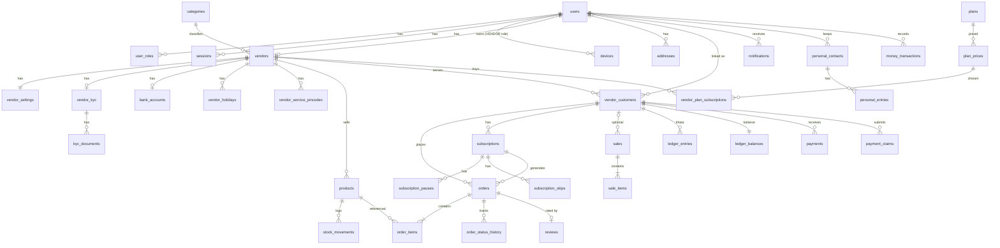

# DATA DESIGN

| Field | Value |
|---|---|
| Status | Draft v0.1 |
| Owner | Technical Architect |
| Last updated | 2026-10-29 |
| Related | [MODULE_DESIGN](MODULE_DESIGN.md), [API_SPECIFICATION](API_SPECIFICATION.md), [AUTH_SECURITY](AUTH_SECURITY.md) |

## 1. Conventions
| Topic | Rule |
|---|---|
| Keys | `id UUID v7` (time-ordered) primary keys; human-readable numbers where needed (`order_no`) |
| Money | `BIGINT` paise, column suffix `_paise` (ADR-009) |
| Quantities | `INTEGER` packs (A-07); pack size in product (`unit_value`, `unit_type`) |
| Time | `TIMESTAMPTZ` UTC (`created_at`, `updated_at`); business dates as `DATE` in IST (`delivery_date`) |
| Soft delete | `deleted_at TIMESTAMPTZ NULL` on user-managed entities (products, customers, addresses) |
| Concurrency | `version INTEGER` on mutable aggregates (orders, subscriptions, products, vendor_settings) |
| Enums | PostgreSQL enums via Prisma |
| Geo | `geography(Point,4326)` (PostGIS) |
| PII encryption | Field-level AES-256-GCM (envelope via KMS) for `bank_accounts.account_number_enc`, `vendor_kyc.pan_enc`; plus last-4 columns for display |
| Naming | snake_case tables/columns, plural table names |

## 2. ER Diagram (core)

## 3. Tables

### 3.1 Identity
| Table | Key columns | Constraints / indexes |
|---|---|---|
| `users` | id, mobile (E.164), name, email, photo_media_id, language (`en` only), active_role, status (ACTIVE/BLOCKED/DELETED), created_at | `UNIQUE(mobile) WHERE status <> 'DELETED'` |
| `user_roles` | user_id, role (CUSTOMER/VENDOR) | PK(user_id, role) |
| `consents` | user_id, doc_type (TERMS/PRIVACY), doc_version, accepted_at, ip | index(user_id) |
| `sessions` | id, user_id, refresh_token_hash, family_id, device_id, expires_at, revoked_at, last_used_at | index(user_id), index(family_id) |
| `devices` | id, user_id, platform, app_version, os_version, push_token, push_enabled, last_seen_at | UNIQUE(push_token) |
| `user_preferences` | user_id, notification_prefs JSONB, … | PK(user_id) |
| `admin_users` | id, email, password_hash (argon2id), totp_secret_enc, role, status, last_login_at | UNIQUE(email) |

### 3.2 Vendor
| Table | Key columns | Notes |
|---|---|---|
| `vendors` | id, user_id, category_id, business_name, gstin, address_line, city, state, pincode, location geography, shop_photo_media_id, onboarding_step, kyc_status, is_suspended, rating_avg, rating_count, badges TEXT[], upi_vpa | UNIQUE(user_id); GIST(location); index(kyc_status) |
| `vendor_settings` | vendor_id, service_radius_km (1–20), delivery_charge_paise, min_order_paise, time_slots JSONB, same_day_cutoff TIME, auto_accept_subscriptions, accepting_today, delivery_paused, delivery_paused_until, max_daily_orders, daily_milk_capacity_ml, low_stock_threshold, allow_khata_orders, version | PK(vendor_id) |
| `vendor_service_pincodes` | vendor_id, pincode | PK(vendor_id, pincode) |
| `vendor_holidays` | id, vendor_id, date, reason | UNIQUE(vendor_id, date) |
| `vendor_kyc` | vendor_id, status, pan_enc, pan_last4, aadhaar_last4, api_results JSONB (redacted), reviewed_by, reviewed_at, rejection_reason, submitted_at | PK(vendor_id) |
| `kyc_documents` | id, vendor_id, type (AADHAAR_FRONT/AADHAAR_BACK/PAN/SHOP_PHOTO), media_id, masked BOOLEAN | private local KYC directory only; authorized API access |
| `bank_accounts` | vendor_id, holder_name, bank_name, ifsc, account_number_enc, account_last4, verified_at | PK(vendor_id) |
| `categories` | id, code, name_en, name_hi, icon, type (SUPPLY/BILL), status (ENABLED/COMING_SOON/HIDDEN), sort_order, product_types JSONB | UNIQUE(code) |

### 3.3 Catalog
| Table | Key columns | Notes |
|---|---|---|
| `products` | id, vendor_id, name, product_type, milk_type, unit_value, unit_type (ML/L/G/KG/PCS), selling_price_paise, subscription_price_paise, stock_qty, moq, description, image_media_id, is_active, deleted_at, version | index(vendor_id, is_active); CHECK(subscription_price_paise ≤ selling_price_paise) |
| `stock_movements` | id, product_id, delta, reason (ORDER/SALE/ADJUST/REVERSAL), ref_id, created_by, created_at | append-only |

### 3.4 Customers & addresses
| Table | Key columns | Notes |
|---|---|---|
| `vendor_customers` | id, vendor_id, user_id NULL, name, mobile, email, address_text, address_id NULL, preferred_payment, status (ACTIVE/INACTIVE), link_status (UNLINKED/PENDING/LINKED) | UNIQUE(vendor_id, mobile) WHERE deleted_at IS NULL; index(user_id) |
| `addresses` | id, user_id, label, line1, line2, landmark, city, state, pincode, location geography, is_default, deleted_at | one default per user (partial unique index) |
| `favorites` | user_id, vendor_id | PK |

`vendor_customers` is the **link entity** for all vendor-side relations (orders, subscriptions, ledger). A customer-app order auto-creates/links a `vendor_customers` row (counts toward plan limit — RULE-12; if limit reached, order is rejected with `VENDOR_UNAVAILABLE`, vendor notified to upgrade).

### 3.5 Orders, subscriptions, sales
| Table | Key columns | Notes |
|---|---|---|
| `orders` | id, order_no, vendor_id, vendor_customer_id, source (APP/SUBSCRIPTION/VENDOR), subscription_id NULL, status, delivery_date DATE, time_slot, address_snapshot JSONB, subtotal_paise, delivery_charge_paise, discount_paise, total_paise, payment_mode (POD_CASH/POD_UPI/KHATA), payment_status (UNPAID/PAID), reject_reason, cancel_reason, fail_reason, version, created_at | UNIQUE(order_no); **UNIQUE(subscription_id, delivery_date) WHERE subscription_id IS NOT NULL**; index(vendor_id, delivery_date, status); index(vendor_customer_id, created_at) |
| `order_items` | id, order_id, product_id, product_name_snapshot, unit_snapshot, unit_price_paise, qty, line_total_paise | |
| `order_status_history` | id, order_id, from_status, to_status, actor_type, actor_id, reason, at | append-only |
| `subscriptions` | id, vendor_id, vendor_customer_id, product_id, qty, weekdays SMALLINT (bitmask Mon=1…Sun=64), start_date, end_date NULL, time_slot, address_snapshot JSONB, payment_method, status, created_by (VENDOR/CUSTOMER), version | index(vendor_id, status) |
| `subscription_pauses` | id, subscription_id, from_date, to_date NULL | |
| `subscription_skips` | subscription_id, date | PK(subscription_id, date) |
| `sales` | id, sale_no, vendor_id, vendor_customer_id NULL, total_paise, paid_paise, balance_paise, payment_method, client_created_at, created_at | CHECK(vendor_customer_id IS NOT NULL OR balance_paise = 0) (RULE-11) |
| `sale_items` | id, sale_id, product_id, name_snapshot, qty, rate_paise, amount_paise | |
| `job_runs` | id, job, run_date, status, counts JSONB, error, started_at, finished_at | UNIQUE(job, run_date) |

### 3.6 Ledger & payments
| Table | Key columns | Notes |
|---|---|---|
| `ledger_entries` | id, vendor_id, vendor_customer_id, type (DEBIT/CREDIT), amount_paise (>0), ref_type (ORDER/SALE/PAYMENT/CLAIM/OPENING/REVERSAL), ref_id, reverses_entry_id NULL, note, entry_date DATE, created_by, created_at | **append-only** (no UPDATE/DELETE grants); index(vendor_customer_id, entry_date) |
| `ledger_balances` | vendor_customer_id, total_debit_paise, total_credit_paise, due_paise, updated_at | updated in same transaction as entry insert |
| `payments` | id, vendor_id, vendor_customer_id, amount_paise, method (CASH/UPI/BANK/WALLET), received_on, note, client_ref, created_at | |
| `payment_claims` | id, vendor_customer_id, amount_paise, method (UPI/CASH), upi_txn_ref NULL, status (PENDING/CONFIRMED/REJECTED), decided_by, decided_at, reject_reason | |

### 3.7 Customer personal finance
| Table | Key columns |
|---|---|
| `personal_contacts` | id, user_id, name, mobile NULL, deleted_at |
| `personal_entries` | id, contact_id, direction (GAVE/GOT), amount_paise, date, note, deleted_at |
| `money_transactions` | id, user_id, kind (INCOME/EXPENSE), category, amount_paise, date, note, source (MANUAL/AUTO), deleted_at |

### 3.8 Plans
| Table | Key columns | Notes |
|---|---|---|
| `plans` | id, code (BASIC/STANDARD/BUSINESS/PREMIUM), name, customer_limit, features TEXT[], is_popular, status | |
| `plan_prices` | id, plan_id, duration (MONTHLY/HALF_YEARLY/YEARLY), price_paise, store_product_id NULL | |
| `vendor_plan_subscriptions` | id, vendor_id, plan_price_id, status (PENDING_PAYMENT/ACTIVE/EXPIRED/CANCELLED), starts_at, ends_at, provider, provider_ref, granted_by_admin NULL | index(vendor_id, status) |
| `plan_payments` | id, vendor_plan_subscription_id, amount_paise, provider, provider_payment_id, status, raw_webhook JSONB (redacted), invoice_no | UNIQUE(provider, provider_payment_id) |

### 3.9 Engagement, content, platform
| Table | Key columns |
|---|---|
| `reviews` | id, order_id UNIQUE, vendor_id, user_id, rating 1–5, text, status (PUBLISHED/HIDDEN), created_at |
| `notifications` | id, user_id, role, category, type, title, body, data JSONB (deep link), read_at, created_at (TTL 90 d) |
| `banners`, `faqs`, `legal_documents` (type, version, locale, body_md, effective_at), `app_config` (key, value JSONB) | |
| `coupons` | TBD (Q-06) |
| `bill_payments` | TBD (Q-07) |
| `referrals` | id, referrer_user_id, code UNIQUE, referred_user_id, status (TBD Q-14) |
| `media_files` | id, owner_user_id, purpose (MEDIA/KYC), relative_storage_key, mime, size, sha256, scan_status |
| `audit_logs` | id, actor_type (USER/ADMIN/SYSTEM), actor_id, action, entity, entity_id, before JSONB, after JSONB (PII redacted), ip, at — append-only |
| `outbox_events`, `idempotency_keys` (key, user_id, request_hash, response JSONB, expires_at), `data_requests` | |

## 4. Derived Values
| Value | Computation |
|---|---|
| Vendor rating | avg(reviews.rating where PUBLISHED); stored on vendors, updated on review change |
| Due (Khata) | `ledger_balances.due_paise = total_debit − total_credit` |
| Dashboard metrics | SQL aggregates on orders/sales by `delivery_date`/`created_at` in IST; queried directly from PostgreSQL initially |
| Milk stock (L) | Σ(stock_qty × unit in litres) for active products with product_type = MILK |

## 5. Mobile Local Database (drift + SQLCipher)
| Table | Purpose | Role |
|---|---|---|
| `cached_orders`, `cached_order_items` | Orders/deliveries for ±7 days | Vendor, Customer |
| `cached_products` | Vendor catalog | Vendor |
| `cached_customers`, `cached_ledger_balances`, `cached_ledger_entries` (last 90 d) | Khata offline | Vendor |
| `cached_dashboard` | Last metrics JSON + fetched_at | Vendor |
| `outbox` | id, type, payload JSON, idempotency_key, created_at, attempts, last_error, status (PENDING/SENDING/FAILED/DONE) | Vendor |
| `cart_items` | Local cart | Customer |
| `personal_entries`, `money_transactions` | Cache + optimistic writes | Customer |
| `kv` | small key-values (last role, recent searches) | Both |
DB is wiped on logout and on role switch only for that role's caches.

## 6. Data Lifecycle & Retention (proposed, Q-20)
| Data | Retention |
|---|---|
| KYC documents | Until vendor account deleted + legal period TBD; access-logged |
| Ledger, orders, sales, plan payments | Retained per financial record-keeping law (period TBD); anonymized on account deletion |
| Notifications | 90 days |
| Idempotency keys | 24 hours |
| OTP | PostgreSQL digest/expiry rows, 5 min |
| Audit logs | TBD (proposed ≥ 3 years) |
| Analytics | Firebase default retention configured to 14 months |

## 7. Migrations & Seed
- Prisma Migrate; every migration reviewed; destructive changes use expand → migrate → contract across two releases.
- Seed (`prisma/seed.ts`): categories (English), plans & prices from BRD §5, FAQs placeholder, demo vendor/customer for dev only.

## 8. ADR-023 baseline reconciliation (T-180/T-181/T-182)
Target tables below require reviewed migrations during implementation; they are not yet claims about schema.prisma. Keep financial rows/unique constraints and existing idempotency/outbox data intact.

| State | Minimum durable representation and integrity |
|---|---|
| OTP challenges | Opaque ID, purpose-separated mobile hash, salt/HMAC digest, revision, PENDING/ACTIVE/CONSUMED state, expiry, attempts and exhaustion state; never plaintext OTP/PII keys |
| Rate-limit state | Hashed mobile/IP/device + rule/window identity, send timestamps or rolling-window events, cooldown/lockout deadlines, unique keys; transaction/row or advisory lock serializes checks and increments |
| Scheduled jobs | job type, business date, scope ID with unique key; status, attempt count, next attempt, lease expiry, completion counts and sanitized error; restart catch-up uses persisted state |
| Outbox delivery | Existing event ID/payload plus claim lease, next-attempt time and bounded retries; row claim with SKIP LOCKED, unique delivery/event effect keys for replay |
| Media | Owner and tenant/resource linkage, generated relative storage key, purpose, validated MIME/bytes/hash, quarantine/READY/rejected state; root path remains environment config |

Use DB time for TTL/limits, expire consumed OTP state safely, and index due-job/outbox scans. Cleanup is bounded; it must not erase rate-limit budgets early or mutate financial history. Use rolling-window semantics to preserve existing OTP limits. Claim/verify must be atomic across processes; fail closed if durable state is unavailable. Media metadata/file commit failures need compensation and orphan cleanup as described in LOCAL_FILE_STORAGE.

## 9. Approved active data scope (ADR-024)
Future-only tables for Money transactions, bill payments, referrals, coupons, reviews/rating aggregates and banner/broadcast campaigns are POST-DELIVERY; their earlier schema descriptions are reference only and need no active migrations or seeds. Preserve existing data/source until an implementation task safely reconciles it. Personal contacts/entries, financial ledgers, transactional notifications, privacy/audit records and categories remain active.

KYC stores manual reviewer/method/reason/time and distinguishes provider NOT_RUN from actual verified checks; approval grants business KYC status without faking PAN/bank API success. Vendor plan assignments store catalog tier, validity, reason, actor and audit with idempotent mutation behavior. A grant is not a plan payment; do not seed fabricated invoices/revenue. Existing entitlement history and limits stay consistent. Effective expiry/visibility rules use approved Q-04/Q-18 decisions.
