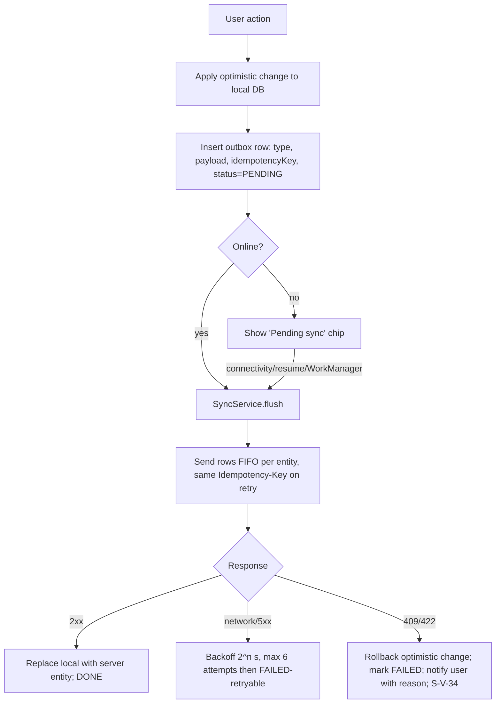

# MOBILE STRATEGY

| Field | Value |
|---|---|
| Status | Draft v0.1 |
| Owner | Mobile Solution Architect |
| Last updated | 2026-10-19 |
| Related | [ARCHITECTURE](ARCHITECTURE.md), [AUTH_SECURITY](AUTH_SECURITY.md), [USER_FLOWS](../03-ux/USER_FLOWS.md) |

## 1. Purpose
Flutter-specific strategy for lifecycle, navigation, state, offline, caching, deep links, push notifications, platform differences and performance.

## 2. App Lifecycle & Background Execution
| Event | Behaviour |
|---|---|
| Cold start | Native splash → `bootstrap()` (Firebase init, open DB, read secure storage, Remote Config fetch with 3 s timeout using cached values) → router decides route (USER_FLOWS §2). Heavy init deferred until after first frame |
| `resumed` | Refresh session if access token expired; trigger `SyncService.flush()`; refresh visible screen if data older than 60 s; re-check notification permission |
| `paused` | Persist drafts (onboarding, quick sale, cart); stop timers |
| `detached`/killed | Outbox persisted in DB → nothing lost |
| Background sync | Android: WorkManager one-off with network constraint when outbox non-empty (via `workmanager` plugin). iOS: `BGAppRefreshTask` best-effort; primary sync on foreground. No continuous background services (NFR-014) |
| Push received in background | Data-only payloads not relied upon; notification payload displays; inbox fetched on open |
| Memory pressure | Clear image cache (`PaintingBinding.imageCache.clear()`) on `didHaveMemoryPressure` |

## 3. Navigation (go_router)
- Top-level routes: `/splash`, `/language`, `/login`, `/otp`, `/role`, `/vendor/onboarding/*`, `/vendor/*` (StatefulShellRoute with 5 branches), `/customer/*` (StatefulShellRoute with 5 branches), `/common/*` (settings, legal, notifications).
- **Guards (redirect order):** forceUpdate → auth → role selected → vendor onboarding complete → route role matches active role (else prompt switch).
- Each bottom-nav branch keeps its own stack; re-tapping the active tab pops to root.
- Typed routes (`go_router_builder`) — no string paths in widgets.
- Android back: on a root tab → go to Home tab; on Home → system default (exit). Forms with unsaved changes use `PopScope` confirmation.

## 4. Deep Links
| Type | Config |
|---|---|
| Android App Links | `https://{link-domain}/*` with `assetlinks.json` (per flavor package ID & signing cert SHA-256, incl. Play App Signing key) |
| iOS Universal Links | `applinks:{link-domain}` with `apple-app-site-association` |
| Custom scheme | `supplybiz://` (fallback, notifications only) |
| Domain | TBD (Q-33) |
Routes per [USER_FLOWS §5](../03-ux/USER_FLOWS.md#5-deep-link-entry-points). Handling: parse → validate IDs → if unauthenticated store `pendingDeepLink` and resume post-login → if role mismatch prompt to switch → navigate; unknown links open Home. Referral install attribution (deferred deep link) requires a provider — TBD with Q-14 (Firebase Dynamic Links is discontinued; do not use).

## 5. State Management (Riverpod)
| Kind | Pattern |
|---|---|
| Server data | `AsyncNotifier` per screen/aggregate; repository returns `Stream` (local DB watch) + `refresh()` |
| Forms | `Notifier` holding immutable form state (freezed) + validation; submit returns `AsyncValue` |
| Session | `SessionController` (`keepAlive`) — tokens, user, activeRole |
| Cart | `CartController` backed by drift `cart_items` |
| Feature flags/config | `configProvider` (Remote Config + `/config`) |
| Connectivity | `connectivityProvider` (connectivity_plus + API reachability) |
Rules: `ref.watch` in build, `ref.read` in callbacks; no business logic in widgets; providers auto-dispose unless documented.

## 6. Offline Support & Sync
| Capability | Vendor | Customer |
|---|---|---|
| Read cached data | Dashboard, orders/deliveries ±7 days, products, customers, Khata (90 d) | Orders, subscriptions, Khata, Money, addresses |
| Offline writes (outbox) | Delivery transitions (start/delivered/failed), payment record, quick sale, stock adjustment | Personal Khata entries, Money transactions |
| Online-only | Onboarding/KYC uploads, product create/edit with image, subscriptions, settings, plans, reports | Ordering, subscriptions, settle payment, bills, grocery parse |

### 6.1 Outbox algorithm

- Ordering: rows for the same order are sent sequentially; independent entities may be sent in parallel (max 3).
- Conflict policy: **server authoritative**. Example: customer cancelled while vendor offline marked delivered → 409 → local rollback + message.
- Sync queue screen (S-V-34) lists pending/failed items with retry/discard (discard requires confirmation).
- Client timestamps (`clientCreatedAt`) are sent for audit; server time is authoritative for cutoffs.

## 7. Caching
| Data | Strategy | TTL |
|---|---|---|
| Config, categories, legal versions | HTTP cache + local | 5 min (fetch on resume) |
| Lists (orders, customers, products) | Stale-while-revalidate via drift | Refresh on open & pull |
| Vendor discovery results | Memory cache keyed by location+category+sort | 2 min |
| Images | `cached_network_image` with size-bound disk cache (100 MB), resized server variants (thumbnail 200 px, medium 600 px) | 7 days |
| Dashboard | drift `cached_dashboard` | Refresh on open; shows "updated hh:mm" |

## 8. Push Notifications
- FCM for both platforms (APNs key uploaded to Firebase). Token registered via `PUT /me/devices/current` on login, token refresh, and app start.
- Permission: pre-prompt (S-COM-09) after first value moment; Android 13+ runtime permission; iOS authorization (alert, badge, sound).
- **Android channels:** `orders` (high), `deliveries` (high), `payments` (default), `subscriptions` (default), `offers` (low), `system` (default). Names localized.
- Payload: `notification` (title/body localized server-side by user language) + `data` { `type`, `deepLink`, `role`, `entityId` }. No sensitive data.
- Foreground: show in-app banner (not system notification) and refresh relevant providers.
- Tap: route via deep-link handler (§4), mark read.
- Server sends to all devices of the user, filtered by user preferences (FR-103) and by role relevance.
- iOS badge = unread count (server-provided).

## 9. Platform Differences
| Topic | Android | iOS | Handling |
|---|---|---|---|
| OTP autofill | SMS Retriever API (no permission) | `textContentType.oneTimeCode` | `SbOtpField` supports both |
| UPI payment | `upi://pay` intent → chooser of UPI apps; result returned (unreliable) | No generic chooser; app-specific schemes (`phonepe://`, `gpay://`, `paytmmp://`) need `LSApplicationQueriesSchemes`; result not returned | Always ask user to confirm payment; fallback VPA + QR + copy (R-11) |
| Background work | WorkManager | BGTaskScheduler (best-effort) | Foreground sync is primary |
| Notifications permission | Runtime on 13+, channels | Always runtime | Pre-prompt both |
| Photo picking | Photo Picker (Android 13+, backported via Play services) | PHPicker | `image_picker` |
| Back navigation | System back / predictive back | Swipe back | `PopScope` |
| File sharing (reports) | FileProvider | Share sheet | `share_plus` |
| Screenshots of KYC | `FLAG_SECURE` | Blur on `inactive` | Platform channel / plugin |
| Speech recognition | Google on-device/online (Hindi support varies by device) | SFSpeechRecognizer (hi-IN supported, may need network) | Feature check + graceful fallback to typing |
| In-app purchase (plans) | Google Play Billing (if ADR-015 = store) | StoreKit 2 | `in_app_purchase` behind `BillingProvider` |
| Min OS | API 24 | iOS 13 | A-13 |

## 10. Performance & Resource Budgets
| Metric | Budget | How |
|---|---|---|
| Cold start (NFR-001) | ≤ 2.5 s p90 Android ref. device | Defer non-critical init, avoid sync I/O before first frame, Impeller (iOS) |
| Frame build | < 16 ms | `const` widgets, `ListView.builder`, avoid rebuild storms (select providers) |
| Memory | < 250 MB on 3 GB devices | Image downsampling (`cacheWidth`), dispose controllers |
| APK size (NFR-013) | ≤ 40 MB/ABI | Split per ABI (AAB), font subsetting, tree-shaken icons, deferred ML Kit models (download on first use) |
| Network | Payloads < 100 KB per list page; gzip/brotli | Pagination, sparse fields |
| Battery | No polling timers > 1/min; no background location | Push-driven refresh |
| Monitoring | Firebase Performance traces: `app_start`, `screen_render_<id>`, HTTP metrics | See QUALITY_OBSERVABILITY |

## 11. Device & OS Compatibility
| Tier | Devices (examples) | Use |
|---|---|---|
| Reference low-end Android | 3 GB RAM, Android 10–11 (e.g., Redmi 9A class) | Performance budgets |
| Mid Android | 4–6 GB, Android 12–14 (Samsung A-series, Redmi Note) | Primary QA |
| Latest Android | Pixel, Android 15/16 | Behaviour changes (edge-to-edge, predictive back) |
| Oldest supported | Android 7.0 (API 24) emulator + one physical if available | Smoke |
| iOS | iPhone SE (2nd gen) iOS latest-1, iPhone 13/15 latest | Small screen + modern |
Full matrix in [TEST_STRATEGY §7](../07-testing/TEST_STRATEGY.md#7-device--os-matrix).

## 12. App Updates
- Remote `minVersion` per platform → force update screen (S-COM-06); `recommendedVersion` → dismissible banner.
- Android In-App Updates API (flexible) for recommended updates; iOS links to App Store.
