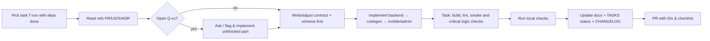

# AGENTS — Rules for AI Coding Agents

| Field | Value |
|---|---|
| Status | Draft v0.1 |
| Owner | Technical Architect |
| Last updated | 2026-10-29 |
| Applies to | Cursor, Claude Code, GitHub Copilot, OpenAI Codex, Windsurf, and human contributors |

## 1. Before You Start Any Task
1. Read, in order: [CONTEXT](CONTEXT.md) → this file → the task in [TASKS](TASKS.md) → referenced FR/US in [SRS](../02-requirements/SRS.md) / [USER_STORIES](../02-requirements/USER_STORIES.md) → referenced screens in [SCREEN_SPECIFICATIONS](../03-ux/SCREEN_SPECIFICATIONS.md) → relevant architecture docs.
2. Check [DECISIONS](DECISIONS.md) for constraints; **Accepted ADRs override other docs.**
3. Check whether the task depends on an open question (`Q-xx` in [SCOPE §8](../01-business/SCOPE.md#8-open-questions)). If it does, implement only the unblocked part behind a feature flag and stop to ask — **do not invent business rules.**

## 2. Source-of-Truth Hierarchy
| Topic | Source of truth |
|---|---|
| Scope, assumptions, open questions | SCOPE |
| Functional & non-functional requirements | SRS |
| Business rules & acceptance criteria | USER_STORIES |
| Screen behaviour | SCREEN_SPECIFICATIONS |
| Visual tokens & components | UI_UX_GUIDELINES |
| Technical decisions | DECISIONS |
| API contract | `contracts/openapi.yaml` (must match API_SPECIFICATION) |
| Data model | `apps/api/src/prisma/schema.prisma` (must match DATA_DESIGN) |
| Task status | TASKS |
On conflict: stop, report the conflict with file/section references, propose a fix; do not silently pick one.

## 3. Hard Rules
- Follow [FOLDER_STRUCTURE](../04-architecture/FOLDER_STRUCTURE.md) and [CODING_STANDARDS](../06-development/CODING_STANDARDS.md).
- Never hand-edit generated code (`packages/api_client`, `packages/ts-client`, `*.g.dart`, `*.freezed.dart`). Change the source and run codegen.
- Money is integer paise; never use `double` for money.
- Never trust client input for prices, totals, roles, vendorId, or plan entitlements.
- Every mobile mutation that changes server state sends `Idempotency-Key`.
- Every user-visible string goes through English ARB/intl. No extra translations or language selector are required (ADR-023).
- Every interactive widget has semantics labels and ≥ 48dp target.
- No PII/tokens/OTPs in logs, analytics, crash keys or test fixtures committed to repo (use fake data).
- No new dependency without justification in the PR (license, size, maintenance). Prefer packages already listed in ARCHITECTURE §3.
- No secrets in code, config files or commits.
- Do not disable lint rules, tests or security checks to make CI pass.
- Do not change accepted ADRs; propose a new ADR instead.
- Destructive DB changes follow expand/contract (DATA_DESIGN §7).

## 4. Implementation Workflow

## 5. Commands (canonical; finalized in T-001)
| Purpose | Command |
|---|---|
| Bootstrap | `tools/bootstrap.sh` after T-182 reconciles native setup; current source is not yet the target baseline |
| Codegen (API → clients) | `tools/codegen.sh` |
| Dart codegen | `melos run build_runner` |
| Mobile analyze/test | `melos run analyze` · `melos run test` |
| Mobile run | `cd apps/mobile && fvm flutter run --flavor dev -t lib/main_dev.dart --dart-define-from-file=config/dev.json` |
| API dev | `pnpm --filter api dev` · worker `pnpm --filter api dev:worker` |
| API test | `pnpm --filter api test` · e2e `pnpm --filter api test:e2e` |
| DB migrate | `pnpm --filter @supplybiz/api prisma:migrate:dev` |
| Admin dev/test | `pnpm --filter admin dev` · `pnpm --filter admin test` |
| Comprehensive checks (module gate only) | `pnpm turbo run lint test` + `melos run analyze test` |

## 6. Definition of Done (every task)
- [ ] Acceptance criteria of referenced US satisfied; tests reference TC IDs.
- [ ] Affected-layer build/typecheck, lint/analyze and runnable smoke pass; focused changed business-rule/security checks pass. Comprehensive integration/regression/E2E (including authZ/IDOR) runs at module completion per TEST_STRATEGY, not after every task.
- [ ] Loading, empty, error, offline, locked states implemented (SCREEN_SPECIFICATIONS §2).
- [ ] English strings; semantics labels; text scale 200% checked.
- [ ] Basic redacted diagnostics/operational alerts where applicable; advanced analytics/events are deferred by approved SR-06.
- [ ] If contract changed: regenerate OpenAPI/clients and verify compatibility; no unrelated codegen.
- [ ] Lint/format clean; evidence of task checks recorded; module gates tracked separately.
- [ ] Docs updated if behaviour/contract changed; TASKS status updated; CHANGELOG `Unreleased` entry.

## 7. Commit & PR Conventions
- Conventional Commits with scope and IDs: `feat(orders): accept/reject order [FR-042][US-041][T-045]`.
- PR description: summary, IDs, screenshots (English) for UI, test evidence, open questions encountered.
- One task per PR where possible; ≤ 400 changed lines excluding generated code.

## 8. When Unsure
Ask a concise question listing options and your recommendation. Record answers in SCOPE (resolve Q-xx) or DECISIONS (new ADR) in the same PR.

## 9. Prohibited Until Explicit Approval
- Implementing anything before the documentation set is approved.
- Implementing features marked blocked by Q-03, Q-05, Q-06, Q-07, Q-14 beyond stubs/flags.
- Publishing builds to stores or deploying to production.

## 10. Admin UI Rules (`apps/admin`)
- These rules apply only to the Next.js admin app; they do not apply to the Flutter mobile app or NestJS API.
- Use strict TypeScript and explicit types for component props and function parameters. Do not use `any` or broad types to bypass the compiler.
- Use Next.js App Router Server Components by default. Add `"use client"` only to the smallest component boundary that needs browser interactivity.
- Use Tailwind utility classes for styling; do not add raw inline CSS styles.
- Keep components focused and reusable. Keep UI presentation separate from API/data-access utilities; use the generated TypeScript client through the documented server-side data-access patterns.
- Do not expose admin tokens to the browser. Follow the session-cookie/BFF and authorization requirements in [DECISIONS](DECISIONS.md) and [CODING_STANDARDS](../06-development/CODING_STANDARDS.md).
- Use the workspace package manager (`pnpm`), not `npm`, for admin commands. The current admin scripts are placeholders; do not treat them as verification until T-150 implements real checks. Run the available package scripts after that task is complete.
- Never push directly to `main` or `master`; prepare a descriptive pull request and follow the repository's commit and PR conventions in §7.

## 11. 15-day delivery rules (ADR-023)
- This turn authorizes documentation/planning only; no application implementation. Later implementation requires the normal task request/approved documentation gate.
- Use ROADMAP daily priority, module gates and critical-path dependencies rather than lowest task number. Prefer complete vertical flows; no UI-only completion with disconnected server behavior.
- English-only UI, PostgreSQL-backed durable jobs/OTP/rate limits, native host processes and local filesystem uploads are the accepted baseline. T-180–T-184 reconcile existing implementation without silently accepting old dependencies.
- Task completion requires lightweight checks and manual PASS; module completion additionally requires comprehensive integration, regression and E2E evidence. Task DONE is not a claim that the module gate passed. PROMPTS §6 and §13 govern these separate gates; these project rules also govern task skill finalization references.
- Do not run screenshot baseline generation/refresh or introduce its dependencies. No broad test matrix after each task.
- SR-01–SR-06 are approved (2026-10-29; ADR-024). Use DELIVERY_SCOPE and active/simplified ACs. Skip DEFERRED tasks; no feature stubs, navigation or provider setup for approved backlog. Never mark deferred tasks DONE or ask for the same approval again.
- Safe concurrent implementation: assign separate modules/files, freeze API/schema contracts first, use one migration/client-codegen owner, merge daily and smoke the integrated flow. No independent worker may edit shared contracts/migrations without coordination.

## 12. Android-first release sequence (ADR-025)
Current mobile build/run/smoke/native-storage/accessibility/E2E/release tasks target **Android only**. Do not run iOS builds, simulators/devices, signing, TestFlight, APNs or VoiceOver checks, require Apple/Xcode/CocoaPods setup, or treat them as Android gate blockers. Preserve iOS source/configuration. After Android production release T-179, use T-185 for actual iOS validation; never report deferred checks as passed. A documentation-only request still authorizes no application implementation.
