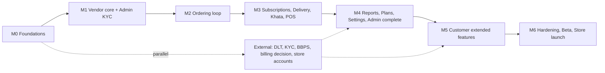

# ROADMAP — Phases, Milestones, Priorities

| Field | Value |
|---|---|
| Status | Draft v0.1 |
| Owner | Product Manager |
| Last updated | 2026-10-19 |
| Related | [PRD](../01-business/PRD.md), [TASKS](TASKS.md), [DEPLOYMENT_OPERATIONS](../08-deployment-operations/DEPLOYMENT_OPERATIONS.md) |

## 1. Approach
Single public release **v1.0** (stakeholder decision: full scope). Built in internal milestones, each ending with a demoable build on internal test tracks (Play Internal / TestFlight). P2 features ship behind Remote Config flags so launch is not blocked by external dependencies (R-01). Calendar dates are **TBD** (Q-01); sequence and exit criteria are fixed.

## 2. Milestones
| Milestone | Scope (Features) | Key tasks | Exit criteria |
|---|---|---|---|
| **M0 Foundations** | Monorepo, CI, envs, design system, auth (F-01), config/flags, l10n, observability | T-001–T-019 | Login via OTP (dev fake + real SMS on staging) on Android & iOS; role select; CI green; `ui_kit` goldens |
| **M1 Vendor core** | F-02, F-03 (basic), F-04, F-07, admin auth + KYC review (F-25 part) | T-020–T-039, T-150–T-153 | Vendor onboards, KYC approved via admin, adds products & customers; offline read cache works |
| **M2 Ordering loop** | F-15, F-16, F-17, F-18, F-05, F-11 | T-040–T-069 | Customer finds verified vendor, places order; vendor accepts → delivers; push notifications both ways |
| **M3 Daily operations** | F-08, F-09, F-12, F-06, F-19 (vendor ledgers + settle) | T-070–T-099 | Subscriptions generate nightly correctly (TC-070 series pass); holidays; Khata balances match; quick sale offline sync |
| **M4 Business features** | F-10, F-13 (per ADR-015), F-14, F-24, remaining admin (F-25) | T-100–T-119, T-154–T-162 | Reports & downloads; plan purchase & gating; admin CMS/config/broadcast/audit |
| **M5 Customer extended** | F-20, F-21 (flag), F-22 (flag), F-23, referral (flag) | T-120–T-139 | Money, services, insights, profile complete; bills/grocery/referral functional on staging where dependencies resolved |
| **M6 Hardening & launch** | NFRs, security, a11y, performance, store readiness | T-170–T-189 | All P0/P1 TCs pass; pen-test criticals fixed; crash-free ≥ 99.5% in beta; store approvals |

## 3. External Dependency Timeline (start in M0)
| Item | Needed by | Q/D |
|---|---|---|
| DLT entity + SMS template registration; SMS provider | M0 (staging real SMS) | Q-09, D-01 |
| WhatsApp Business template approval | M1 | D-02 |
| Apple Developer & Play Console org accounts | M0 | D-10 |
| KYC provider contract | M1 | Q-08 |
| Cloud provider decision | M0 | Q-02 |
| Billing channel decision (ADR-015) | M3 end | Q-03 |
| BBPS partner | M5 | Q-07 |
| Maps provider | M1 | Q-32 |
| Legal: Terms, Privacy, grievance officer | M2 (beta) | Q-20 |
| Pen-test vendor | M6 | — |

## 4. Priorities Within Milestones
P0 before P1 before P2 ([PRD §3](../01-business/PRD.md#3-priority-definitions)). If timeline pressure occurs, the PO may launch with P2 flags off — this is a business decision, not an engineering default.

## 5. Post-v1 Candidates (not committed)
Live delivery tracking & delivery-staff app (F-D3, F-D1), support tickets/chat (F-D2), category-specific workflows (Q-12), dark mode, tablet layouts, platform-collected payments (if Q-05 changes ADR-008), web customer app.
