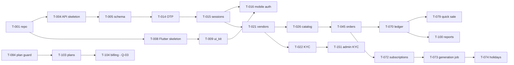

# TASKS — Implementation Plan

| Field | Value |
|---|---|
| Status | Draft v0.1 |
| Owner | Technical Architect + Product Manager |
| Last updated | 2026-10-19 |
| Related | [ROADMAP](ROADMAP.md), [AGENTS](AGENTS.md), [SRS](../02-requirements/SRS.md), [TEST_CASES](../07-testing/TEST_CASES.md) |

## 1. How to Use
- **Default delivery cycle:** `TODO → IN_PROGRESS → READY_FOR_VERIFY → DONE`; use `BLOCKED (Q-xx)` when required decisions are unresolved.
- **FAST implementation:** follow [PROMPTS.md](PROMPTS.md) §1; implement the smallest runnable slice and run targeted checks only. Do not mark DONE until manual verification and required DoD checks.
- **RUN / VERIFY:** follow PROMPTS §4 to start the affected service/app; verify the task's `Done when` behavior manually. Fix defects with PROMPTS §5.
- **FINALIZE:** after manual PASS, follow PROMPTS §6 for remaining tests, appropriate regression checks, docs and DONE status.
- **Dependency policy:** downstream tasks may start only when prerequisite tasks are DONE or READY_FOR_VERIFY, unless explicitly approved for a stubbed integration.
- **Agent efficiency:** inspect only the selected row, direct dependencies and linked requirement sections; avoid loading the entire documentation set.

- Pick the lowest-numbered `TODO` task whose dependencies are `DONE` or `READY_FOR_VERIFY`. Update **Status** as work progresses (`TODO → IN_PROGRESS → READY_FOR_VERIFY → DONE`, or `BLOCKED (Q-xx)`).
- **Done when** criteria are in addition to the global Definition of Done in [AGENTS §6](AGENTS.md#6-definition-of-done-every-task).
- Layers: API = backend, MOB = Flutter, ADM = admin, OPS = infra/CI.
- Number ranges are reserved per milestone; gaps are intentional for later insertion.

## 2. M0 — Foundations
| ID | Task | Layer | Refs | Deps | Done when | Status |
|---|---|---|---|---|---|---|
| T-001 | Create monorepo skeleton per FOLDER_STRUCTURE; melos, pnpm, turbo, .fvmrc, .nvmrc, editorconfig, bootstrap & codegen scripts | OPS | ADR-003 | — | `tools/bootstrap.sh` works on clean macOS; README commands verified | DONE |
| T-002 | Local infra: docker-compose (Postgres+PostGIS, Redis, MinIO) | OPS | ENVIRONMENT_SETUP | T-001 | `docker compose up` healthy; API connects | IN_PROGRESS |
| T-003 | CI pipelines (lint, test, build) with path filters | OPS | GIT_CICD §4 | T-001 | PR checks run for mobile/api/admin | DONE |
| T-004 | NestJS app skeleton: config validation, pino, OTel, Problem Details filter, health endpoints, request-id, rate limiter | API | ARCHITECTURE §7, QUALITY §2–3 | T-001 | `/health/ready` OK; error format test passes | DONE |
| T-005 | Prisma schema v1 for identity tables + migrations + seed (categories, plans) | API | DATA_DESIGN §3.1, §3.8, §7 | T-004 | Migration applies; seed idempotent | DONE |
| T-006 | Idempotency interceptor + `idempotency_keys` + outbox_events dispatcher | API | ARCHITECTURE §7 | T-005 | TC-500, TC-501 pass | DONE |
| T-007 | OpenAPI generation + CI diff + Dart & TS client generation | OPS/API | ADR-013 | T-004 | `tools/codegen.sh` produces clients; CI fails on drift | DONE |
| T-008 | Flutter app skeleton: flavors (dev/staging/prod), bootstrap, error zones, Firebase per flavor | MOB | MOBILE_STRATEGY §2 | T-001 | App runs on Android & iOS for 3 flavors | READY_FOR_VERIFY (targeted checks pass; native runs and real Firebase configuration verification pending) |
| T-009 | `ui_kit`: tokens, theme, fonts (Noto + Devanagari), core components (§4 of UI_UX_GUIDELINES) with goldens | MOB | UI_UX_GUIDELINES, DESIGN | T-008 | Golden tests EN/HI pass; a11y guideline tests pass | IN_PROGRESS (implemented; final Hindi contrast verification and golden refresh pending execution permission) |
| T-010 | l10n setup (ARB en/hi), formatters (INR, IST dates) | MOB | ADR-019, RULE-01 | T-008 | Unit tests for `formatInr` (TC-502) | READY_FOR_VERIFY (focused formatter/localization tests pass; device verification pending) |
| T-011 | Core network: dio, auth interceptor single-flight refresh, idempotency header, error mapping | MOB | MODULE_DESIGN §3.1, QUALITY §2.1 | T-007, T-008 | Unit tests for refresh race & mapping | TODO |
| T-012 | Secure storage + drift DB with SQLCipher + migrations framework | MOB | ADR-006 | T-008 | DB opens encrypted; wipe on logout | TODO |
| T-013 | Router with guards, shells placeholders, deep-link parser | MOB | MOBILE_STRATEGY §3–4 | T-008 | Guard unit tests; deep link test routes | TODO |
| T-014 | OTP providers adapters (console, SMS, WhatsApp) + OTP service + rate limits | API | FR-001–FR-003, AUTH_SECURITY §2.1 | T-005 | TC-001–TC-006 pass (API) | TODO |
| T-015 | Sessions: tokens, refresh rotation, reuse detection, logout/all, `/me`, roles, active role, consent | API | FR-005, FR-006, FR-009 | T-014 | TC-007–TC-010 pass | TODO |
| T-016 | Mobile auth flow S-COM-01–S-COM-05, language select, consent | MOB | US-001–US-005, US-007 | T-009–T-015 | Patrol E2E login both platforms | TODO |
| T-017 | Remote config + `/config` + force update S-COM-06 + feature flags | MOB/API | FR-408 | T-016 | TC-011 pass | TODO |
| T-018 | Observability wiring: Crashlytics, Analytics wrapper (consent), Performance; Sentry API | MOB/API | QUALITY | T-008, T-004 | Test crash visible per flavor; events in DebugView | TODO |
| T-019 | Account deletion (API + S-COM-10) | API/MOB | FR-008, US-006 | T-016 | TC-012 pass | TODO |

## 3. M1 — Vendor Core + Admin KYC
| ID | Task | Layer | Refs | Deps | Done when | Status |
|---|---|---|---|---|---|---|
| T-020 | Media module: pre-signed upload, finalize, validation, malware scan job | API | ADR-018, FR-012 | T-005 | TC-503 (type/size) pass | TODO |
| T-021 | Vendors module: category, business info, onboarding step, settings defaults | API | FR-010, FR-011, FR-016 | T-015 | TC-020–TC-022 | TODO |
| T-022 | KYC module: submission, encryption, provider adapter (fake), status machine, events | API | FR-013–FR-015, ADR-014 | T-020 | TC-023–TC-026 | TODO |
| T-023 | Service area (radius + pincodes) with PostGIS | API | FR-018 | T-021 | TC-028 | TODO |
| T-024 | Mobile onboarding S-V-01–S-V-04 with resumable drafts, uploads, FLAG_SECURE | MOB | US-010–US-013 | T-016, T-021, T-022 | TC-020–TC-027 (UI) | TODO |
| T-025 | Service area screen S-V-30 (map provider per Q-32) | MOB | US-014 | T-023 | TC-028 | BLOCKED (Q-32 provider) |
| T-026 | Catalog API: products CRUD, soft delete rule, stock movements, low-stock event | API | FR-030–FR-036 | T-021 | TC-035–TC-041 | TODO |
| T-027 | Mobile products S-V-06, S-V-07, S-V-35 + cache | MOB | US-030–US-032 | T-026 | Widget + E2E tests | TODO |
| T-028 | Customers API: vendor_customers CRUD, limits hook, link requests | API | FR-060–FR-064 | T-021 | TC-060–TC-064 | TODO |
| T-029 | Mobile vendor customers S-V-12–S-V-14 (tabs stubbed until M2/M3) | MOB | US-060–US-062 | T-028 | Widget tests | TODO |
| T-030 | Dashboard API (metrics, cached) | API | FR-020–FR-022 | T-026, T-028 | TC-030 | TODO |
| T-031 | Mobile vendor shell, bottom nav, dashboard S-V-05, More S-V-19 | MOB | US-020 | T-030 | TC-030–TC-031 | TODO |
| T-032 | Vendor notifications infra: push tokens, FCM adapter, inbox API, prefs | API | FR-100–FR-103 | T-015 | TC-100–TC-102 | TODO |
| T-033 | Mobile notifications center + push handling + permission pre-prompt | MOB | US-100, US-101 | T-032 | TC-100–TC-104 | TODO |
| T-150 | Admin app skeleton, login + TOTP, RBAC, session | ADM/API | FR-400 | T-015 | TC-400–TC-401 | TODO |
| T-151 | Admin KYC queue & case review (S-A-03, S-A-04), document view audit | ADM/API | FR-402 | T-022, T-150 | TC-402–TC-403 | TODO |
| T-152 | Audit module + viewer S-A-16 | API/ADM | FR-411 | T-150 | TC-408 | TODO |
| T-153 | Admin categories S-A-08 | ADM/API | FR-405 | T-150 | CRUD tests | TODO |

## 4. M2 — Ordering Loop
| ID | Task | Layer | Refs | Deps | Done when | Status |
|---|---|---|---|---|---|---|
| T-040 | Addresses API + geo adapter | API | FR-291 | T-015 | TC-290 | TODO |
| T-041 | Discovery API: vendor list (geo, sort, RULE-13), details, products, search, favorites | API | FR-202, FR-210–FR-212, FR-214 | T-023, T-026 | TC-200–TC-210 | TODO |
| T-042 | Customer home API (banners, categories, today's deliveries) | API | FR-201 | T-041 | TC-201 | TODO |
| T-043 | Mobile customer shell + Home S-C-01, location S-C-02, search S-C-03 | MOB | US-200–US-202 | T-042 | TC-200–TC-203 | TODO |
| T-044 | Mobile discovery S-C-05–S-C-08, S-C-37 | MOB | US-210, US-211 | T-041 | TC-204–TC-210 | TODO |
| T-045 | Orders API: quote, place (FR-225 validations), state machine, history, capacity | API | FR-040–FR-046, FR-220–FR-225 | T-026, T-028, T-006 | TC-045–TC-051, TC-220–TC-232 | TODO |
| T-046 | Mobile cart & checkout S-C-11, place new order S-C-12 | MOB | US-220, US-221 | T-045, T-040 | TC-220–TC-232 | TODO |
| T-047 | Mobile addresses S-C-28/29 | MOB | US-290 | T-040 | TC-290 | TODO |
| T-048 | Mobile vendor orders S-V-08–S-V-10 | MOB | US-040–US-042 | T-045 | TC-045–TC-050 | TODO |
| T-049 | Deliveries API (list by date/tab counts) + delivered side effects (ledger debit stub, stock) | API | FR-080, FR-081 | T-045 | TC-085–TC-087 | TODO |
| T-050 | Mobile deliveries S-V-16 with outbox + sync queue S-V-34 | MOB | US-080 | T-049, T-012 | TC-086–TC-088, TC-504 | TODO |
| T-051 | Customer my orders & tracking S-C-13/14, cancel, reorder | MOB/API | US-240, US-241 | T-045 | TC-240–TC-245 | TODO |
| T-052 | Order notifications fan-out (all FR-101 order events) + deep links | API/MOB | FR-101, FR-104 | T-032, T-045 | TC-103–TC-104 | TODO |
| T-053 | Link offline customer flow S-C-38 | MOB/API | FR-064 | T-028 | TC-064 | TODO |

## 5. M3 — Daily Operations
| ID | Task | Layer | Refs | Deps | Done when | Status |
|---|---|---|---|---|---|---|
| T-070 | Ledger module: entries, balances, reversal, reconciliation job, DB grants | API | FR-110–FR-116, ADR-021 | T-045 | TC-110–TC-116 | TODO |
| T-071 | Wire DEBIT/CREDIT side effects for delivered orders & payments | API | RULE-10 | T-070, T-049 | TC-087, TC-111 | TODO |
| T-072 | Subscriptions API: CRUD, approval, pause/resume/skip, cutoff logic | API | FR-070–FR-073, FR-076, FR-077, FR-230–FR-232 | T-045 | TC-070–TC-079 | TODO |
| T-073 | Generation job (BullMQ repeatable 22:00 IST), idempotency, job_runs, alerts | API | FR-074, NFR-006 | T-072 | TC-080–TC-084 | TODO |
| T-074 | Holidays / pause / availability API + order cancellation side effects | API | FR-082–FR-085, RULE-20 | T-073 | TC-089–TC-091 | TODO |
| T-075 | Subscription settings API (auto-accept, caps, pause all) | API | FR-075 | T-072 | TC-078 | TODO |
| T-076 | Mobile vendor subscriptions S-V-15, S-V-21 | MOB | US-070–US-073 | T-072, T-075 | Widget + E2E | TODO |
| T-077 | Mobile availability & holidays S-V-22 | MOB | US-081 | T-074 | TC-089–TC-091 | TODO |
| T-078 | Mobile customer subscriptions S-C-09, S-C-10, S-C-15, S-C-16 (+ statement) | MOB | US-074–US-076 | T-072 | TC-070–TC-077 | TODO |
| T-079 | Quick sale API | API | FR-050–FR-054 | T-070 | TC-055–TC-059 | TODO |
| T-080 | Mobile quick sale S-V-11 with outbox | MOB | US-050, US-051 | T-079, T-050 | TC-055–TC-059 | TODO |
| T-081 | Mobile vendor Khata S-V-23–S-V-26 (payments, claims, opening, reversal) | MOB | US-110–US-114 | T-070 | TC-110–TC-116 | TODO |
| T-082 | Customer Khata API (summary, vendor entries, claims) + personal contacts/entries API | API | FR-250–FR-253 | T-070 | TC-250–TC-255 | TODO |
| T-083 | Mobile customer Khata S-C-17–S-C-20 incl. UPI intent & iOS fallback | MOB | US-250–US-252 | T-082 | TC-250–TC-256 | TODO |
| T-084 | Plan gating guard & customer-limit hook (temporary: all vendors on a default plan until M4) | API | FR-122, FR-123 | T-028 | TC-120–TC-121 | TODO |

## 6. M4 — Business Features & Admin Completion
| ID | Task | Layer | Refs | Deps | Done when | Status |
|---|---|---|---|---|---|---|
| T-100 | Reports API (summary, chart, product-wise) | API | FR-090–FR-093, FR-095 | T-079, T-070 | TC-095–TC-096 | TODO |
| T-101 | Report export job (format per Q-23) | API | FR-094 | T-100 | TC-097 | BLOCKED (Q-23) |
| T-102 | Mobile reports S-V-17 (+ chart table alternative) | MOB | US-090, US-091 | T-100 | Widget + a11y | TODO |
| T-103 | Plans API: catalog, entitlements, expiry reminders | API | FR-120, FR-122–FR-124 | T-084 | TC-122–TC-124 | TODO |
| T-104 | Billing provider implementation per ADR-015 | API/MOB | FR-121, FR-126 | T-103 | TC-122 | BLOCKED (Q-03) |
| T-105 | Mobile plans S-V-27, S-V-28 + locked-feature UI | MOB | US-120, US-121 | T-103 | TC-120–TC-124 | TODO |
| T-106 | Vendor settings S-V-20, S-V-31–S-V-33 incl. re-verification rule | MOB/API | FR-130–FR-132, RULE-22 | T-021, T-022 | TC-130–TC-131 | TODO |
| T-107 | Help/FAQ/legal (content module + S-V-29, S-C-34, S-COM-08) | MOB/API | FR-133, FR-134, FR-296 | T-017 | TC-132 | TODO |
| T-108 | Reviews API + S-C-35 + vendor rating aggregation | API/MOB | FR-213 | T-045 | TC-211–TC-212 | TODO |
| T-154 | Admin dashboard S-A-02 | ADM/API | FR-401 | T-150 | Values match DB fixtures | TODO |
| T-155 | Admin vendors & customers S-A-05–S-A-07 (suspend/block, badges) | ADM/API | FR-403, FR-404 | T-150 | TC-404–TC-405 | TODO |
| T-156 | Admin plans & vendor subscriptions S-A-09/10 | ADM/API | FR-406 | T-103 | TC-406 | TODO |
| T-157 | Admin banners S-A-11 (coupons blocked Q-06) | ADM/API | FR-407 | T-150 | CRUD tests | TODO |
| T-158 | Admin CMS & app config S-A-12/13 | ADM/API | FR-408 | T-150 | TC-407 | TODO |
| T-159 | Admin broadcasts S-A-14 | ADM/API | FR-409 | T-032 | TC-409 | TODO |
| T-160 | Admin review moderation S-A-15 | ADM/API | FR-410 | T-108 | TC-410 | TODO |
| T-161 | Admin data-subject requests S-A-18 + privacy jobs | ADM/API | FR-412, FR-008 | T-019 | TC-012 | TODO |
| T-162 | Admin users & roles S-A-17, reports export S-A-19 | ADM/API | FR-400, FR-413 | T-150 | RBAC tests | TODO |

## 7. M5 — Customer Extended
| ID | Task | Layer | Refs | Deps | Done when | Status |
|---|---|---|---|---|---|---|
| T-120 | Money API + S-C-21/22 (pie + table alt) | API/MOB | FR-260–FR-262 | T-015 | TC-260–TC-262 | TODO |
| T-121 | Money auto-import | API | FR-263 | T-120 | — | BLOCKED (Q-21) |
| T-122 | Services screen S-C-04 (category types, coming soon) | MOB | FR-270 | T-042 | TC-270 | TODO |
| T-123 | Bill payments module + S-C-23/24 behind flag | API/MOB | FR-271, FR-272 | T-122 | TC-271 | BLOCKED (Q-07) |
| T-124 | Grocery parse API (text → items → catalog match, EN/HI) | API | FR-282 | T-026 | TC-280–TC-282 | TODO |
| T-125 | Mobile grocery voice/image S-C-25 (speech_to_text, ML Kit) behind flag | MOB | FR-280, FR-281, FR-283 | T-124 | TC-280–TC-283 | TODO |
| T-126 | Profile, edit profile, settings, about S-C-27, S-C-33, S-C-36 | MOB | FR-290, FR-295, FR-297 | T-016 | TC-291–TC-293 | TODO |
| T-127 | Insights API + S-C-32 | API/MOB | FR-294 | T-120, T-045 | TC-294 | TODO |
| T-128 | Payment methods S-C-30 | MOB | FR-292 | — | — | BLOCKED (Q-22) |
| T-129 | Invite & earn S-C-31 + referral API behind flag | API/MOB | FR-293 | — | — | BLOCKED (Q-14) |
| T-130 | Coupons | API/MOB/ADM | FR-222 | — | — | BLOCKED (Q-06) |

## 8. M6 — Hardening & Launch
| ID | Task | Layer | Refs | Deps | Done when | Status |
|---|---|---|---|---|---|---|
| T-170 | Performance pass: startup, frame, memory, APK size budgets | MOB | NFR-001, NFR-002, NFR-013 | M5 | TC-600–TC-603 pass on reference device | TODO |
| T-171 | API load test (k6) at NFR-005 targets; DB index tuning | API | NFR-003, NFR-005 | M5 | p95 within budget | TODO |
| T-172 | Accessibility audit (TalkBack, VoiceOver, text scale) & fixes | MOB | NFR-010 | M5 | TC-610–TC-613 pass | TODO |
| T-173 | Security: MobSF, ZAP, dependency audit, threat model update, pen test & fixes | ALL | AUTH_SECURITY §9 | M5 | No open high/critical | TODO |
| T-174 | Hindi copy review by native speaker | MOB | NFR-011 | M5 | Sign-off | TODO |
| T-175 | Production infra (IaC), backups, DR drill | OPS | NFR-017, ADR-017 | Q-02 | Restore test passes RTO/RPO | BLOCKED (Q-02) |
| T-176 | Alerts & dashboards per QUALITY §7 | OPS | NFR-016 | T-175 | Alerts fire in staging drill | TODO |
| T-177 | Store assets, listings (EN/HI), privacy labels, Data safety, review notes, demo accounts | OPS/PM | DEPLOYMENT_OPERATIONS §4 | M5 | Submitted | TODO |
| T-178 | Closed beta (vendors + customers in launch city) & fixes | ALL | ROADMAP M6 | T-177 | Crash-free ≥ 99.5%, no P0 bugs | TODO |
| T-179 | Production release & staged rollout | OPS | DEPLOYMENT_OPERATIONS §5 | T-178 | 100% rollout, monitoring green | TODO |

## 9. Dependency Overview

