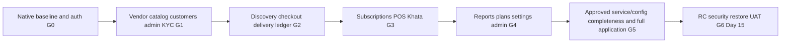

# TASKS — Implementation Plan

| Field | Value |
|---|---|
| Status | Draft v0.1 |
| Owner | Technical Architect + Product Manager |
| Last updated | 2026-10-29 |
| Related | [ROADMAP](ROADMAP.md), [AGENTS](AGENTS.md), [SRS](../02-requirements/SRS.md), [TEST_CASES](../07-testing/TEST_CASES.md) |

## 1. How to Use
- **Default delivery cycle:** `TODO → IN_PROGRESS → READY_FOR_VERIFY → DONE`; `DEFERRED (SR-xx)` means approved post-delivery backlog, not completion; use `BLOCKED (Q-xx)` when required decisions are unresolved.
- **FAST implementation:** follow [PROMPTS.md](PROMPTS.md) §1; implement the smallest runnable slice and run targeted checks only. Do not mark DONE until manual verification and required DoD checks.
- **RUN / VERIFY:** follow PROMPTS §4 to start the affected service/app; verify the task's `Done when` behavior manually. Fix defects with PROMPTS §5.
- **Temporary mobile verification scope (2026-10-29):** run and verify mobile tasks on Android only. iOS builds, runs, runtime/device/simulator testing, signing, TestFlight, VoiceOver and E2E are deferred until after Android production release and do not block current task completion. Preserve iOS implementation/configuration; record iOS checks as deferred, never as passed. Other acceptance criteria and manual verification gates still apply.
- **FINALIZE:** after manual PASS, follow PROMPTS §6 for task-level checks, docs and DONE status; run PROMPTS §13 comprehensive checks only at module completion.
- **Dependency policy:** downstream tasks may start only when prerequisite tasks are DONE or READY_FOR_VERIFY, for implementation against stable contracts. Required prior module gates must pass before claiming integrated completion. READY_FOR_VERIFY permits provisional parallel work only; module gates cannot pass until prerequisite tasks have manual PASS/DONE and their module gates pass.
- **Agent efficiency:** inspect only the selected row, direct dependencies and linked requirement sections; avoid loading the entire documentation set.

- Pick the highest-priority eligible task in ROADMAP daily order. Task IDs are stable references, not execution order. Update **Status** as work progresses (`TODO → IN_PROGRESS → READY_FOR_VERIFY → DONE`, or `BLOCKED (Q-xx)`).
- **Done when** criteria are in addition to the global Definition of Done in [AGENTS §6](AGENTS.md#6-definition-of-done-every-task).
- Layers: API = backend, MOB = Flutter, ADM = admin, OPS = infra/CI.
- Number ranges are reserved per milestone; gaps are intentional for later insertion.

## 2. M0 — Foundations
| ID | Task | Layer | Refs | Deps | Done when | Status |
|---|---|---|---|---|---|---|
| T-001 | Create monorepo skeleton per FOLDER_STRUCTURE; melos, pnpm, turbo, .fvmrc, .nvmrc, editorconfig, bootstrap & codegen scripts | OPS | ADR-003 | — | `tools/bootstrap.sh` works on clean macOS; README commands verified | DONE |
| T-002 | Local native PostgreSQL/PostGIS setup and persistent upload directory | OPS | ENVIRONMENT_SETUP | T-001 | Native DB connects; root writable with restricted permissions; no container services required | IN_PROGRESS (scope revised; native connectivity verification pending) |
| T-003 | CI pipelines (lint, test, build) with path filters | OPS | GIT_CICD §4 | T-001 | PR checks run for mobile/api/admin | DONE |
| T-004 | NestJS app skeleton: config validation, pino, OTel, Problem Details filter, health endpoints, request-id, rate limiter | API | ARCHITECTURE §7, QUALITY §2–3 | T-001 | `/health/ready` OK; error format test passes | DONE |
| T-005 | Prisma schema v1 for identity tables + migrations + seed (categories, plans) | API | DATA_DESIGN §3.1, §3.8, §7 | T-004 | Migration applies; seed idempotent | DONE |
| T-006 | Idempotency interceptor + `idempotency_keys` + outbox_events dispatcher | API | ARCHITECTURE §7 | T-005 | TC-500, TC-501 pass | DONE |
| T-007 | OpenAPI generation + CI diff + Dart & TS client generation | OPS/API | ADR-013 | T-004 | `tools/codegen.sh` produces clients; CI fails on drift | DONE |
| T-008 | Flutter app skeleton: flavors (dev/staging/prod), bootstrap, error zones, Firebase per flavor | MOB | MOBILE_STRATEGY §2 | T-001 | App runs on Android for all 3 flavors; iOS verification deferred | READY_FOR_VERIFY (targeted checks pass; Android runs and real Firebase configuration verification pending; iOS verification deferred) |
| T-009 | `ui_kit`: tokens, English fonts and core accessible components | MOB | UI_UX_GUIDELINES, DESIGN | T-008 | Focused widget/accessibility checks and representative screen smoke pass | IN_PROGRESS (existing implementation; English-only cleanup T-183 and UI verification pending) |
| T-010 | English ARB strings, formatters (INR, IST dates) | MOB | ADR-019, RULE-01 | T-008 | Unit tests for `formatInr` (TC-502) | READY_FOR_VERIFY (previous focused formatter checks; English-only cleanup/verification pending T-183) |
| T-011 | Core network: dio, auth interceptor single-flight refresh, idempotency header, error mapping | MOB | MODULE_DESIGN §3.1, QUALITY §2.1 | T-007, T-008 | Unit tests for refresh race & mapping | READY_FOR_VERIFY (focused network/localization checks pass; live session integration belongs to T-015) |
| T-012 | Secure storage + drift DB with SQLCipher + migrations framework | MOB | ADR-006 | T-008 | DB opens encrypted; wipe on logout | READY_FOR_VERIFY (6 focused storage tests and targeted analysis pass; native encryption/wipe verification pending) |
| T-013 | Router with guards, shells placeholders, deep-link parser | MOB | MOBILE_STRATEGY §3–4 | T-008 | Guard unit tests; deep link test routes | READY_FOR_VERIFY (20 focused router/app-shell tests and targeted analysis pass; provisional A-17 customer tabs approved; native link registration awaits Q-33) |
| T-014 | OTP providers adapters (console, SMS, WhatsApp) + OTP service + rate limits | API | FR-001–FR-003, AUTH_SECURITY §2.1 | T-005, T-180 | TC-001–TC-006 pass (API) | IN_PROGRESS (previous focused checks retained as history; PostgreSQL policy migration and concurrency verification required by T-180) |
| T-015 | Sessions: tokens, refresh rotation, reuse detection, logout/all, `/me`, roles, active role, consent | API | FR-005, FR-006, FR-009 | T-014 | TC-007–TC-010 pass | IN_PROGRESS (prior focused API/TS checks; Dart serializer completion and live PostgreSQL session verification pending) |
| T-016 | Mobile auth flow S-COM-01, S-COM-03–S-COM-05, consent; no language selector | MOB | US-001–US-005, US-007 | T-009–T-015, T-180, T-183 | Login → role switch → refresh/logout UI/API smoke; full auth E2E at G0 | TODO |
| T-017 | Basic API `/config`, min-version force update and simple flags; no Remote Config campaigns | MOB/API | FR-408 | T-016 | Config persists/loads; min-version blocks unsupported Android app; no experimentation dependency | TODO |
| T-018 | Basic crash diagnostics using existing configuration and redacted logs; advanced analytics/performance telemetry deferred | MOB/API | QUALITY | T-008, T-004 | Android test diagnostic captured when configured; no PII; basic errors available; unavailable checks explicit | TODO |
| T-019 | Account deletion (API + S-COM-10) | API/MOB | FR-008, US-006 | T-016 | TC-012 pass | TODO |

## 3. M1 — Vendor Core + Admin KYC
| ID | Task | Layer | Refs | Deps | Done when | Status |
|---|---|---|---|---|---|---|
| T-020 | Local media multipart upload, validation/quarantine and authorized file stream | API | ADR-023, LOCAL_FILE_STORAGE, FR-012 | T-005, T-015, T-182 | TC-503/508; upload → metadata → attachment → authorized display; no raw paths or public KYC | TODO |
| T-021 | Vendors module: category, business info, onboarding step, settings defaults | API | FR-010, FR-011, FR-016 | T-015 | TC-020–TC-022 | TODO |
| T-022 | Manual KYC submission/review state machine, encrypted bank data, method and audit; automated providers deferred | API | FR-013–FR-015, ADR-024, TC-509 | T-020, T-021, T-152 | Submission → MANUAL_REVIEW → authorized VERIFIED/REJECTED with reason/audit/notification; automated checks NOT_RUN | TODO |
| T-023 | Service area (radius + pincodes) with PostGIS | API | FR-018 | T-021 | TC-028 | TODO |
| T-024 | Mobile onboarding S-V-01–S-V-04 with resumable drafts, uploads, FLAG_SECURE | MOB | US-010–US-013 | T-016, T-021, T-022 | TC-020–TC-027 (UI) | TODO |
| T-025 | Service area address/coordinate form with optional GPS; radius/pincode validation | MOB | US-014, SR-04 | T-016, T-023 | Valid coordinates/pincodes persist; invalid/outside coverage handled; no maps provider | TODO (Q-32 provider dependency removed by approved SR-04) |
| T-026 | Catalog API: products CRUD, soft delete rule, stock movements, low-stock event | API | FR-030–FR-036 | T-021, T-020 | TC-035–TC-041 | TODO |
| T-027 | Mobile products S-V-06, S-V-07, S-V-35 + cache | MOB | US-030–US-032 | T-026 | Screen build/lint/smoke; comprehensive widget/E2E at module gate | TODO |
| T-028 | Customers API: vendor_customers CRUD, limits hook, link requests | API | FR-060–FR-064 | T-021 | TC-060–TC-064 | TODO |
| T-029 | Mobile vendor customers S-V-12–S-V-14 (tabs stubbed until M2/M3) | MOB | US-060–US-062 | T-028 | Widget tests | TODO |
| T-030 | Dashboard API (direct SQL metrics; no cache service) | API | FR-020–FR-022 | T-026, T-028 | TC-030 | TODO |
| T-031 | Mobile vendor shell, bottom nav, dashboard S-V-05, More S-V-19 | MOB | US-020 | T-030 | TC-030–TC-031 | TODO |
| T-032 | Vendor notifications infra: push tokens, FCM adapter, inbox API, prefs | API | FR-100–FR-103 | T-015, T-181 | TC-100–TC-102 | TODO |
| T-033 | Mobile notifications center + push handling + permission pre-prompt | MOB | US-100, US-101 | T-032 | TC-100–TC-104 | TODO |
| T-150 | Admin app skeleton, login + TOTP, RBAC, session | ADM/API | FR-400 | T-015, T-180 | Real Next.js checks; admin login/TOTP/RBAC/session smoke; comprehensive tests at G1 | TODO |
| T-151 | Admin manual KYC queue/review with document audit and explicit provider NOT_RUN state | ADM/API | FR-402 | T-022, T-150, T-152 | TC-402/403/509; only permitted reviewers decide with reason/method/audit; no simulated provider verification | TODO |
| T-152 | Audit module + viewer S-A-16 | API/ADM | FR-411 | T-150 | TC-408 | TODO |
| T-153 | Admin categories S-A-08 | ADM/API | FR-405 | T-150 | CRUD tests | TODO |

## 4. M2 — Ordering Loop
| ID | Task | Layer | Refs | Deps | Done when | Status |
|---|---|---|---|---|---|---|
| T-040 | Addresses API: validated address/pincode/coordinates; no geo-provider adapter | API | FR-291 | T-015 | TC-290 | TODO |
| T-041 | Discovery API: geo coverage, Nearby/Popular, verified vendor details, products, search and favorites; no ratings | API | FR-202, FR-210–FR-212, FR-214 | T-023, T-026, T-022, T-084, T-103 | TC-200–TC-210 active cases only; no rating sort/reviews dependency | TODO |
| T-042 | Customer home API: categories and today’s deliveries; marketing banners deferred | API | FR-201 | T-041 | TC-201 | TODO |
| T-043 | Mobile customer shell + Home S-C-01, location S-C-02, search S-C-03 | MOB | US-200–US-202 | T-042, T-016, T-047 | TC-200–TC-203 | TODO |
| T-044 | Mobile discovery S-C-05–S-C-08, S-C-37 | MOB | US-210, US-211 | T-041, T-016 | TC-204–TC-210 | TODO |
| T-045 | Orders API: quote, place (FR-225 validations), state machine, history, capacity | API | FR-040–FR-046, FR-220–FR-225 | T-026, T-028, T-006, T-015, T-040, T-022, T-084, T-103 | TC-045–TC-051, TC-220–TC-232 | TODO |
| T-046 | Mobile cart & checkout S-C-11, place new order S-C-12 | MOB | US-220, US-221 | T-045, T-040, T-016, T-047 | TC-220–TC-232 | TODO |
| T-047 | Mobile addresses S-C-28/29 | MOB | US-290 | T-040, T-016 | TC-290 | TODO |
| T-048 | Mobile vendor orders S-V-08–S-V-10 | MOB | US-040–US-042 | T-045, T-016 | TC-045–TC-050 | TODO |
| T-049 | Deliveries API + transactional delivered side effects (ledger debit and stock) | API | FR-080, FR-081 | T-045, T-070 | Delivery replay creates exactly one stock movement/debit; full flow at G2 | TODO |
| T-050 | Mobile deliveries S-V-16 with outbox + sync queue S-V-34 | MOB | US-080 | T-049, T-012 | TC-086–TC-088, TC-504 | TODO |
| T-051 | Customer my orders & tracking S-C-13/14, cancel, reorder | MOB/API | US-240, US-241 | T-045, T-049, T-016 | TC-240–TC-245 | TODO |
| T-052 | Order notifications fan-out (all FR-101 order events) + deep links | API/MOB | FR-101, FR-104 | T-032, T-045 | TC-103–TC-104 | TODO |
| T-053 | Link offline customer flow S-C-38 | MOB/API | FR-064 | T-028 | TC-064 | TODO |

## 5. M3 — Daily Operations
| ID | Task | Layer | Refs | Deps | Done when | Status |
|---|---|---|---|---|---|---|
| T-070 | Ledger module: entries, balances, reversal, reconciliation job, DB grants | API | FR-110–FR-116, ADR-021 | T-005, T-028 | Append-only ledger, reversal, atomic balance and reconciliation; no order dependency cycle | TODO |
| T-071 | Wire DEBIT/CREDIT side effects for delivered orders & payments | API | RULE-10 | T-070, T-049 | TC-087, TC-111 | TODO |
| T-072 | Subscriptions API: CRUD, approval, pause/resume/skip, cutoff logic | API | FR-070–FR-073, FR-076, FR-077, FR-230–FR-232 | T-045 | TC-070–TC-079 | TODO |
| T-073 | PostgreSQL-backed generation job at 22:00 IST, idempotency, restart catch-up and alerts | API | FR-074, NFR-006, ADR-023 | T-072, T-181 | TC-080–TC-084 | TODO |
| T-074 | Holidays / pause / availability API + order cancellation side effects | API | FR-082–FR-085, RULE-20 | T-073 | TC-089–TC-091 | TODO |
| T-075 | Subscription settings API (auto-accept, caps, pause all) | API | FR-075 | T-072 | TC-078 | TODO |
| T-076 | Mobile vendor subscriptions S-V-15, S-V-21 | MOB | US-070–US-073 | T-072, T-075 | Screen build/lint/smoke; full E2E at module gate | TODO |
| T-077 | Mobile availability & holidays S-V-22 | MOB | US-081 | T-074 | TC-089–TC-091 | TODO |
| T-078 | Mobile customer subscriptions S-C-09, S-C-10, S-C-15, S-C-16 (+ statement) | MOB | US-074–US-076 | T-072, T-082, T-016 | TC-070–TC-077 | TODO |
| T-079 | Quick sale API | API | FR-050–FR-054 | T-070, T-026, T-028 | TC-055–TC-059 | TODO |
| T-080 | Mobile quick sale S-V-11 with outbox | MOB | US-050, US-051 | T-079, T-050 | TC-055–TC-059 | TODO |
| T-081 | Mobile vendor Khata S-V-23–S-V-26 (payments, claims, opening, reversal) | MOB | US-110–US-114 | T-070, T-082, T-016 | TC-110–TC-116 | TODO |
| T-082 | Customer Khata API (summary, vendor entries, claims) + personal contacts/entries API | API | FR-250–FR-253 | T-070 | TC-250–TC-255 | TODO |
| T-083 | Mobile customer Khata S-C-17–S-C-20 with Android UPI intent and no-UPI-app fallback; iOS validation after Android release | MOB | US-250–US-252 | T-082, T-016 | TC-250–TC-256 | TODO |
| T-084 | Plan gating guard and customer-limit hook using audited manual assignments; default plans for test fixtures only | API | FR-122, FR-123 | T-028, T-015 | TC-120–TC-121 | TODO |

## 6. M4 — Business Features & Admin Completion
| ID | Task | Layer | Refs | Deps | Done when | Status |
|---|---|---|---|---|---|---|
| T-100 | Reports API: SQL summary, daily-sales table and product-wise data; chart polish deferred | API | FR-090–FR-093, FR-095 | T-079, T-070 | TC-095–TC-096 reduced table scope; paise/IST totals reconcile | TODO |
| T-101 | CSV-only server-authorized report export/share; PDF deferred | API | FR-094, SR-04, TC-512 | T-100 | CSV matches reports, tenant authorization and safe cell encoding; download/share works | TODO (Q-23 resolved: CSV-only under approved SR-04) |
| T-102 | Mobile report summaries/tables and CSV download/share | MOB | US-090, US-091, SR-04 | T-100, T-101 | Summary/daily/product tables render; CSV shares; locked tier enforced; no chart/PDF requirement | TODO |
| T-103 | Plan catalog, audited manual assignment service, server entitlements and expiry reminders | API | FR-120, FR-122–FR-125, FR-406, ADR-024 | T-084, T-181, T-152 | Admin grant/extension with reason/dates/idempotency changes entitlements atomically and audits; expiry policy Q-04; no purchase prerequisite | TODO |
| T-104 | POST-DELIVERY: Billing provider implementation per ADR-015 | API/MOB | FR-121, FR-126 | T-103 | Future acceptance only; excluded from G0–G6 by SR-03. TC-122 | DEFERRED (SR-03; user approved 2026-10-29) |
| T-105 | Mobile plan catalog/current assignment/validity and locked-feature guidance; no checkout or invoice UI | MOB | US-120, US-121, SR-03 | T-103, T-016 | Assigned plan and limits reflect DB; support-assisted guidance; no payment-link/checkout/invoice CTA | TODO |
| T-106 | Vendor settings S-V-20, S-V-31–S-V-33 incl. re-verification rule | MOB/API | FR-130–FR-132, RULE-22 | T-021, T-022, T-016 | TC-130–TC-131 | TODO |
| T-107 | Help/FAQ/legal (content module + S-V-29, S-C-34, S-COM-08) | MOB/API | FR-133, FR-134, FR-296 | T-017 | TC-132 | TODO |
| T-108 | POST-DELIVERY: Reviews API + S-C-35 + vendor rating aggregation | API/MOB | FR-213 | T-045 | Future acceptance only; excluded from G0–G6 by SR-05. TC-211–TC-212 | DEFERRED (SR-05; user approved 2026-10-29) |
| T-154 | Admin dashboard S-A-02 | ADM/API | FR-401 | T-150 | Real DB values; plan grants never counted as paid revenue; unavailable billing metric explicit | TODO |
| T-155 | Admin vendors & customers S-A-05–S-A-07 (suspend/block, badges) | ADM/API | FR-403, FR-404 | T-150 | TC-404–TC-405 | TODO |
| T-156 | Admin plan catalog and audited vendor assignment/extension; billing deferred | ADM/API | FR-406, SR-03, TC-510 | T-103, T-150, T-152 | Authorized reason/dates/idempotency flow updates effective limits with audit; invalid/unauthorized grants denied; no payments/invoices fabricated | TODO |
| T-157 | POST-DELIVERY: Admin banners S-A-11 (coupons blocked Q-06) | ADM/API | FR-407 | T-150 | Future acceptance only; excluded from G0–G6 by SR-05. CRUD tests | DEFERRED (SR-05; user approved 2026-10-29) |
| T-158 | Admin CMS & app config S-A-12/13 | ADM/API | FR-408 | T-150 | TC-407 | TODO |
| T-159 | POST-DELIVERY: Admin broadcasts S-A-14 | ADM/API | FR-409 | T-032, T-150 | Future acceptance only; excluded from G0–G6 by SR-05. TC-409 | DEFERRED (SR-05; user approved 2026-10-29) |
| T-160 | POST-DELIVERY: Admin review moderation S-A-15 | ADM/API | FR-410 | T-108, T-150 | Future acceptance only; excluded from G0–G6 by SR-05. TC-410 | DEFERRED (SR-05; user approved 2026-10-29) |
| T-161 | Admin data-subject requests S-A-18 + privacy jobs | ADM/API | FR-412, FR-008 | T-019, T-150 | TC-012 | TODO |
| T-162 | Admin users & roles S-A-17, reports export S-A-19 | ADM/API | FR-400, FR-413 | T-150 | RBAC tests | TODO |

## 7. M5 — Customer Extended
| ID | Task | Layer | Refs | Deps | Done when | Status |
|---|---|---|---|---|---|---|
| T-120 | POST-DELIVERY: Money API + S-C-21/22 (pie + table alt) | API/MOB | FR-260–FR-262 | T-015 | Future acceptance only; excluded from G0–G6 by SR-01. TC-260–TC-262 | DEFERRED (SR-01; user approved 2026-10-29) |
| T-121 | POST-DELIVERY: Money auto-import | API | FR-263 | T-120 | Future acceptance only; excluded from G0–G6 by SR-01. — | DEFERRED (SR-01; user approved 2026-10-29) |
| T-122 | Services screen S-C-04 (category types, coming soon) | MOB | FR-270 | T-042 | TC-270 | TODO |
| T-123 | POST-DELIVERY: Bill payments module + S-C-23/24 behind flag | API/MOB | FR-271, FR-272 | T-122 | Future acceptance only; excluded from G0–G6 by SR-02. TC-271 | DEFERRED (SR-02; user approved 2026-10-29) |
| T-124 | POST-DELIVERY: Grocery parse API (text → items → catalog match, English) | API | FR-282 | T-026 | Future acceptance only; excluded from G0–G6 by SR-01. TC-280–TC-282 | DEFERRED (SR-01; user approved 2026-10-29) |
| T-125 | POST-DELIVERY: Mobile grocery voice/image S-C-25 (speech_to_text, ML Kit) behind flag | MOB | FR-280, FR-281, FR-283 | T-124 | Future acceptance only; excluded from G0–G6 by SR-01. TC-280–TC-283 | DEFERRED (SR-01; user approved 2026-10-29) |
| T-126 | Profile, edit profile, settings, about S-C-27, S-C-33, S-C-36 | MOB | FR-290, FR-295, FR-297 | T-016 | TC-291–TC-293 | TODO |
| T-127 | POST-DELIVERY: Insights API + S-C-32 | API/MOB | FR-294 | T-120, T-045 | Future acceptance only; excluded from G0–G6 by SR-01. TC-294 | DEFERRED (SR-01; user approved 2026-10-29) |
| T-128 | POST-DELIVERY: Payment methods S-C-30 | MOB | FR-292 | — | Future acceptance only; excluded from G0–G6 by SR-02. — | DEFERRED (SR-02; user approved 2026-10-29) |
| T-129 | POST-DELIVERY: Invite & earn S-C-31 + referral API behind flag | API/MOB | FR-293 | — | Future acceptance only; excluded from G0–G6 by SR-02. — | DEFERRED (SR-02; user approved 2026-10-29) |
| T-130 | POST-DELIVERY: Coupons | API/MOB/ADM | FR-222 | — | Future acceptance only; excluded from G0–G6 by SR-02. — | DEFERRED (SR-02; user approved 2026-10-29) |

## 8. M6 — Hardening & Launch
| ID | Task | Layer | Refs | Deps | Done when | Status |
|---|---|---|---|---|---|---|
| T-170 | Representative Android startup/frame/memory/size checks and fixes | MOB | NFR-001, NFR-002, NFR-013 | G4 | Representative Android startup/frame/memory/size checks; defects fixed; advanced tuning deferred by approved SR-06 | TODO |
| T-171 | Representative API load and demonstrated bottleneck fixes; scale campaign deferred | API | NFR-003, NFR-005 | G4 | Representative API load within approved capacity; bottlenecks fixed; broad target-scale campaign SR-06 | TODO |
| T-172 | Android TalkBack, semantics and 200% text-scale audit; iOS after Android release | MOB | NFR-010 | G4 | Android TalkBack and 200% scale; iOS verification remains explicitly deferred | TODO |
| T-173 | Focused security/dependency/tenant/input review and fixes; independent external audit scheduling deferred | ALL | AUTH_SECURITY §9 | G4 | Security/authZ/input/tenant/dependency checks; no open high/critical; independent external audit scheduling SR-06 | TODO |
| T-174 | Retired task ID — extra-language copy review removed | MOB | ADR-023 | — | No implementation work; do not reuse this ID | REMOVED (explicit user direction 2026-10-29) |
| T-175 | Native host setup, encrypted DB/files backups and paired restore drill | OPS | NFR-017, ADR-023, LOCAL_FILE_STORAGE | T-002, T-182; Q-02 | Restore DB + files consistently; record observed RPO/RTO against agreed targets | BLOCKED (Q-02 hosting decision; local restore preparation may proceed) |
| T-176 | Alerts & dashboards per QUALITY §7 | OPS | NFR-016 | T-175, T-181 | Alerts fire in staging drill | TODO |
| T-177 | Android Play assets/listing/privacy/Data safety/review notes/demo accounts; iOS package after Android release | OPS/PM | DEPLOYMENT_OPERATIONS §4 | G5 | Android English release package ready; submission requires approval; iOS assets/signing/TestFlight do not block | TODO |
| T-178 | Closed beta (vendors + customers in launch city) & fixes | ALL | ROADMAP M6 | G5 | Internal synthetic-account UAT and defect fixes by Day 15; external closed beta scheduling separate | TODO |
| T-179 | Android production release and staged rollout; iOS validation follows after Android release | OPS | DEPLOYMENT_OPERATIONS §5 | T-175, T-176, T-177, T-178 | Android release authorization/store prerequisites and monitoring green; record actual release to unlock iOS validation | TODO |

## 9. Baseline reconciliation (no application code changed by this revision)
Existing DONE tasks record prior work, not compliance with the revised architecture. Reconcile through these new tasks; preserve past evidence and rerun affected checks. New tasks are TODO until explicitly implemented.

| ID | Task | Layer | Refs | Deps | Done when | Status |
|---|---|---|---|---|---|---|
| T-180 | Move OTP, attempt counters, cooldowns, shared rate limits and session abuse controls to PostgreSQL | API | ADR-023, AUTH_SECURITY | T-005 | Atomic per-mobile/IP/device limits and single-use verification survive concurrency/restart; hashed/HMAC keys, expiry cleanup and fail-closed errors; old client dependency/config removed | TODO |
| T-181 | Reconcile worker/outbox and durable scheduling with PostgreSQL | API | ADR-023, ARCHITECTURE §8 | T-005, T-006 | Due-job uniqueness, leased row claims, bounded retries, restart catch-up and failure alerts; no broker dependency; preserve transactional financial effects | TODO |
| T-182 | Native runtime/storage configuration and obsolete infrastructure dependency cleanup | OPS/API | ADR-023, ENVIRONMENT_SETUP | T-001 | Native PostgreSQL/files baseline; deferred provider/telemetry credentials/packages excluded from active setup/CI; no removed service required; shared retained libraries preserved | TODO |
| T-183 | English-only app/UI-kit cleanup and remove visual snapshot generation/refresh tooling | MOB | ADR-023, FR-007, TC-014 | T-008, T-009, T-010 | English-only and snapshot cleanup; deferred-feature navigation/permissions removed or omitted; iOS source/config preserved; Android build/lint/smoke pass | TODO |
| T-184 | Implement task checks and module-gate CI cadence | OPS | TEST_STRATEGY, GIT_CICD | T-003, T-182 | Real task checks and comprehensive module suites on native DB; mobile builds/runs/tests target Android only; no iOS signing/runner/secrets requirement | TODO |

## 10. Priority, dependencies and gates
ROADMAP assigns all task IDs to module/day groups; these tables remain the acceptance and status register. Do not start by numeric ID. Critical chain:

- T-070 ledger foundation may proceed with vendor/customer APIs; T-049 cannot be considered delivered with a ledger stub. T-071 verifies the atomic financial wiring rather than postponing it.
- T-084 server-side entitlements precedes discovery/order access; default development plans are test fixtures, not production purchase evidence. Q-04/Q-18 visibility/expiry decisions still apply.
- Each task uses build/lint/smoke plus focused critical checks. Comprehensive TC sets in `Done when` are module-gate coverage, not instructions to run the full suite on every task.
- No gate may pass with a stub on the demonstrated path. READY_FOR_VERIFY dependencies permit provisional development only. Module gates require relevant tasks DONE, manual PASS and the comprehensive module suite.
- G0–G6 are module gates defined in ROADMAP, not task statuses. Record actual gate evidence below; all are currently NOT RUN under the revised baseline.

| Gate | Status | Evidence |
|---|---|---|
| G0 Auth/baseline | NOT RUN | Pending implementation and real DB/UI checks |
| G1 Vendor/admin core | NOT RUN | Pending |
| G2 Ordering and delivery | NOT RUN | Pending |
| G3 Daily operations | NOT RUN | Pending |
| G4 Business/admin completion | NOT RUN | Pending |
| G5 Approved application scope | NOT RUN | Approved SR-01–SR-06; active-scope integration pending |
| G6 RC/UAT/restore | NOT RUN | Pending |

## 11. Approved scope selection and future platform task
SR-01–SR-06 are approved (user, 2026-10-29; ADR-024). Skip DEFERRED/REMOVED tasks in active selection and completion counts; retain their IDs/ACs as future references. Do not convert deferral to DONE or build placeholder feature routes. DELIVERY_SCOPE maps active/simplified requirements, screens and tests. T-022 is manual-review only; T-103/T-156 must provide actual audited plan grants before discovery; T-101 is CSV-only and unblocked by Q-23.

| ID | Task | Layer | Refs | Deps | Done when | Status |
|---|---|---|---|---|---|---|
| T-185 | After Android production release: validate and prepare iOS build/runtime/distribution | MOB/OPS | ADR-025, MOBILE_STRATEGY | T-179 | After documented Android release, validate shared-code changes on iOS; signing/build/native storage/OTP/APNs/deep links/UPI fallback/VoiceOver/E2E and iOS privacy/store package; record real evidence and fix platform defects | DEFERRED (ADR-025; after Android production release, outside G0–G6) |
