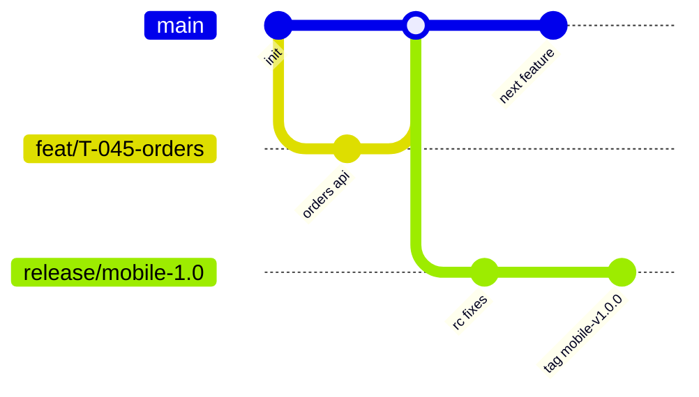

# GIT & CI/CD

| Field | Value |
|---|---|
| Status | Draft v0.1 |
| Owner | DevOps Engineer |
| Last updated | 2026-10-29 |
| Related | [CODING_STANDARDS](CODING_STANDARDS.md), [DEPLOYMENT_OPERATIONS](../08-deployment-operations/DEPLOYMENT_OPERATIONS.md), [ENVIRONMENT_SETUP](ENVIRONMENT_SETUP.md) |

Assumes GitHub + GitHub Actions (A-14, Q-31).

## 1. Branching Strategy (trunk-based with release branches)
| Branch | Purpose | Rules |
|---|---|---|
| `main` | Always releasable; deploys to **staging** automatically | Protected; PR + checks + reviews; squash merge; linear history |
| `feat/T-xxx-short-desc`, `fix/…`, `chore/…`, `docs/…` | Short-lived work (< 3 days) | Rebased on main |
| `release/mobile-x.y` | Mobile release stabilization | Created at code freeze; only fixes cherry-picked from main |
| `hotfix/x.y.z` | Urgent production fix | From release tag; merged back to main |
Backend/admin deploy continuously from `main` (staging) and via tagged promotion to prod (`api-vX.Y.Z`, `admin-vX.Y.Z`).

## 2. Commits & Versioning
- Conventional Commits (`feat`, `fix`, `docs`, `refactor`, `test`, `chore`, `perf`, `ci`, `build`) with scope and IDs (AGENTS §7). `commitlint` enforced.
- Mobile version: SemVer `MAJOR.MINOR.PATCH` (marketing) + build number = CI run number (monotonic across platforms).
- API/admin: SemVer tags; API URI version `/v1` independent.
- Tags: `mobile-v1.0.0`, `api-v1.0.0`, `admin-v1.0.0`.

## 3. Pull Requests
- Template includes: summary, IDs (FR/US/T/TC), screenshots English, test evidence, migration notes, rollout/flag notes, checklist (AGENTS §6).
- Size ≤ 400 lines (excl. generated); draft PRs for early feedback.
- CODEOWNERS: `apps/api/src/modules/{ledger,auth,kyc,subscriptions}` and `infra/` require 2 reviewers.
- Required checks must pass; no force-push to protected branches.

## 4. CI Pipelines
Target cadence (T-184 implements; do not count placeholder scripts as successful checks):

| Workflow | Trigger | Checks |
|---|---|---|
| Mobile task | Affected task/PR | Targeted format/analyze, lightweight Android build, focused changed-critical-logic/widget tests, runnable screen smoke |
| API task | Affected task/PR | Real lint, build/typecheck, focused critical-logic checks, readiness/endpoint smoke against native PostgreSQL; contract drift check only when changed |
| Admin task | Affected task/PR | Real lint/typecheck/build and page/API smoke after T-150; focused changed-critical-logic checks |
| Module verification | Explicit module completion G0–G5 | Comprehensive API integration, admin/mobile E2E and relevant previous-module regression; native PostgreSQL/PostGIS test DB and isolated file root |
| Release candidate | G6 | Full retained-scope integration/regression/E2E, security, accessibility, representative performance and restore evidence |
| Docs | Documentation change | Whitespace, links/references, dependency/acceptance consistency |

Secret/dependency review remains part of review; do not run an exhaustive audit farm after every task. No nightly comprehensive test mandate or visual snapshot baseline machinery. Current CI source is unchanged in this planning revision; T-184 reconciles workflows and real API lint, T-150 real admin scripts.

## 5. CD Pipelines
| Workflow | Trigger | Result |
|---|---|---|
| `api-deploy-staging` | merge to main | Build versioned artifact → apply reviewed migrations → supervised native API/worker restart on staging host → smoke tests |
| `api-deploy-prod` | tag `api-v*` + manual approval | Same immutable artifact promoted → reviewed migrations → supervised restart → smoke → restore previous artifact on failed health |
| `admin-deploy-*` | same pattern | |
| `mobile-beta` | push to `release/mobile-*` or manual | Existing Android AAB build → Play internal track (with authorization); Android/Dart crash symbols only; iOS TestFlight/dSYMs deferred until after Android production release |
| `mobile-release` | tag `mobile-v*` + manual approval | Promote Android to Play production (staged rollout); App Store pipeline deferred to T-185 after Android release |
Mobile flavors: `dev` (local/dev API), `staging` (staging API, Firebase staging), `prod`.

## 6. Build Automation
- Reuse existing Android build/signing scripts; Android upload key from CI secrets with Play App Signing. Do not create iOS lanes/signing jobs now; preserve any existing source for T-185 after Android release.
- Build config via `--dart-define-from-file=config/<flavor>.json` + `--obfuscate --split-debug-info=build/symbols`.
- Caching: pub cache, Gradle, CocoaPods, pnpm store, Turborepo remote cache (optional).
- Current Android checks do not require macOS/iOS runners or Apple signing secrets. iOS build/test/distribution workflows remain disabled/excluded until T-185 after Android release.

## 7. Release Management
| Step | Owner |
|---|---|
| Code freeze → cut `release/mobile-x.y` | Mobile lead |
| Regression suite (TEST_STRATEGY §5) on RC | QA |
| Release notes English (PROMPTS §12) | PM |
| Go/no-go checklist (DEPLOYMENT_OPERATIONS §5) | PM + Eng |
| Staged rollout & monitoring | DevOps |
Backend must be deployed and backward compatible **before** mobile release that depends on it.

## 8. Secrets in CI
GitHub Environments (`staging`, `production`) with required reviewers for production; OIDC to cloud (no long-lived cloud keys); secrets list in [ENVIRONMENT_SETUP §4](ENVIRONMENT_SETUP.md#4-environment-variables--secrets).

## 9. Platform activation
ADR-025 makes Android the only active mobile platform. Workflow source is not changed in this documentation turn; T-184 reconciles CI so iOS jobs/secrets/required checks cannot block Android. After documented Android production release T-179, T-185 validates and enables the iOS pipeline. Deferred SR integrations likewise have no active CI provider prerequisite.
