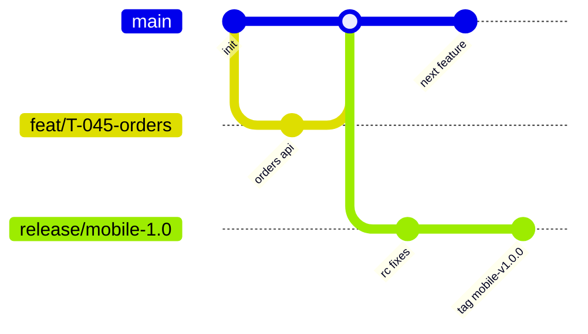

# GIT & CI/CD

| Field | Value |
|---|---|
| Status | Draft v0.1 |
| Owner | DevOps Engineer |
| Last updated | 2026-10-19 |
| Related | [CODING_STANDARDS](CODING_STANDARDS.md), [DEPLOYMENT_OPERATIONS](../08-deployment-operations/DEPLOYMENT_OPERATIONS.md), [ENVIRONMENT_SETUP](ENVIRONMENT_SETUP.md) |

Assumes GitHub + GitHub Actions (A-14, Q-31).

## 1. Branching Strategy (trunk-based with release branches)
| Branch | Purpose | Rules |
|---|---|---|
| `main` | Always releasable; deploys to **staging** automatically | Protected; PR + checks + reviews; squash merge; linear history |
| `feat/T-xxx-short-desc`, `fix/…`, `chore/…`, `docs/…` | Short-lived work (< 3 days) | Rebased on main |
| `release/mobile-x.y` | Mobile release stabilization | Created at code freeze; only fixes cherry-picked from main |
| `hotfix/x.y.z` | Urgent production fix | From release tag; merged back to main |
Backend/admin deploy continuously from `main` (staging) and via tagged promotion to prod (`api-vX.Y.Z`, `admin-vX.Y.Z`).

## 2. Commits & Versioning
- Conventional Commits (`feat`, `fix`, `docs`, `refactor`, `test`, `chore`, `perf`, `ci`, `build`) with scope and IDs (AGENTS §7). `commitlint` enforced.
- Mobile version: SemVer `MAJOR.MINOR.PATCH` (marketing) + build number = CI run number (monotonic across platforms).
- API/admin: SemVer tags; API URI version `/v1` independent.
- Tags: `mobile-v1.0.0`, `api-v1.0.0`, `admin-v1.0.0`.

## 3. Pull Requests
- Template includes: summary, IDs (FR/US/T/TC), screenshots EN/HI, test evidence, migration notes, rollout/flag notes, checklist (AGENTS §6).
- Size ≤ 400 lines (excl. generated); draft PRs for early feedback.
- CODEOWNERS: `apps/api/src/modules/{ledger,auth,kyc,subscriptions}` and `infra/` require 2 reviewers.
- Required checks must pass; no force-push to protected branches.

## 4. CI Pipelines
| Workflow | Trigger | Steps |
|---|---|---|
| `mobile-ci` | PR/push touching `apps/mobile`, `packages/**` | fvm setup → melos bootstrap → build_runner → `dart format --set-exit-if-changed` → analyze → unit/widget/golden tests with coverage (≥ 60% overall, ≥ 80% `domain/` & controllers) → build debug APK (smoke) |
| `api-ci` | PR/push touching `apps/api`, `contracts` | pnpm install → lint → typecheck → unit tests → e2e with Testcontainers (Postgres+PostGIS, Redis) → coverage gate → OpenAPI generate & diff → Prisma migrate diff check |
| `admin-ci` | PR/push touching `apps/admin`, `packages/ts-client` | lint → typecheck → unit → build → Playwright (against mocked API) |
| `security` | PR + nightly | CodeQL (JS/TS), Semgrep, gitleaks, dependency review, `pnpm audit`, OSV scanner for pub |
| `contracts` | PR touching API | Fail if `contracts/openapi.yaml` or generated clients out of date |
| `docs` | PR touching `docs/` | markdownlint, link check, Mermaid render check |
| `e2e-mobile` | Nightly + release branch | Patrol on Firebase Test Lab (Android matrix) and iOS simulators; critical journeys J-01–J-06 |

## 5. CD Pipelines
| Workflow | Trigger | Result |
|---|---|---|
| `api-deploy-staging` | merge to main | Build image (SHA tag) → push registry → run Prisma migrations (job) → rolling deploy API & worker → smoke tests |
| `api-deploy-prod` | tag `api-v*` + manual approval | Same image promoted (no rebuild) → migrations → blue/green or rolling → smoke → auto-rollback on failed health |
| `admin-deploy-*` | same pattern | |
| `mobile-beta` | push to `release/mobile-*` or manual | Fastlane: Android AAB → Play **internal** track; iOS IPA → **TestFlight** (internal); upload Crashlytics symbols & dSYMs |
| `mobile-release` | tag `mobile-v*` + manual approval | Promote to Play production (staged rollout) & App Store submission (phased release) |
Mobile flavors: `dev` (local/dev API), `staging` (staging API, Firebase staging), `prod`.

## 6. Build Automation
- Fastlane lanes: `android beta|release`, `ios beta|release`; match/App Store Connect API key for iOS signing (or Xcode cloud-managed certs); Android upload key from CI secrets (Play App Signing holds app key).
- Build config via `--dart-define-from-file=config/<flavor>.json` + `--obfuscate --split-debug-info=build/symbols`.
- Caching: pub cache, Gradle, CocoaPods, pnpm store, Turborepo remote cache (optional).
- macOS runners for iOS builds only.

## 7. Release Management
| Step | Owner |
|---|---|
| Code freeze → cut `release/mobile-x.y` | Mobile lead |
| Regression suite (TEST_STRATEGY §5) on RC | QA |
| Release notes EN/HI (PROMPTS §10) | PM |
| Go/no-go checklist (DEPLOYMENT_OPERATIONS §5) | PM + Eng |
| Staged rollout & monitoring | DevOps |
Backend must be deployed and backward compatible **before** mobile release that depends on it.

## 8. Secrets in CI
GitHub Environments (`staging`, `production`) with required reviewers for production; OIDC to cloud (no long-lived cloud keys); secrets list in [ENVIRONMENT_SETUP §4](ENVIRONMENT_SETUP.md#4-environment-variables--secrets).
