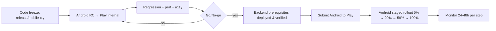

# DEPLOYMENT & OPERATIONS

| Field | Value |
|---|---|
| Status | Draft v0.1 |
| Owner | DevOps Engineer |
| Last updated | 2026-10-29 |
| Related | [GIT_CICD](../06-development/GIT_CICD.md), [QUALITY_OBSERVABILITY](../04-architecture/QUALITY_OBSERVABILITY.md), [AUTH_SECURITY](../04-architecture/AUTH_SECURITY.md) |

## 1. Environments
| Env | Purpose | Backend | Mobile distribution | Data |
|---|---|---|---|---|
| dev | Local development | Native PostgreSQL/PostGIS + Node processes | `flutter run` | Seed/fake |
| staging | Integration, QA, UAT, beta | Cloud (smaller), provider sandboxes | Play Internal / Closed testing (Android); TestFlight after Android release | Synthetic |
| prod | Live | India-hosted server (Q-02), persistent encrypted files | Play production (Android); App Store phase after Android release | Real |
Separate Firebase projects, upload directories, encryption keys, DBs and secrets per env. Staging never contains production personal data.

## 2. Initial infrastructure (ADR-023)
One persistent application host runs supervised native API, worker and Next.js processes behind HTTPS. PostgreSQL/PostGIS may run locally or as a managed service. Upload directories are outside deploy artifacts/web root, encrypted and permission-restricted, with disk-space alerts. Never expose KYC via a static web directory. See LOCAL_FILE_STORAGE for configuration, access and paired backup/restore.

Separate environments and least-privilege DB/runtime accounts; secrets injected at runtime. Deploy immutable versioned build artifacts, with health checks and rollback to the previous artifact. A single-host failure domain is explicit. Multi-zone topology and IaC automation are deferred by approved SR-06; baseline backup/restore and security are mandatory. Q-02/Q-27 still determine hosting capacity and approved RPO/RTO; do not claim HA or scale evidence from this initial topology.

## 3. Mobile signing — Android now; iOS after Android release
| Platform | Approach |
|---|---|
| Android | **Play App Signing** (Google holds app signing key); upload key in CI secrets + offline backup; separate package IDs per flavor (`in.supplybiz.app`, `.staging`, `.dev` — final IDs TBD) |
| iOS (POST-ANDROID-RELEASE; T-185) | Distribution certificate + provisioning profiles managed via fastlane match (private encrypted repo) or App Store Connect API automatic signing; bundle IDs per flavor; App Store Connect API key in CI |
Associated domains / assetlinks must include production signing fingerprints.

## 4. Store submission — Android now; iOS column is future reference
| Item | Android (Play, active) | iOS (future reference; T-185 after Android release) |
|---|---|---|
| Listing | Title "Supply Biz", short & full description English, screenshots (phone), feature graphic | Name, subtitle, description, keywords English, screenshots 6.7"/6.5"/5.5" |
| Category | Business (or Shopping — PO decision) | Business |
| Privacy | Data safety form (aligned with AUTH_SECURITY §7) | Privacy nutrition labels; privacy manifest (`PrivacyInfo.xcprivacy`) incl. required-reason APIs for all SDKs |
| Account deletion | In-app path + web URL | In-app path (Guideline 5.1.1(v)) |
| Permissions declarations | Camera/mic/location justifications; no background location | Purpose strings English |
| Review access | Demo vendor & customer accounts with test OTP (allow-listed numbers) and instructions | Same, in App Review notes |
| Billing | No in-app purchase/payment links/invoices in this release (SR-03); manual plan assignment only | Future iOS billing policy review; automated purchases deferred SR-03 |
| Target API | Meet Play's current target API level requirement | Built with current required Xcode/SDK |
| Content rating | IARC questionnaire | Age rating questionnaire |

## 5. Release Process

**Go/No-go checklist**
- [ ] All P0/P1 TCs pass; no open P0/P1 bugs
- [ ] Crash-free ≥ 99.5% on beta; no ANR regressions
- [ ] Backend changes live and backward compatible with previous app version
- [ ] Feature flags configured for launch (P2 per approved DELIVERY_SCOPE)
- [ ] Release notes English; store metadata updated
- [ ] Monitoring dashboards & alerts green; on-call assigned
- [ ] Rollback plan reviewed

Rollout halt criteria: crash-free < 99%, P0 bug, error rate > 2% on new version's API calls.

## 6. Rollback
| Component | Strategy |
|---|---|
| Mobile | Halt Android staged rollout (Play); disable feature via basic API config flag; ship hotfix (`hotfix/x.y.z`). Stores do not support binary rollback — design every risky feature behind a flag |
| API/Admin | Redeploy previous versioned build artifact; automatic on failed health checks |
| DB | Expand/contract migrations make rollback of code safe; destructive migrations only after two releases; PITR for disasters |
| Config/flags | Versioned in admin config with audit; revert previous value |
| Force update | `minVersion` raise only for security/critical bugs |

## 7. Disaster Recovery
Encrypt DB and file backups on a separate disk/host. Establish a consistent DB/files checkpoint (or pause writes), record it, then restore both to a clean environment. Verify hashes, references, ownership/access controls, ledger totals, job catch-up and UI file display. A local upload folder alone provides no backup or HA. Targets for RPO/RTO need owner agreement under Q-02/Q-20; record observed restore results rather than assume historic multi-zone guarantees. Restore verification is required before Day 15 handoff and production release; repeat after material storage changes and in periodic operations drills.

For host/disk failure, restore paired DB/files and keys to a replacement host, verify access and job replay before switching traffic. For accidental deletion, restore approved retained files from the matching backup without reviving erased personal data. For compromise, rotate secrets and revoke affected sessions; maintain incident/audit evidence. No ephemeral OTP state is reconstructed from plaintext; users request fresh codes after invalidation.

### Subscription generation runbook
1. Alert fires (job not SUCCESS by 22:30 IST).
2. Check worker logs/queue; fix cause.
3. Re-run `generate-day(date)` via admin-only ops endpoint/CLI (idempotent).
4. Verify counts vs expected (`job_runs.counts`), notify vendors if delayed past 05:00 IST.

## 8. Monitoring & Incident Management
- Dashboards and alerts per [QUALITY_OBSERVABILITY §6–7](../04-architecture/QUALITY_OBSERVABILITY.md#6-performance-monitoring).
- Severity: SEV1 (outage, data/money integrity, security breach), SEV2 (major feature down), SEV3 (degraded).
- Incident flow: detect → acknowledge (SEV1 ≤ 15 min) → mitigate → communicate (basic API-config maintenance notice and existing support channels; no bulk broadcast dependency) → postmortem within 5 business days.
- Personal-data breach: follow DPDP Rules notification obligations (Board + affected users) — legal owner TBD (Q-20).
- On-call rota & tooling: TBD.

## 9. Operational Tasks
| Task | Frequency | Owner |
|---|---|---|
| KYC manual queue review | Daily (SLA TBD) | Ops |
| Ledger reconciliation report review | Daily (automated alert) | Eng |
| Dependency & OS updates | Monthly | Eng |
| Certificate / pin review | Before expiry/rotation | DevOps |
| Access review (admin users, cloud IAM) | Quarterly | Security |
| Backup restore test | Quarterly | DevOps |
| Store policy & SDK requirement check | Quarterly | Mobile lead |

## 10. Internal delivery versus public launch
ROADMAP Day 15 is the integrated application handoff. The release process above applies only after public-launch prerequisites and explicit deployment/submission authorization. ADR-025 defers all iOS build/run/testing/signing/distribution until after Android production release; iOS is not a blocker for Android handoff/release. SR-06 external audit/performance reductions are approved; basic security and representative performance checks remain mandatory. Legal/store policy details in this document must be verified by release owners before actual launch; this planning edit does not certify current legal compliance.

## 11. Post-Android-release iOS phase
Entry requires actual Android production release T-179, with date/version/evidence recorded. Then T-185 validates iOS signing/build/toolchain, native storage and logout, OTP autofill, APNs, Universal Links, UPI fallback, privacy snapshot blur, VoiceOver and critical E2E journeys. Prepare iOS store assets/privacy disclosures only in that phase. Existing iOS reference columns are retained design guidance, not current execution or release requirements. Public iOS release still requires its own approval; Android approval is not inherited deployment authorization.
