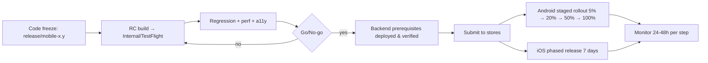

# DEPLOYMENT & OPERATIONS

| Field | Value |
|---|---|
| Status | Draft v0.1 |
| Owner | DevOps Engineer |
| Last updated | 2026-10-19 |
| Related | [GIT_CICD](../06-development/GIT_CICD.md), [QUALITY_OBSERVABILITY](../04-architecture/QUALITY_OBSERVABILITY.md), [AUTH_SECURITY](../04-architecture/AUTH_SECURITY.md) |

## 1. Environments
| Env | Purpose | Backend | Mobile distribution | Data |
|---|---|---|---|---|
| dev | Local development | Docker compose | `flutter run` | Seed/fake |
| staging | Integration, QA, UAT, beta | Cloud (smaller), provider sandboxes | Play Internal / Closed testing; TestFlight | Synthetic |
| prod | Live | Cloud India region (Q-02), HA | Play production; App Store | Real |
Separate Firebase projects, buckets, KMS keys, DBs and secrets per env. Staging never contains production personal data.

## 2. Infrastructure (provider-agnostic until ADR-017)
| Component | Prod spec (initial, revisit with Q-27) |
|---|---|
| API | ≥ 2 containers across 2 zones, autoscale on CPU/RPS |
| Worker | ≥ 1 container (2 during 21:30–23:00 IST), autoscale on queue depth |
| PostgreSQL 16 + PostGIS | Managed, multi-AZ standby, PITR enabled, automated daily snapshots |
| Redis | Managed, replica + AOF persistence |
| Object storage | `media` (CDN) + `kyc` (private, versioning, SSE-KMS, no public access) |
| Admin | 2 containers behind same WAF; optional IP allow-list |
| DNS/TLS | Managed certs; domains TBD (Q-33) |
| IaC | Terraform in `infra/terraform`, state remote & locked |

## 3. Mobile Signing
| Platform | Approach |
|---|---|
| Android | **Play App Signing** (Google holds app signing key); upload key in CI secrets + offline backup; separate package IDs per flavor (`in.supplybiz.app`, `.staging`, `.dev` — final IDs TBD) |
| iOS | Distribution certificate + provisioning profiles managed via fastlane match (private encrypted repo) or App Store Connect API automatic signing; bundle IDs per flavor; App Store Connect API key in CI |
Associated domains / assetlinks must include production signing fingerprints.

## 4. Store Submission
| Item | Android (Play) | iOS (App Store) |
|---|---|---|
| Listing | Title "Supply Biz", short & full description EN + HI, screenshots (phone), feature graphic | Name, subtitle, description, keywords EN + HI, screenshots 6.7"/6.5"/5.5" |
| Category | Business (or Shopping — PO decision) | Business |
| Privacy | Data safety form (aligned with AUTH_SECURITY §7) | Privacy nutrition labels; privacy manifest (`PrivacyInfo.xcprivacy`) incl. required-reason APIs for all SDKs |
| Account deletion | In-app path + web URL | In-app path (Guideline 5.1.1(v)) |
| Permissions declarations | Camera/mic/location justifications; no background location | Purpose strings EN/HI |
| Review access | Demo vendor & customer accounts with test OTP (allow-listed numbers) and instructions | Same, in App Review notes |
| Billing | Per ADR-015 (Play Billing if digital plan sold in app) | Per ADR-015 (IAP / no in-app purchase links) |
| Target API | Meet Play's current target API level requirement | Built with current required Xcode/SDK |
| Content rating | IARC questionnaire | Age rating questionnaire |

## 5. Release Process

**Go/No-go checklist**
- [ ] All P0/P1 TCs pass; no open P0/P1 bugs
- [ ] Crash-free ≥ 99.5% on beta; no ANR regressions
- [ ] Backend changes live and backward compatible with previous app version
- [ ] Feature flags configured for launch (P2 per PO decision)
- [ ] Release notes EN/HI; store metadata updated
- [ ] Monitoring dashboards & alerts green; on-call assigned
- [ ] Rollback plan reviewed

Rollout halt criteria: crash-free < 99%, P0 bug, error rate > 2% on new version's API calls.

## 6. Rollback
| Component | Strategy |
|---|---|
| Mobile | Halt staged rollout (Play) / pause phased release (iOS); disable feature via Remote Config flag; ship hotfix (`hotfix/x.y.z`). Stores do not support binary rollback — design every risky feature behind a flag |
| API/Admin | Redeploy previous image tag (immutable images); automatic on failed health checks |
| DB | Expand/contract migrations make rollback of code safe; destructive migrations only after two releases; PITR for disasters |
| Config/flags | Versioned in admin config with audit; revert previous value |
| Force update | `minVersion` raise only for security/critical bugs |

## 7. Disaster Recovery
| Scenario | RPO / RTO | Procedure |
|---|---|---|
| Zone failure | 0 / minutes | Multi-AZ failover (managed) |
| DB corruption / bad migration | ≤ 15 min / ≤ 4 h | PITR to new instance → verify → switch connection → replay idempotent jobs (subscription generation for affected dates) |
| Region failure | ≤ 15 min (cross-region backup copies) / ≤ 24 h (TBD) | Restore in secondary India region from backups; DNS switch |
| Accidental KYC object deletion | 0 / 4 h | Bucket versioning restore |
| Redis loss | n/a / minutes | Recreate; queues rebuilt from DB (`job_runs`, outbox_events); OTPs re-requested |
| Secret compromise | — | Rotate keys (JWT kid, provider keys), revoke sessions if JWT key leaked |
DR drill: restore test quarterly; subscription-generation catch-up procedure tested in staging.

### Subscription generation runbook
1. Alert fires (job not SUCCESS by 22:30 IST).
2. Check worker logs/queue; fix cause.
3. Re-run `generate-day(date)` via admin-only ops endpoint/CLI (idempotent).
4. Verify counts vs expected (`job_runs.counts`), notify vendors if delayed past 05:00 IST.

## 8. Monitoring & Incident Management
- Dashboards and alerts per [QUALITY_OBSERVABILITY §6–7](../04-architecture/QUALITY_OBSERVABILITY.md#6-performance-monitoring).
- Severity: SEV1 (outage, data/money integrity, security breach), SEV2 (major feature down), SEV3 (degraded).
- Incident flow: detect → acknowledge (SEV1 ≤ 15 min) → mitigate → communicate (in-app banner via Remote Config, vendor broadcast) → postmortem within 5 business days.
- Personal-data breach: follow DPDP Rules notification obligations (Board + affected users) — legal owner TBD (Q-20).
- On-call rota & tooling: TBD.

## 9. Operational Tasks
| Task | Frequency | Owner |
|---|---|---|
| KYC manual queue review | Daily (SLA TBD) | Ops |
| Ledger reconciliation report review | Daily (automated alert) | Eng |
| Dependency & OS updates | Monthly | Eng |
| Certificate / pin review | Before expiry/rotation | DevOps |
| Access review (admin users, cloud IAM) | Quarterly | Security |
| Backup restore test | Quarterly | DevOps |
| Store policy & SDK requirement check | Quarterly | Mobile lead |
